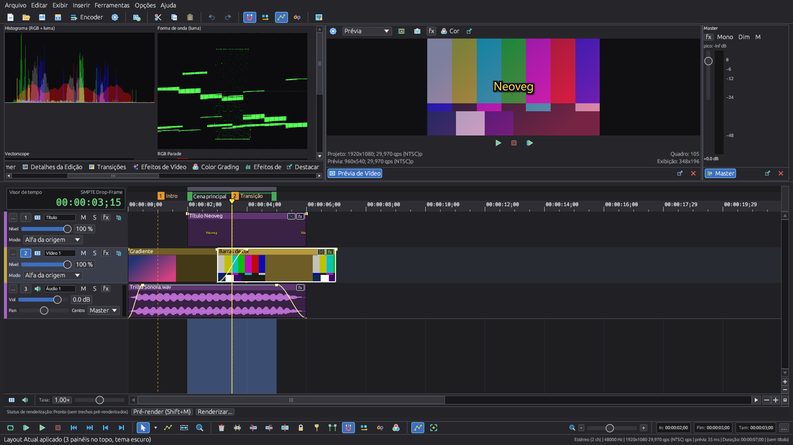
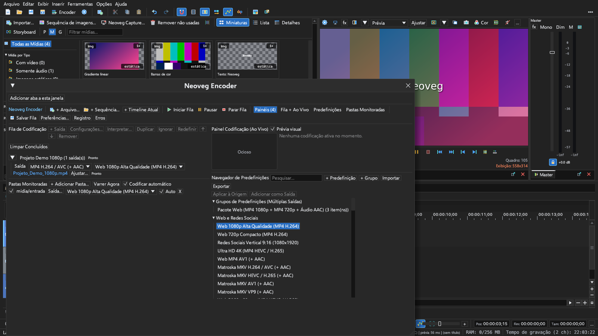

# Neoveg

[Português (BR)](README.md) | [English](README.en.md) | [Español](README.es.md) | [Français](README.fr.md) | **Deutsch** | [日本語](README.ja.md)

Nichtlinearer Videoeditor (NLE) in **reinem Rust**, mit nativer mehrsprachiger Benutzeroberfläche (`pt-BR` Standard, `en`, `es`, `fr`, `de` und `ja`; `eframe` + `wgpu` mit automatischem Fallback auf `glow`), an VEGAS Pro angelehnter Bedienlogik und strikter **Zero-Panic-Richtlinie in Produktion**.

## Neoveg ausprobiert? Erzählen Sie, wie es lief

Wenn Sie Neoveg installiert oder verwendet haben, füllen Sie bitte das **[Feedback-Formular für Neoveg-Tester](https://docs.google.com/forms/d/e/1FAIpQLSfal0jWd9rdw7ph_Zm9_ZsTrZiThVsuzjlGMjL9v37Bdq9asQ/viewform)** aus. Die Antworten helfen bei der Entscheidung, was zuerst behoben und weiterentwickelt wird. Fehlerberichte mit Schritten zur Reproduktion können ebenfalls in den *Issues* des Repositorys eingereicht werden.

## Screenshots


| Willkommensbildschirm | Rendern als... |
|---|---|
|  |  |

| Video-FX | Mediengeneratoren |
|---|---|
|  |  |

| Farbkorrektur | Videoscopes |
|---|---|
|  |  |

| Mixer und Aux-Busse | 5.1 Surround-Panner |
|---|---|
|  |  |

| Lautheitsmesser (EBU R128) | Event-Eigenschaften |
|---|---|
|  |  |



Die Screenshots zeigen ausschließlich die Oberfläche von Neoveg mit synthetischen Medien, die vom Programm selbst erzeugt wurden (Farbverlauf, Farbbalken, Text und Sinuston).

## Workspace-Architektur (5 Crates)

- **`neoveg_common`** (`crates/neoveg_common`): Basistypen, exakte Ganzzahl-Zeitdarstellung (`Ticks`, `FrameRate`, `Rate`, *SMPTE Drop-Frame*), Kurven, Einstellungen und Grundhilfsfunktionen.
- **`neoveg_engine`** (`crates/neoveg_engine`): Timeline-Zustand, atomare Bearbeitungs-Invarianten, Mehrspur-Mixer mit bis zu 26 Aux-Bussen (`Bus A`..`Bus Z`), DSP-Verarbeitung über `fundsp`, *Varispeed* mit `rubato`, 2D/3D-Videocompositor (Pan/Crop mit animierbarer Bézier-Maske, 2D/3D-Track-Motion mit Schatten/Glühen, 3D-Eltern/Kind-Hierarchie, Z-Sortierung und stereoskopischer 3D-*Off-Axis*-Kamera), Effekte/Übergänge, Videoscopes, interne Sequenzen in Tabs im Stil von Premiere Pro (`Project.sequences` und eigenständige `.nvegseq`), `.neoveg`/`.nvp`-Persistenz mit Wiederherstellung verschachtelter Projekte, Clean-Room-Austauschformate (OpenTimelineIO, FCPXML, FCP7 XML, EDL CMX 3600, AAF, SRT/WebVTT), 5.1-*Surround*, isolierter Plug-in-Host für OFX (Kacheln, *General*-Kontext mit Hilfseingängen und Generatoren) und VST3 (`IPlugView`, samplegenaue Automation und MIDI-Instrumente mit Clean-Room-SMF-Parser für `.mid`/`.midi`), Audio- und Videodekodierung in reinem Rust (`WAV`/`AIFF`/`FLAC`/`Vorbis`/`MP3`, `FFV1 v3`, `media/fallback.rs`), einheitlicher System-Dekodierungsvertrag (`media/system.rs`) mit nativen Backends für **Windows Media Foundation**, **Linux VA-API** und **macOS VideoToolbox/AudioToolbox** sowie die **Einheitliche Befehlstabelle**.
- **`neoveg_scripting`** (`crates/neoveg_scripting`): Headless-Automatisierung (`--command`, `--list-commands`) und bedarfsweise Brücke für `.NET`/`C#`-Skripte (`.cs`/`.dll`), kompatibel mit `ScriptPortal.Vegas` (Clean Room, Protokoll 6) über `netcorehost`.
- **`neoveg_ui`** (`crates/neoveg_ui`): native Desktop-Oberfläche in `eframe` + `wgpu`, interaktive Timeline mit 22 eigenen Vektor-Bearbeitungszeigern (`cursors.rs`), flexibles `egui_tiles`-Docking mit abdockbaren Multi-Tab-Fenstern, dauerhaftem Dialog-Docking und `egui_kittest`-Interaktionstests, 7 visuelle Themen (inkl. 2 WCAG-AAA-Kontrastthemen), `.neoveglayout`-Layoutmanager, Scopes/Vorschau mit CC1–CC4-Untertiteln und interaktiver 360°-Equirektangular-Ansicht sowie Editoren für Tastenkürzel und Einstellungen.
- **`neoveg`** (`crates/neoveg`): Hauptprogramm und CLI mit hardwareangepasster Initialisierung des `rayon`-Threadpools.

## Implementierte Funktionen

- **Timeline, Audio und Schnitt im Stil von VEGAS Pro:** mehrere A/V-Spuren, Mixer mit bis zu 26 Aux-Bussen (`Bus A`..`Bus Z`) + *Master-Bus* (`Mono`/`Dim -20 dB`, *Pre/Post-Fader*-Sends und zyklenfreies Routing), DSP mit `fundsp`, automatische Überblendung beim Überlappen von Events auf derselben Spur, Blendenanfasser in den oberen Ecken, dB-Pegelanfasser am oberen Rand von Audio-Events, physischer `1 px`-Abspielkopf, stufenlose Wiedergabegeschwindigkeit (*Playback Rate* mit *Sinc*-Resampling über `rubato`), Teilen (`S`), Marker (`M`), Regionen (`R`), *Auto Ripple* (`Ctrl+L`), Einrasten (`F8`) und *Scrub* (`J`/`K`/`L`). *Adjustment Track* (`insert.track_adjustment`), 5.1-*Surround-Panner* (Stereo/5.1-Master, LFE, ITU-Downmix und 6-Kanal-WAV-Export), EBU-R128-Lautheitsmesser und **Projekt-Arbeitsordner** (*Datei → Arbeitsordner...*, `file.work_folders`, zur dauerhaften Zuordnung von Aufnahmen, Audioaufzeichnungen, Vorrenderings, Proxys und Exporten).
- **Spur-Keyframes direkt in der Timeline:** Keyframes von Spur-Videoeffekten und *Track Motion* erscheinen in Zeilen unterhalb der Videospur; Ziehen verschiebt die Position (mit Einrasten und ohne Nachbarn zu überschreiten), Rechtsklick fügt hinzu, löscht und wechselt zwischen den 6 klassischen Kurven (*Linear, Schnell, Langsam, Weich, Steil, Halten* für Track Motion und Effektparameter), und die Keyframe-Schaltfläche im Spurkopf klappt den Bereich auf oder zu (VEGAS Pro 21 Handbuch, S. 389).
- **Mehrere Takes pro Event:** ein Event speichert mehrere alternative Medien (Takes) mit jeweils eigenem Versatz und Namen; *Als Take zu ausgewählten Events hinzufügen* (Kontextmenü der Projektmedien) macht das neue Medium zum aktiven Take und behält die vorherigen, `T`/`Shift+T` schalten vor/zurück, das Untermenü *Take* am Event wählt oder entfernt den aktiven Take, und *Optionen → Alle Takes verschieben (Slip)* verschiebt alle Takes gemeinsam. Teilen und Trimmen halten alle Takes synchron; Rendering und Export verwenden den aktiven Take (VEGAS Pro 21 Handbuch, S. 346–348).
- **Externe Plug-ins (OFX und VST3):** Erkennung von VST3/OFX in Standardordnern und benutzerdefinierten Ordnern (z. B. Google Drive, *Plug-In-Manager → Plug-in-Ordner*) im *Plug-In-Manager* und im 2-spaltigen *Plug-In Chooser* mit Effektketten-Pills; **OFX**-Videoeffekte und -Generatoren (Kachel-Rendering `SupportsTiles = 1`, *General*-Kontext mit mehreren Hilfseingängen, *Filter* und *Generator* unter *Mediengeneratoren → Drittanbieter*, Parameter-Keyframes und vollständige Host-Auswertung über `getValueAtTime`/`getDerivative`/`getIntegral`) sowie **VST3**-Effekte und -Instrumente (Events, Spuren, Busse und Master, native `IPlugView`/`IPlugFrame`-Oberfläche, samplegenaue Echtzeit-Automation über `IParameterChanges`, MIDI-Instrumente mit `IEventList` und SMF-Parser für `.mid`/`.midi`, Zustandsspeicherung `IComponent::getState`/`setState` und automatischer Latenzausgleich PDC) in dem isolierten Unterprozess `neoveg --plugin-host`, sodass ein Plug-in-Absturz den Editor nicht beendet.
- **Einheitliche Befehlstabelle, Tastenkürzel und `.NET`-Skripting:** Menüs, Symbolleiste, Tastenkürzel und CLI-Befehle nutzen dieselbe Befehls-`id`; benutzerdefinierte Kürzel lassen sich in *Hilfe → Tastenkürzel* festlegen oder löschen, und `.cs`/`.dll`-Skripte (`ScriptPortal.Vegas` Clean Room, Protokoll 6) laufen bei Bedarf über *Extras → Skript ausführen (.cs/.dll)...* (`tools.run_script`) oder `--run-script`. Die API folgt den Bezeichnern der *VEGAS Pro Scripting API Summary* (öffentliche MAGIX-Dokumentation) und der Handbuch-FAQ mit eigener Implementierung: Projekt, Spuren (Name, Mute/Solo, Auswahl, `Events`, `Effects`, `Envelopes`), Events (`Start`/`Length`/`End`, Name, Mute, Locked, Auswahl, `FadeIn`/`FadeOut`, `Effects`, `Envelopes`; Verschieben zwischen gleichartigen Spuren und Löschen), Effektparameter und Keyframes (`Effect.Keyframes`, `Effect.Parameters`, `Effect.Preset`) inkl. erkannter OFX/VST3-Plug-ins, Marker, `Vegas.Cursor`, `Transport.CursorPosition`/`SelectionStart`/`SelectionLength` und `Timecode` in exakten Ticks mit Operatoren, Projektmedien (`Project.MediaPool`, `Media`, `VideoStream`/`AudioStream`) sowie Takes (`Takes`, `ActiveTake`, `AddTake`, `Take.Offset`/`Name`/`MediaPath`), samt Event-Erstellung (`AddVideoEvent`/`AddAudioEvent` + `AddTake`) und Medienimport (`MediaPool.AddMedia` oder `new Media(path)`, bis zu 64 pro Lauf). Unter Windows mit `Microsoft.WindowsDesktop.App` nutzen Skripte echtes `System.Windows.Forms` in einem STA-Thread; unter Linux, macOS und ohne `WindowsDesktop` laufen Dialoge und Formulare (`MessageBox`, `Form.ShowDialog` und Dateiauswahl) über die eigene Schicht in `crates/neoveg_ui/src/script_forms.rs`.
- **Oberfläche, Mauszeiger, Anpassung und Barrierefreiheit:** kompaktes redaktionelles Oberflächendesign mit 7 Themen unter *Ansicht → Thema* oder *Optionen → Einstellungen...* (einschließlich WCAG-AAA-Hochkontrast Dunkel und Hell >= 7:1), **22 originalen Vektor-Bearbeitungszeigern** (`cursors.rs`: Trimmen links/rechts/benachbart, Zeitstreckung, *Split Trim*, Blendenversatz, *Slip*, *Slide*, Crossfade-Slip, *Scrub*, Drehen, freies/X/Y-Verschieben, Hüllkurven-Hand, Lupe +/-, Auswahlrahmen sowie Zeichenstift-/Knotenwerkzeuge für Bézier-Masken), 22 px breiter farbiger Spurkopf-Leiste mit Menü `Mehr (…)` am Spurkopf, dunklen Kapsel-Etiketten und konfigurierbaren Event-Schaltflächen (`Pan/Crop`, `fx`, `…`), zentraler dB-Skala im *Master-Bus*, **Pan/Crop** mit animierbarer interaktiver **Bézier-Masken**-Zeile, Vorgaben und FX-Ketten-Pills, vollständigem **2D/3D Track Motion** (Drehpunkt, Ausrichtung, 2D-Schatten/Glühen, 3D-Eltern/Kind-Komposition, Z-Sortierung und stereoskopischer 3D-*Off-Axis*-Kamera), **Videovorschau** mit **CC1–CC4**-Untertiteldekodierung und **interaktiver 360°-Equirektangular-Ansicht**, **Bearbeiten → Eigenschaften → Layout** mit den klassischen Anordnungen (*Klassisch*, *Mittel*, *Neuer* und *Modern*), **Startbildschirm** und **Willkommensbildschirm**, andockbarem **Farbkorrektur**-Panel, 2-spaltigem Dialog **Rendern als...**, 123 nativen farbigen Vektor-Icons (`crates/neoveg_ui/src/icons.rs`), unterer Transport-/Bearbeitungsleiste in Handbuch-Reihenfolge mit Auswahlfeldern `Start`/`Ende`/`Länge`, abdockbaren Multi-Tab-Fenstern und dauerhaftem Dialog-Docking (`Preferences.docked_dialogs`), `F11`/`Shift+F11`/`Ctrl+F11` sowie `.neoveglayout`-Dateien.
- **Neoveg Encoder (Stapel-Kodierungswarteschlange und Mehrfachausgaben):** eigenes Fenster außerhalb des Docking-Bereichs (Schaltfläche **Encoder** in der oberen Leiste, *Ansicht → Neoveg Encoder* `Ctrl+Alt+M`, Schaltfläche **An den Encoder senden** in *Rendern als...* und *Datei → An Neoveg Encoder senden...* `Ctrl+Shift+M`) sowie CLI `--encode` in allen 7 VEGAS-Pro-Themen: dauerhafte Warteschlange (`encoder/queue.json`) mit mehreren parallelen Ausgaben pro Quelle, Live-*Kodierung*-Panel mit Vorschaubild und Restzeit, kooperativer Pause und Einzel-/Gesamtstopp, *Vorgaben-Browser* (Systemvorgaben, eigene `.neovegpreset`, Gruppen und Aliase), *Überwachte Ordner* (*Watch Folders* mit automatischer Auslösung und Überschreibschutz), Fenster *Exporteinstellungen* (`In`/`Out`-Bereich, *Crop* mit Seitenverhältnissperre, 5 Skalierungsmodi und *Quelle/Ausgabe*-Vorschau), Vor-Kodierungseffekte (Farbkorrektur, 1D/3D-`.cube`-LUTs im Clean-Room-Verfahren, Bild-/Namen-/SMPTE-Timecode-Überlagerung und Zeitanpassung) sowie Protokolle in `logs/neoveg_encoder*.log`.
- **ArtCraft- & Blender-Integration (*Extras → Integrationen*):** automatische Erkennung und manuelle Pfade (*Einstellungen → Externe Anwendungen*) für **PhotoCraft**, **VectorCraft**, **FilmCraft**, **EffectCraft**, **AniCraft**, **SoundCraft** und **Blender**. Beinhaltet *Round-Trip*-Arbeitskopien als *Takes* (PNG für PhotoCraft, sauberes SVG für VectorCraft und BWF-WAV mit `bext` `TimeReference` für SoundCraft mit automatischem Neuladen beim Speichern), TCP-Loopback-Client (`127.0.0.1`) mit HMAC-SHA256-Authentifizierung für laufende ArtCraft-Apps, OTIO-Export nach FilmCraft, Headless-Rendering von `.anicraft`-, `.ecproj`- und `.blend`-Szenen direkt als PNG-Sequenzen in die Timeline, Erzeugung von `.py`-Synchronisationsskripten für FPS/Marker/Pan-Crop sowie Import von Blender-Kameras (`.json`) als *Track Motion*- / *Pan/Crop*-Keyframes.
- **Unterstützte Formate:**
  - **Austausch (reines Rust, Clean Room):** OpenTimelineIO `.otio` (Schema 0.17), Final Cut Pro XML `.fcpxml`, Final Cut Pro 7 XML `.xml` (`xmeml`), AAF `.aaf`, EDL CMX 3600 `.edl` sowie Untertitel SubRip `.srt` / W3C WebVTT `.vtt` (Import und Export). Verfügbar unter *Datei → Austausch & Untertitel* sowie per Drag-and-Drop; die verwendeten Spezifikationsfassungen stehen in [`crates/neoveg_engine/README.md`](crates/neoveg_engine/README.md).
  - **Reines Rust (plattformübergreifend):**
    - *Projekte, Sequenzen und Video:* `.neoveg` (und älteres `.nvp`), eigenständige `.nvegseq`-Sequenzen (Import/Export mit ID-Neuzuordnung), `AVI` (Import `MJPEG`/`DIB RGB24/32`/`YUY2`/`UYVY`/`I420` + PCM/G.711; Export `AVI MJPEG` und `Unkomprimiertes RGB24-AVI`), `Y4M`, animiertes `GIF` (Import und Export), Container-Demuxer für `MP4`/`MOV`/`MKV`/`WEBM` (`media/demux/`), verlustfreier `FFV1 v3`-Dekoder (`media/ffv1.rs`) und plattformübergreifender Fallback-Dekoder (`media/fallback.rs`).
    - *Bilder und Bildsequenzen:* `PNG`, `JPEG`, `BMP`, `TIFF`, `WebP` (statisch und animiert), `GIF`, `TGA`/`ICB`/`VDA`/`VST`, `ICO`/`CUR`, `PNM` (`PBM`/`PGM`/`PPM`/`PAM`), `Radiance HDR`, `DDS`, `Farbfeld`, `QOI`, `OpenEXR` (`.exr`), `DPX` (`.dpx`), `Kodak Cineon` (`.cin`), `WBMP`, `XBM`, `XPM` und `Amiga IFF/ILBM` (`.iff`/`.ilbm`/`.lbm`), zusätzlich Standbild-Export und Sequenz-Rendering in 10 Formaten (`PNG`, `JPEG`, `TIFF`, `TGA`, `BMP`, `WebP`, `PNM`, `QOI`, `DPX`, `EXR`).
    - *Audio und MIDI:* `WAV` / `BWF` / `RF64` (PCM, Float32, ITU-T G.711 µ-law/A-law, IMA/DVI ADPCM), `AIFF`/`AIFC` (Import und Export), `Sun/NeXT AU/SND`, `Apple CAF`, `Sony Wave64` (`.w64`), `Creative VOC`, `Amiga IFF 8SVX` (8-Bit-PCM und Fibonacci Delta), `QOA` (`.qoa`), `FLAC` (`claxon`), `Ogg Vorbis` (`.ogg`, `.oga`, `lewton`), `MP3` (`puremp3`) sowie **Standard MIDI File** (`.mid`/`.midi`, Formate 0/1/2, Clean-Room-Parser in `midi.rs` mit polyphoner Fallback-Vorschau und Weiterleitung an VST3-Instrumente).
  - **Native System-Backends (Windows, Linux und macOS):**
    - *Windows (Media Foundation):* Streaming-Import/Dekodierung von `MP4`, `MOV`, `MKV`, `WEBM`, `M4V`, `M4A`, `AAC`, `WMV`, `ASF`, `WMA`, `3GP`, `3G2`, `M2TS`, `MTS`, `TS`, `MPG`, `MPEG`, `MPE`, `VOB`, `MP2`, `MPA`, `M4B` und `ALAC`; nativer Export über `IMFSinkWriter` in `MP4 (H.264/HEVC + AAC)`, `MOV (H.264 + AAC)`, `3GP (H.264 + AAC)`, `WMV` sowie Audio `M4A (AAC)`, `AAC (ADTS)`, `WMA` und `MP3`.
    - *Linux (VA-API):* beschleunigte Dekodierung über dynamisch geladene `libva.so.2`/`libva-drm.so.2` (`media/vaapi.rs`, ohne GStreamer/LGPL), mit automatischem Fallback auf reines Rust.
    - *macOS (VideoToolbox / AudioToolbox):* H.264/HEVC-Videodekodierung über `VTDecompressionSession` und Audio über `ExtAudioFile` (`media/videotoolbox.rs`), mit automatischem Fallback auf reines Rust.
  - **Konvertierung in kompatibles Format (Windows):** wenn eine Datei nicht direkt geöffnet werden kann (nicht gelistete Erweiterung oder Codec außerhalb der eigenen Leser, z. B. Nicht-MJPEG-AVI), bietet Neoveg die Konvertierung über den Systemdekoder in AVI MJPEG + PCM (Video) oder 24-Bit-WAV (nur Audio) an und importiert das Ergebnis an derselben Stelle; auch unter *Datei → Medien in kompatibles Format konvertieren...*. Das Ziel wird im Dialog gewählt, bis zum Abschluss wird in `.part` geschrieben, AVI nutzt OpenDML-Erweiterungen (ohne 4-GB-Grenze; bis ~250 GB, JPEG-Qualität sinkt nur bei Bedarf von 90 bis 50 mit Warnung), und nichts wird stillschweigend aufgefüllt oder abgeschnitten (`media/convert.rs`). (`ffmpeg`/`ffprobe` dienen ausschließlich als externe Testorakel und Fixture-Generatoren via `tools/gen_media_fixtures.py`, sie werden niemals gelinkt oder ausgeliefert.)
- **Bericht nach nicht ordnungsgemäßem Beenden:** jede UI-Sitzung hält eine gesperrte Markierung in `logs/sessoes/`; beim nächsten Start nach einem Absturz, erzwungenem Beenden oder Stromausfall zeigt das Fenster *Neoveg wurde nicht ordnungsgemäß beendet*, was passiert ist (Fehler und Stelle oder plötzlicher Abbruch), listet isolierte Sitzungsfehler auf, bietet die Wiederherstellung des automatisch gespeicherten Projekts an und erlaubt das Kopieren des Berichts oder Öffnen des Log-Ordners. Gleichzeitig laufende Instanzen gelten nicht als Absturz, und Panics anderer Instanzen oder Plug-in-Hosts werden nicht vermischt.
- **Projekteigenschaften:** Tabs *Video*, *Audio*, *Lineal*, *Zusammenfassung* und *Audio-CD* wie in VEGAS Pro; Zusammenfassung und UPC/EAN-Code fließen in exportierte `.cue`-Dateien ein.
- **Windows und Linux:** eigener Rust-Installer und portables Paket für beide Systeme; unter Linux mit Anwendungsmenü-Eintrag, Befehl `neoveg` und Verknüpfung für `.neoveg`-Dateien (siehe *Installer für Linux*).
- **Für ältere/schwächer ausgestattete Hardware:** Vorschauauflösungen (*Entwurf / Vorschau / Gut / Optimal*), `.avi`-Proxy-Erstellung, selektives Vorrendern von Bereichen, konfigurierbare RAM-/Frame-Cache-Grenzen und portabler Build ohne `-C target-cpu=native`.

## Ausführen

```bash
# Grafische Oberfläche starten (optional mit Projekt oder Mediendatei)
cargo run -p neoveg
cargo run -p neoveg -- mein_projekt.neoveg

# Kommandozeile (CLI)
cargo run -p neoveg -- --list-commands
cargo run -p neoveg -- --probe-integrations
cargo run -p neoveg -- --command insert.marker mein_projekt.neoveg aktualisiert.neoveg
cargo run -p neoveg -- --run-script mein_skript.cs
cargo run -p neoveg -- --render mein_projekt.neoveg ausgabe.avi
cargo run -p neoveg -- --encode eingabe.mp4 ausgabe.mp4 sys.web_1080p_hq
```

Logs, Autosave, Einstellungen (`preferencias.json`), Layouts (`.neoveglayout`), Proxys und Vorrenderings werden in portablen Builds neben der ausführbaren Datei gespeichert (oder im temporären Systemordner bei schreibgeschütztem Verzeichnis).

## Bedienung

### Erste Schritte

1. Starten Sie Neoveg (`cargo run -p neoveg` oder die portable Anwendung). Wählen Sie auf dem **Willkommensbildschirm** eines der 5 Seitenverhältnisse (*Widescreen 16:9*, *Fullscreen 4:3*, *Portrait 9:16*, *Square 1:1* oder *Scope 2.4:1*), stellen Sie Auflösung, Bildrate und *Drop-Frame* ein oder öffnen Sie ein bestehendes Projekt über *Projekt öffnen*. Der Bildschirm lässt sich jederzeit über *Hilfe → Willkommensbildschirm* erneut öffnen.
2. Importieren Sie Video, Audio, Standbilder oder Bildsequenzen über *Datei → Medien importieren...* (`Ctrl+I`) oder per Drag-and-Drop in das Fenster. Clips erscheinen in *Projektmedien*; ziehen Sie sie auf die Timeline oder doppelklicken Sie zum Einfügen am Cursor. Zum Setzen von *In*/*Out*-Punkten vor dem Schnitt nutzen Sie den **Trimmer** (`Alt+2`).
3. Das Format der zuerst importierten Mediendatei legt Auflösung und Bildrate des Projekts automatisch fest, sofern *Projekteigenschaften* (`Alt+Enter`) noch nicht manuell geändert wurde.
4. Unter Windows bieten Dateien außerhalb der direkt unterstützten Codecs automatisch eine sichere Konvertierung in `AVI MJPEG + PCM` oder `24-Bit-WAV` an (*Datei → Medien in kompatibles Format konvertieren...*).
5. Speichern Sie mit `Ctrl+S` (oder `Ctrl+Shift+S` / `Ctrl+Alt+S` für Versionen). Das Projekt wird als `.neoveg` mit automatischer Wiederherstellung gespeichert.

### Schnitt in der Timeline

| Aktion | Tastenkürzel |
|---|---|
| Wiedergabe / Pause / ab Start / Stopp | `Leertaste` / `Shift+Leertaste` / `Esc` |
| Rückwärts-Scrub, Pause, Vorwärts-Scrub | `J`, `K`, `L` |
| Vorheriger / nächster Frame | `Alt+←` / `Alt+→` |
| Nächstes / vorheriges Bearbeitungswerkzeug | `D` / `Shift+D` |
| Event am Cursor teilen | `S` |
| Event-Anfang / -Ende am Cursor trimmen | `Alt+[` / `Alt+]` |
| Auf Zeitauswahl trimmen | `Ctrl+T` |
| Auswahl-Start / -Ende / Loop-Region setzen | `I` / `O` / `Q` (`Shift+Q`) |
| Nächster / vorheriger Take | `T` / `Shift+T` |
| Gruppieren / Gruppierung aufheben / Gruppe auswählen | `G` / `U` / `Shift+G` |
| Marker / Region einfügen | `M` / `R` |
| Lautstärke- / Panorama-Hüllkurve der Spur | `V` / `P` |
| Ausgewählte Spur stummschalten / Solo | `Z` / `X` |
| Video- / Audio- / Busspur einfügen | `Ctrl+Shift+Q` / `Ctrl+Q` / `Ctrl+B` |
| Einrasten (`Snapping`) / Auto-Ripple | `F8` / `Ctrl+L` |
| Horizontaler Zoom / vertikaler Wellenform-Zoom | `↑` / `↓` (`Shift+↑` / `Shift+↓`) |
| Rückgängig / Wiederherstellen | `Ctrl+Z` / `Ctrl+Y` |
| Event-Eigenschaften | `F2` |
| Neoveg Encoder / Timeline senden | `Ctrl+Alt+M` / `Ctrl+Shift+M` |
| Rendern als... | `Ctrl+M` |

- **Bearbeitungswerkzeuge und Modi (`D` / `Shift+D`):** wechseln Sie in der Transportleiste oder unter *Bearbeiten → Bearbeitungswerkzeug* zwischen **Normal** (Verschieben und Trimmen im *Normal*- oder *Slip*-Modus), **Hüllkurve** (bewegt nur Hüllkurvenpunkte), **Auswahl** (Auswahlrahmen; `Shift`/`Ctrl` erweitern) und **Zoom** (Rahmen vergrößert; Einzelklick passt das Projekt ans Fenster an).
- **Blenden, Pegel und Keyframes:** überlappende Events derselben Spur erzeugen automatisch ein Crossfade; die oberen Eckanfasser steuern Blenden, die obere Leiste von Audioclips regelt den Pegel in dB, und die Zeilen unterhalb der Spur bearbeiten Keyframes für *Track Motion* und Spureffekte.
- **Spurköpfe, Transport und Tabellenbearbeitung:** die untere Leiste folgt der VEGAS-Pro-Reihenfolge mit bearbeitbaren Feldern für `Start`, `Ende` und `Länge`, *Playback Rate* (`0.25×`–`4.00×`), *Mehr*-Schaltfläche (`…`) am Spurkopf zur Konfiguration sichtbarer Bedienelemente sowie dem Panel **Bearbeitungsdetails** (`Alt+3`) für tabellarisches Bearbeiten.
- **Sequenzen, eigenständige `.nvegseq` und Verschachtelung:** interaktive Tabs oberhalb der Timeline für mehrere Sequenzen im selben Projekt, Import und Export eigenständiger `.nvegseq`-Sequenzen (*Bearbeiten → Sequenz → Sequenz importieren/exportieren...* oder per Drag-and-Drop) sowie automatische Wiederherstellung geänderter verschachtelter `.neoveg`-Projekt-Tabs (`autosave/recuperacao_aninhados.json`), inklusive direkter In-Memory-Weitergabe über mehrere Verschachtelungsebenen (auch Enkelprojekte). Ziehen Sie eine Sequenz aus *Projektmedien* in die aktive Timeline oder wählen Sie *Auswahl in neue Sequenz verschachteln* (`sequence.nest_selection`); strikte Zyklusprüfung und Tiefenlimit von 32 Ebenen.

### Takes

Ein Event kann mehrere alternative Medien (Takes) aufnehmen. Klicken Sie in *Projektmedien* mit der rechten Maustaste auf ein Medium und wählen Sie *Als Take zu ausgewählten Events hinzufügen*; wechseln Sie den aktiven Take mit `T` / `Shift+T` oder über das Untermenü *Take* des Events. Mit *Optionen → Alle Takes verschieben (Slip)* bleiben beim Verschieben alle Takes synchron.

### Effekte, Generatoren, Farbkorrektur und Videoscopes

- **Video-FX, Audio-FX und Übergänge:** 46 native Videoeffekte in 8 Kategorien (Farbe, Licht, Weichzeichnen & Schärfen, Stilisieren, Verzerren, Komposition & Rahmen, Stabilisierung, Zuschnitt) sowie 33 Übergänge. Filtern Sie nach Kategorie oder Suche, ziehen Sie die Vorgaben-Miniatur auf ein Event, eine Spur oder einen Übergang, oder wenden Sie über *Events*, *Spur* und *Master* an. Mit `★` als Favorit markieren.
- **Mediengeneratoren:** fügen Sie animierten Text mit Kontur/Schatten, Vollfarben, Verläufe, Schachbrett, Farbbalken, Rauschen, **Testmuster** (Konvergenzgitter, Graukeil, Zonenplatte, Pixelraster), fraktale **Rauschtextur** und **OFX**-Generatoren von Drittanbietern (*Drittanbieter*) über *Mediengeneratoren* ein (*Am Cursor einfügen* oder per Drag-and-Drop).
- **Farbkorrektur und Videoscopes:** öffnen Sie *Farbkorrektur* (oder klicken Sie auf **Farbe** in der Kopfzeile der *Videovorschau*) für Farbräder (*Lift*, *Gamma*, *Gain*), das Feld *Temperatur × Farbton*, Sättigung und Vorgaben für `FxKind::ColorCorrector`. Prüfen Sie das Signal live im Tab **Videoscopes** (*RGB + Luma Histogramm*, *Wellenform*, *Vektorskop* und *RGB-Parade*).
- **Externe Plug-ins (OFX und VST3):** verwalten Sie VST3- und OFX-Pfade im *Plug-In-Manager* (`Ctrl+Alt+1`). Alle Plug-ins laufen im isolierten Unterprozess `--plugin-host`, mit OFX-Kacheln, *General*-Kontext mit Hilfseingängen und Generatoren sowie VST3-Unterstützung für native Oberflächen (`IPlugView`), samplegenaue Echtzeit-Automation, MIDI-Instrumente (`.mid`/`.midi`), Zustandsspeicherung (`IComponent::getState`/`setState`) und automatischen Latenzausgleich (PDC), ohne den Editor zu gefährden.

### Audio, Mixer, 5.1 Surround und Lautheit

- **Mixer und Aux-Busse (`Bus A`..`Bus Z`):** klicken Sie im *Mixer* auf **＋ Bus** oder nutzen Sie *Einfügen → Audiobus* für bis zu 26 Busse mit *Pre/Post-Fader*-Sends und Anzeige in der Timeline (`Ctrl+B`).
- **Master-Bus:** das rechte Panel bietet Stereo-Monitoring mit `fx`, `Mono`, `Dim` (`-20 dB`) und `M` (Stumm).
- **5.1 Surround-Panner:** wechseln Sie im Tab *Surround-Panner* (oder in den *Projekteigenschaften*) den *Master-Modus* auf `5.1 Surround`, positionieren Sie Spuren und Busse im ITU-R-BS.775-Ring, regeln Sie den LFE-Kanal und rendern Sie als 6-Kanal-WAV.
- **EBU-R128-Lautheitsmesser (`Ctrl+Alt+7`):** überwachen Sie `M`, `S`, `I`, `LRA` und `True Peak` mit wählbaren Zielwerten (*EBU R128 -23 LUFS*, Streaming, ATSC, Podcast) sowie Offline-Analyse (*Projekt analysieren* / *Auswahl analysieren*).

### Rendern

*Datei → Rendern als...* (`Ctrl+M`) öffnet den 2-spaltigen Dialog mit Suche, ★ Favoriten, Bereichszusammenfassung (*Gesamtes Projekt* oder *Loop-Region*) und allen **31 unterstützten Ausgabeformaten**: `MP4 (H.264/HEVC + AAC)`, `MOV`, `3GP` und `WMV` (Windows Media Foundation), `AVI MJPEG` und `Unkomprimiertes RGB24-AVI` (mit OpenDML), animiertes `GIF`, `Y4M`, 10 Bildsequenzen (`PNG`, `JPEG`, `TIFF`, `TGA`, `BMP`, `WebP`, `PNM`, `QOI`, `DPX`, `EXR`) und Audio (`WAV`, `BWF`, `RF64`, `Wave64`, `AIFF`, `AU`, `CAF`, `QOA`, `M4A`, `AAC`, `WMA`, `MP3`). Direkt im Dialog steht auch **An den Encoder senden** bereit, oder per CLI ohne GUI über `neoveg --render projekt.neoveg ausgabe.ext`.

### Neoveg Encoder (Stapelwarteschlange und überwachte Ordner)

Öffnen Sie den **Neoveg Encoder** über die Schaltfläche **Encoder** in der oberen Leiste, unter *Ansicht → Neoveg Encoder* (`Ctrl+Alt+M`), *Extras → Neoveg Encoder*, über **An den Encoder senden** in *Rendern als...* oder mit *Datei → An Neoveg Encoder senden...* (`Ctrl+Shift+M`, sendet die aktuelle Timeline oder Auswahl in die Warteschlange). Klicken Sie auf **Abdocken** in der Tableiste, um ihn als eigenes großes Fenster zu nutzen.

- **Panels (4):** *Kodierungswarteschlange* (mehrere parallele Ausgaben pro Quelle, Duplizieren, Umsortieren und Medieninterpretation), *Kodierung (Live)* (Vorschaubild, Restzeit, kooperative Pause und Einzel- oder Gesamtstopp), *Vorgaben-Browser* (Systemvorgaben, eigene `.neovegpreset` und Mehrfachausgabe-Gruppen) und *Überwachte Ordner* (automatische Erkennung in Eingabeverzeichnissen).
- **Exporteinstellungen:** `In`/`Out`-Bereich, *Crop* mit Seitenverhältnissperre, 5 Skalierungsmodi, Farbkorrektur, 1D/3D-`.cube`-LUTs, Bild-/Namen-/SMPTE-Timecode-Überlagerungen und *Zeitanpassung* (%). Auch per Kommandozeile nutzbar: `neoveg --encode eingabe.mp4 ausgabe.mp4 sys.web_1080p_hq`.

### Austausch und Untertitel

Verwenden Sie *Datei → Austausch & Untertitel* (oder ziehen Sie die Datei direkt in Neoveg), um Timelines als **OpenTimelineIO (`.otio`)**, **Final Cut Pro XML (`.fcpxml`)**, **Final Cut Pro 7 XML (`.xml`, `xmeml`)**, **AAF (`.aaf`)**, **EDL CMX 3600 (`.edl`)** sowie Untertitel im Format **SubRip (`.srt`)** / **WebVTT (`.vtt`)** zu importieren und zu exportieren.

### Integrationen (ArtCraft & Blender)

Öffnen Sie *Extras → Integrationen (ArtCraft & Blender)...* (oder legen Sie manuelle Pfade in *Optionen → Einstellungen... → Externe Anwendungen* fest), um mit **PhotoCraft**, **VectorCraft**, **FilmCraft**, **EffectCraft**, **AniCraft**, **SoundCraft** und **Blender** zusammenzuarbeiten. Erstellen Sie *Round-Trip*-Kopien als *Takes* (PNG, sauberes SVG oder WAV/BWF mit automatischem Neuladen beim Speichern), exportieren Sie OTIO nach FilmCraft, rendern Sie `.anicraft`/`.ecproj`/`.blend`-Szenen als PNG-Sequenzen in die Timeline, erzeugen Sie `.py`-Synchronisationsskripte und importieren Sie Blender-Kameradaten im JSON-Format.

### C#-Skripte (`.cs`/`.dll`)

*Extras → Skript ausführen (.cs/.dll)...* (oder `neoveg --run-script mein_skript.cs`) führt `.NET`-Skripte mit `ScriptPortal.Vegas`-API in einem einzigen Rückgängig-Schritt aus. Unter Windows (mit `Microsoft.WindowsDesktop.App`) nutzen Formulare `System.Windows.Forms`; unter Linux, macOS und ohne `WindowsDesktop` laufen Dialoge über die eigene Implementierung in `script_forms.rs`.

### Layout, Darstellung und Tastenkürzel

- **Layout und abdockbare Fenster:** *Bearbeiten → Eigenschaften → Layout* schaltet zwischen *Klassisch*, *Mittel* und *Aktuell* (3 Spalten) sowie Position von Docking-Bereich und Tabs um. Alle Tabs, die *Videovorschau* und der *Master-Bus* lassen sich per Ziehen neu anordnen oder als native Fenster abdocken und als `.neoveglayout` speichern.
- **Themen und Tastenkürzel:** wählen Sie unter *Ansicht → Thema* aus 7 Themen (inkl. 2 AAA-Hochkontrastthemen) und passen Sie jeden Befehl der Einheitlichen Befehlstabelle unter *Hilfe → Tastenkürzel* oder *Optionen → Einstellungen...* an.

## Portables Paket und Qualitätskontrollen

```bash
cargo fmt --all -- --check
cargo clippy --workspace --all-targets -- -D warnings
cargo test --workspace
python tools/check_licenses.py
python build_portable.py
```

Die GitHub-CI (`.github/workflows/ci.yml`) führt diese Prüfungen bei jedem Pull Request unter Windows und Linux (Ubuntu) aus, mit sequenziellen Tests und zur Laufzeit erzeugten Medien-Fixtures.

Das Skript `build_portable.py` kompiliert im Release-Modus und erzeugt das portable Paket in `dist/` im Repository-Stammverzeichnis, inklusive offener Schriftarten unter `assets/fonts/` (`OFL-1.1`) und den `i18n/*.json`-Katalogen — ohne Installer, proprietäre Schriften oder externe Binärdateien. Nach der Prüfsummenkontrolle (`SHA-256`) löscht es das Cargo-Build-Verzeichnis (`target/` bzw. `CARGO_TARGET_DIR`); schlägt Build, Prüfung oder Kopie fehl, bleibt der Ordner erhalten und der Fehler wird gemeldet. Mit `--keep-target` bleibt der Build-Ordner erhalten, `--out` wählt einen anderen Zielpfad. `dist/` und `target/` stehen in `.gitignore`.

### Installer für Windows

```bash
python build_installer.py
```

`build_installer.py` erstellt das portable Paket über `build_portable.py`, packt `dist/` als ZIP und hängt es an `neoveg-setup.exe` an — den eigenen Rust-Installer (`crates/neoveg/src/setup/`, Lizenz `MIT OR Apache-2.0`, ohne Drittanbieter-Tools). Das Ergebnis landet unter `dist-installer/Neoveg-Setup-<Version>.exe` (ebenfalls in `.gitignore`). Es unterstützt dieselben Optionen `--no-build` und `--keep-target`.

Der Installer fragt nach dem Installationsumfang:

- **Nur für mich:** unter `%LOCALAPPDATA%\Programs\Neoveg`, ohne Administratorabfrage.
- **Für alle Benutzer:** unter `%ProgramFiles%\Neoveg`, mit UAC-Bestätigung.

Er erstellt eine Startmenü-Verknüpfung sowie optional eine Desktop-Verknüpfung und kann `.neoveg`-Dateien verknüpfen. Neoveg erscheint unter *Einstellungen → Apps* (Programme hinzufügen oder entfernen) mit dem Deinstallationsprogramm `desinstalar.exe`.

In der installierten Version speichert Neoveg Einstellungen, Layouts, Logs und Wiederherstellungsdaten in `%APPDATA%\Neoveg` statt im Programmordner. Der Datenordner wird nur gelöscht, wenn diese Option bei der Deinstallation gewählt wird. Das portable Paket speichert weiterhin alles neben der ausführbaren Datei.

Unbeaufsichtigter Modus: `Neoveg-Setup.exe --silent [--user | --all-users] [--dir <Ordner>] [--desktop] [--no-assoc]`. Stille Deinstallation: `desinstalar.exe --uninstall --silent [--remove-data]`.

### Installer für Linux

```bash
python3 build_installer.py
```

Unter Linux erzeugt dasselbe `build_installer.py` zwei Dateien in `dist-installer/`:

- `Neoveg-Setup-<Version>-linux-x86_64`: derselbe Rust-Installer mit demselben Fenster und denselben Optionen. Ausführbar machen (`chmod +x`) und starten.
- `Neoveg-<Version>-linux-x86_64.tar.gz`: das portable Paket. Entpacken und `./neoveg` ausführen; alle Daten bleiben neben der Binärdatei.

Der Installer fragt nach dem Installationsumfang:

- **Nur für mich:** in `~/.local/opt/neoveg`, ohne Passwortabfrage. Der Starter landet in `~/.local/share/applications` und der Befehl `neoveg` in `~/.local/bin`.
- **Für alle Benutzer:** in `/opt/neoveg`, mit Administrator-Passwort über `pkexec`. Starter und MIME-Typ gehen nach `/usr/local/share`, der Befehl nach `/usr/local/bin`. Ohne `pkexec`: `sudo ./Neoveg-Setup-<Version>-linux-x86_64 --silent --all-users`.

Der Starter entspricht der freedesktop.org-*Desktop Entry Specification* und erscheint mit dem Neoveg-Symbol im Anwendungsmenü kompatibler Desktop-Umgebungen (GNOME, KDE Plasma, Xfce usw.). Auf Wunsch wird er auch auf dem Desktop angelegt (nur bei Benutzerinstallation, Pfad aus `~/.config/user-dirs.dirs`). Die Dateiverknüpfung für `.neoveg` registriert `application/x-neoveg-project` (*Shared MIME-info*). `update-desktop-database`, `update-mime-database`, `xdg-mime` und `gio` werden genutzt, falls vorhanden; fehlen sie, läuft die Installation dennoch durch. Zum Deinstallieren wählen Sie *Neoveg deinstallieren* im Kontextmenü des Starters oder führen `desinstalar --uninstall` im Installationsordner aus.

Installiert speichert Neoveg seine Daten in `$XDG_DATA_HOME/Neoveg` (typischerweise `~/.local/share/Neoveg`). Der stille Modus akzeptiert dieselben Parameter wie unter Windows: `./Neoveg-Setup-<Version>-linux-x86_64 --silent [--user | --all-users] [--dir <Ordner>] [--desktop] [--no-assoc]` und `desinstalar --uninstall --silent [--remove-data]`.

Die ausführbare Datei nutzt die glibc-Version des Build-Systems: für ältere Distributionen sollte auf der ältesten Ziel-Distribution kompiliert werden.

### Sprachen (`i18n/*.json`)

Neoveg unterstützt **Brasilianisches Portugiesisch (`pt-BR`, Standard)**, **Englisch (`en`)**, **Spanisch (`es`)**, **Französisch (`fr`)**, **Deutsch (`de`)** und **Japanisch (`ja`)** über JSON-Kataloge in `i18n/`. Die Sprache lässt sich im laufenden Betrieb unter **Einstellungen → Allgemein**, auf dem **Willkommensbildschirm** oder beim Start über `--lang <Code>` / `NEOVEG_LANG` umstellen. Für Japanisch werden CJK-Glyphen zur Laufzeit aus installierten Systemschriften geladen. Die Oberfläche verwendet wie VEGAS Pro Systemschriften: Segoe UI unter Windows (Tahoma als Alternative; Noto Sans, Liberation Sans oder DejaVu Sans unter Linux) sowie Consolas oder Cascadia Mono für Festbreitenfelder, direkt aus dem Systemschriftordner gelesen und niemals weiterverteilt; **Einstellungen → Allgemein** schaltet zurück auf die eingebetteten Schriften. Die Größe von Texten, Schaltflächen und Panels lässt sich über **Ansicht → Oberflächenskalierung** (Vergrößern, Verkleinern, 100 %; 50 % bis 300 % in 10-%-Schritten) oder in den Einstellungen anpassen; diese Befehle haben kein Standardkürzel und können unter *Tastenkürzel* belegt werden. Die *Zeitanzeige* nutzt die fette System-Sans-Serif-Schrift (Segoe UI Bold) mit Tabellenziffern.

## Paritätsverfolgung

- [Roadmap](ROADMAP.md)
- [VEGAS-Pro-Paritätsmatrix](docs_obsidian/ui_references/matriz_de_paridade.md)
- [Asset-Zuschreibung und Lizenzen](ATTRIBUTION.md)

## Lizenz

Neoveg steht nach Ihrer Wahl unter einer der beiden Lizenzen:

- MIT ([LICENSE-MIT](LICENSE-MIT))
- Apache 2.0 ([LICENSE-APACHE](LICENSE-APACHE))

Sofern nicht ausdrücklich anders angegeben, wird jeder zur Aufnahme in dieses Projekt eingereichte Beitrag unter denselben Doppel-Lizenzbedingungen ohne zusätzliche Auflagen lizenziert.
