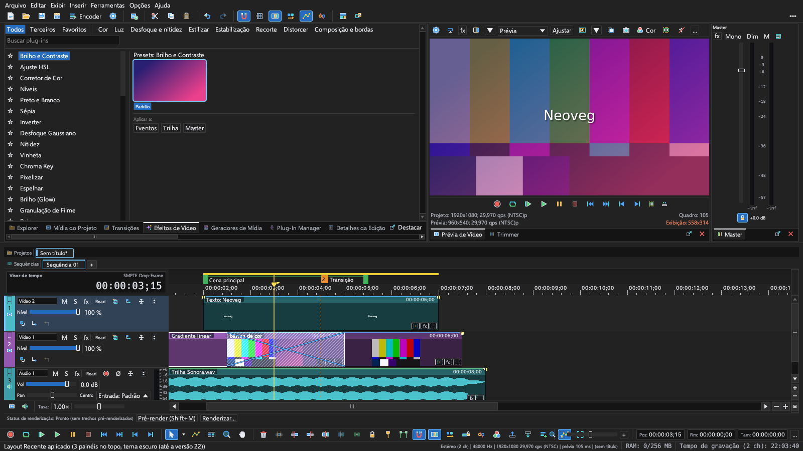
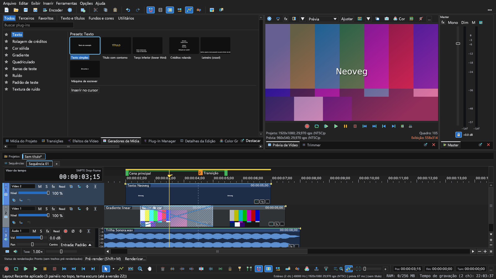
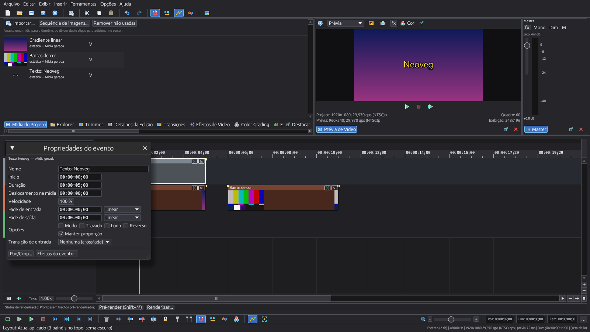

# Neoveg

[Português (BR)](README.md) | **English** | [Español](README.es.md) | [Français](README.fr.md) | [Deutsch](README.de.md) | [日本語](README.ja.md)

Non-linear video editor (NLE) written in **pure Rust**, with a native multilingual interface (`pt-BR` default, `en`, `es`, `fr`, `de`, and `ja`; `eframe` + `wgpu` with automatic fallback to `glow`), VEGAS Pro-inspired operational semantics, and a strict **zero-panic in production** policy.

## Tried Neoveg? Let us know how it went

If you installed or used Neoveg, please fill out the **[feedback form for Neoveg testers](https://docs.google.com/forms/d/e/1FAIpQLScsDpUJgDH_hfs2KsD5iO-TcgOLnCiZQvpi2jMNGabmddLCUA/viewform)**. Responses help decide what to fix and prioritize next. Bug reports with reproduction steps can also be submitted in the repository *Issues*.

Other languages: [Português (BR)](https://docs.google.com/forms/d/e/1FAIpQLScyRCZRUxQ48eokch70fh8RRVbK2zXDYoDH9zeRM06bm7OyjA/viewform) | [Español](https://docs.google.com/forms/d/e/1FAIpQLSdpY1-si_e8qwGT9Q3eOkcn9LvvqxQaY1S_HsXk5wJewJi6bw/viewform) | [Français](https://docs.google.com/forms/d/e/1FAIpQLSdXkSbZPAGymZRSHzz1gRUAaw-kc9IjmlFVU7pFQCYtLvv-7w/viewform) | [Deutsch](https://docs.google.com/forms/d/e/1FAIpQLSf3El0zy7Tc-5EKrlebeuC3KN6BATtO9KnJyTr6F5PzwAn_BQ/viewform) | [日本語](https://docs.google.com/forms/d/e/1FAIpQLSdW8rLZc9LrAnchxxNdaXQgfW57kqqrI00fQ0grnuRtRfrdDA/viewform)

## Screenshots


| Welcome Screen | Render As... |
|---|---|
|  |  |

| Video FX | Media Generators |
|---|---|
|  |  |

| Color Grading | Video Scopes |
|---|---|
|  |  |

| Mixer and Auxiliary Buses | 5.1 Surround Panner |
|---|---|
|  |  |

| Loudness Meters (EBU R128) | Event Properties |
|---|---|
|  |  |


The screenshots show only the Neoveg interface, using synthetic media generated by the program itself (gradient, color bars, text, and sine-wave audio).

## Workspace Architecture (5 Crates)

- **`neoveg_common`** (`crates/neoveg_common`): core types, exact integer time representation (`Ticks`, `FrameRate`, `Rate`, *SMPTE Drop-Frame*), curves, preferences, and base utilities.
- **`neoveg_engine`** (`crates/neoveg_engine`): timeline state, atomic editing invariants, multitrack mixer with up to 26 auxiliary buses (`Bus A`..`Bus Z`), DSP processing via `fundsp`, *varispeed* with `rubato`, 2D/3D video compositor (Pan/Crop with animatable Bézier mask, 2D/3D Track Motion with Shadow/Glow, 3D Parent/Child hierarchy, Z-depth sorting, and off-axis stereoscopic 3D camera), effects/transitions, scopes, Premiere Pro-style tabbed internal sequences (`Project.sequences` and standalone `.nvegseq`), `.neoveg`/`.nvp` persistence with nested project recovery, Clean Room interchange (OpenTimelineIO, FCPXML, FCP7 XML, EDL CMX 3600, AAF, SRT/WebVTT), 5.1 *Surround*, isolated plugin host for OFX (tiles, *General* context with auxiliary inputs, and generators) and VST3 (`IPlugView`, sample-accurate automation, and MIDI instruments with a clean-room SMF `.mid`/`.midi` parser), pure-Rust audio and video decoding (`WAV`/`AIFF`/`FLAC`/`Vorbis`/`MP3`, `FFV1 v3`, `media/fallback.rs`), unified system decoding contract (`media/system.rs`) with native **Windows Media Foundation**, **Linux VA-API**, and **macOS VideoToolbox/AudioToolbox** backends, and the **Single Command Table**.
- **`neoveg_scripting`** (`crates/neoveg_scripting`): headless automation (`--command`, `--list-commands`) and on-demand bridge for `.NET`/`C#` scripts (`.cs`/`.dll`) compatible with `ScriptPortal.Vegas` (Clean Room, Protocol 6) via `netcorehost`.
- **`neoveg_ui`** (`crates/neoveg_ui`): native desktop interface in `eframe` + `wgpu`, interactive timeline with 22 original vector editing cursors (`cursors.rs`), flexible `egui_tiles` docking with multi-tab detachable windows, persistent dialog docking, and `egui_kittest` interaction tests, 7 visual themes (including 2 WCAG AAA High Contrast themes), `.neoveglayout` layout manager, scopes/preview with CC1–CC4 captions and interactive 360° equirectangular view, plus shortcut and preference editors.
- **`neoveg`** (`crates/neoveg`): main binary and CLI with hardware-scaled `rayon` thread pool initialization.

## Implemented Features

- **VEGAS Pro-Style Timeline, Audio, and Editing:** multiple A/V tracks, mixer with up to 26 auxiliary buses (`Bus A`..`Bus Z`) + *Master Bus* (`Mono`/`Dim -20 dB`, *pre/post-fader* sends, and acyclic routing), DSP with `fundsp`, automatic crossfade when overlapping events on the same track, fade handles in upper event corners, dB gain handle along the top of audio events, physical `1 px` playhead, continuous playback rate control (*Playback Rate* with *Sinc* resampling via `rubato`), split (`S`), markers (`M`), regions (`R`), *Auto Ripple* (`Ctrl+L`), snapping (`F8`), and *scrub* (`J`/`K`/`L`). *Adjustment Track* (`insert.track_adjustment`), 5.1 *Surround Panner* (Stereo/5.1 Master, LFE, ITU downmix, and 6-channel WAV render), EBU R128 Loudness Meters, and **Project Work Folders** (*File → Work Folders...*, `file.work_folders`, for persistent mapping of captures, recordings, pre-renders, proxies, and exports).
- **Track Keyframes on the Timeline:** keyframes for track video effects and *Track Motion* appear in rows beneath the video track; dragging changes position (with snapping and clamped between neighbors), right-clicking adds, deletes, and switches interpolation across the 6 classic curves (*Linear, Fast, Slow, Smooth, Sharp, Hold* for both Track Motion and effect parameters), and the header keyframe button expands or collapses the lane (VEGAS Pro 21 manual, p. 389).
- **Multiple Takes per Event:** an event stores multiple alternative media items (takes), each with its own offset and name; *Add as Take to Selected Events* (Project Media context menu) makes the new media the active take while keeping previous ones, `T`/`Shift+T` cycles next/previous, the event *Take* submenu picks or removes the active take, and *Options → Slip All Takes* shifts all takes together when slipping. Splitting and trimming keep takes synchronized; rendering and exporters use the active take (VEGAS Pro 21 manual, pp. 346–348).
- **External Plug-ins (OFX and VST3):** discovery of VST3/OFX plug-ins in standard folders and user-mapped folders (e.g., Google Drive, *Plug-In Manager → Plug-in folders*) in *Plug-In Manager* and the 2-column *Plug-In Chooser* with chain pills; **OFX** video effects and generators (tiled rendering `SupportsTiles = 1`, *General* context with multiple auxiliary inputs, *Filter* and *Generator* in *Media Generators → Third-Party*, parameter keyframes, and full host evaluation via `getValueAtTime`/`getDerivative`/`getIntegral`) and **VST3** effects and instruments (events, tracks, buses, and Master, native `IPlugView`/`IPlugFrame` GUI, real-time sample-accurate automation via `IParameterChanges`, MIDI instruments with `IEventList` and SMF `.mid`/`.midi` parser, `IComponent::getState`/`setState` state persistence, and automatic Plugin Delay Compensation (PDC)) running inside the isolated subprocess `neoveg --plugin-host`, so a plug-in crash cannot bring down the editor.
- **Single Command Table, Shortcuts, and `.NET` Scripting:** menus, toolbar, keyboard shortcuts, and CLI commands all dispatch through the same command `id`; custom shortcuts can be recorded/cleared in *Help → Keyboard Shortcuts*, and `.cs`/`.dll` scripts (`ScriptPortal.Vegas` Clean Room, Protocol 6) run on demand via *Tools → Run Script (.cs/.dll)...* (`tools.run_script`) or `--run-script`. The scripting API follows the naming from the *VEGAS Pro Scripting API Summary* (public MAGIX documentation) and manual FAQ, with an original implementation: project, tracks (name, Mute/Solo, selection, `Events`, `Effects`, `Envelopes`), events (`Start`/`Length`/`End`, name, Mute, Locked, selection, `FadeIn`/`FadeOut`, `Effects`, `Envelopes`; moving across same-type tracks and deletion), effect parameters and keyframes (`Effect.Keyframes`, `Effect.Parameters`, `Effect.Preset`) including discovered OFX/VST3 plug-ins, markers, `Vegas.Cursor`, `Transport.CursorPosition`/`SelectionStart`/`SelectionLength`, and `Timecode` in exact ticks with operators, project media (`Project.MediaPool`, `Media`, `VideoStream`/`AudioStream`), and takes (`Takes`, `ActiveTake`, `AddTake`, `Take.Offset`/`Name`/`MediaPath`), plus event creation (`AddVideoEvent`/`AddAudioEvent` + `AddTake`) and importing new media (`MediaPool.AddMedia` or `new Media(path)`, up to 64 per run). On Windows with the `Microsoft.WindowsDesktop.App` runtime, scripts use real `System.Windows.Forms` on an STA thread; on Linux, macOS, and environments without `WindowsDesktop`, dialogs and forms (`MessageBox`, `Form.ShowDialog`, and file pickers) run through the built-in layer in `crates/neoveg_ui/src/script_forms.rs`.
- **Interface, Cursors, Customization, and Accessibility:** high-density editorial visual design with 7 selectable themes in *View → Theme* or *Options → Preferences...* (including Dark and Light WCAG AAA High Contrast with >= 7:1 contrast), **22 original vector editing cursors** (`cursors.rs`: left/right/adjacent trim, time stretch, *Split Trim*, fade offset, *Slip*, *Slide*, crossfade slip, *scrub*, rotate, free/X/Y move, envelope hand, zoom +/-, selection box, and Bézier mask pen/vertex tools), 22 px colored vertical track header gutter with `More (…)` menu, dark capsule event labels and configurable event buttons (`Pan/Crop`, `fx`, `…`), center dB scale on the *Master Bus*, **Pan/Crop** with animatable interactive **Bézier Mask** row, presets, and FX chain pills, full **2D/3D Track Motion** (pivot, orientation, 2D Shadow/Glow, 3D Parent/Child compositing, Z-sorting, and off-axis stereoscopic 3D camera), **Video Preview** with **CC1–CC4** closed caption decoding and **interactive 360° equirectangular view**, **Edit → Properties → Layout** with classic layout eras (*Classic*, *Intermediate*, *Recent*, and *Modern*), **Splash Screen** and **Welcome Screen**, dockable **Color Grading** panel, 2-column **Render As...** dialog, 123 native colored vector icons (`crates/neoveg_ui/src/icons.rs`), bottom transport/edit bar in manual order with `In`/`End`/`Len` selection display, multi-tab floating docks and persistent dialog docking (`Preferences.docked_dialogs`), `F11`/`Shift+F11`/`Ctrl+F11`, and `.neoveglayout` files.
- **Neoveg Encoder (Batch Encoding Queue and Multiple Outputs):** standalone window outside the docking area (top toolbar **Encoder** button, *View → Neoveg Encoder* `Ctrl+Shift+Alt+M`, **Send to Encoder** button in *Render As...*, and *File → Send to Neoveg Encoder...* `Ctrl+Shift+M`) and `--encode` CLI integrated with all 7 VEGAS Pro themes: persistent queue (`encoder/queue.json`) with multiple parallel outputs per source, live *Encoding* panel with thumbnail and ETA, cooperative pause and per-item/full stop, *Preset Browser* (system, custom `.neovegpreset`, groups, and aliases), *Watch Folders* (auto-trigger with anti-overwrite protection), *Export Settings* window (`In`/`Out` range, aspect-locked *Crop*, 5 source scaling modes, and *Source/Output* preview), pre-encode effects (color correction, Clean Room 1D/3D `.cube` LUTs, image/name/SMPTE timecode overlays, and Time Tuner), and logs in `logs/neoveg_encoder*.log`.
- **ArtCraft & Blender Integration (*Tools → Integrations*):** automatic discovery and manual paths (*Preferences → External Apps*) for **PhotoCraft**, **VectorCraft**, **FilmCraft**, **EffectCraft**, **AniCraft**, **SoundCraft**, and **Blender**. Includes *Round-Trip* editable copies as *Takes* (PNG for PhotoCraft, clean SVG for VectorCraft, and BWF WAV with `bext` `TimeReference` for SoundCraft with automatic reload on save), TCP loopback (`127.0.0.1`) client with HMAC-SHA256 authentication for running ArtCraft apps, OTIO export to FilmCraft, headless rendering of `.anicraft`, `.ecproj`, and `.blend` scenes directly to PNG sequences on the timeline, `.py` synchronization script generation for FPS/markers/Pan-Crop, and Blender camera (`.json`) import into *Track Motion* / *Pan/Crop* keyframes.
- **Supported Formats:**
  - **Interchange (pure Rust, Clean Room):** OpenTimelineIO `.otio` (schema 0.17), Final Cut Pro XML `.fcpxml`, Final Cut Pro 7 XML `.xml` (`xmeml`), AAF `.aaf`, EDL CMX 3600 `.edl`, and SubRip `.srt` / W3C WebVTT `.vtt` subtitles (import and export). Available under *File → Interchange & Subtitles* and via drag-and-drop; the specification editions used are recorded in [`crates/neoveg_engine/README.md`](crates/neoveg_engine/README.md).
  - **Pure Rust (cross-platform):**
    - *Projects, sequences, and video:* `.neoveg` (and legacy `.nvp`), standalone `.nvegseq` sequences (import/export with ID remapping), `AVI` (`MJPEG`/`DIB RGB24/32`/`YUY2`/`UYVY`/`I420` + PCM/G.711 import; `AVI MJPEG` and `Uncompressed RGB24 AVI` export), `Y4M`, animated `GIF` (import and export), `MP4`/`MOV`/`MKV`/`WEBM` container demuxer (`media/demux/`), lossless `FFV1 v3` decoder (`media/ffv1.rs`), and cross-platform fallback decoder (`media/fallback.rs`).
    - *Images and image sequences:* `PNG`, `JPEG`, `BMP`, `TIFF`, `WebP` (static and animated), `GIF`, `TGA`/`ICB`/`VDA`/`VST`, `ICO`/`CUR`, `PNM` (`PBM`/`PGM`/`PPM`/`PAM`), `Radiance HDR`, `DDS`, `Farbfeld`, `QOI`, `OpenEXR` (`.exr`), `DPX` (`.dpx`), `Kodak Cineon` (`.cin`), `WBMP`, `XBM`, `XPM`, and `Amiga IFF/ILBM` (`.iff`/`.ilbm`/`.lbm`), plus frame capture and sequence rendering in 10 formats (`PNG`, `JPEG`, `TIFF`, `TGA`, `BMP`, `WebP`, `PNM`, `QOI`, `DPX`, `EXR`).
    - *Audio and MIDI:* `WAV` / `BWF` / `RF64` (PCM, Float32, ITU-T G.711 µ-law/A-law, IMA/DVI ADPCM), `AIFF`/`AIFC` (import and export), `Sun/NeXT AU/SND`, `Apple CAF`, `Sony Wave64` (`.w64`), `Creative VOC`, `Amiga IFF 8SVX` (8-bit PCM and Fibonacci Delta), `QOA` (`.qoa`), `FLAC` (`claxon`), `Ogg Vorbis` (`.ogg`, `.oga`, `lewton`), `MP3` (`puremp3`), and **Standard MIDI File** (`.mid`/`.midi`, formats 0/1/2, clean-room parser in `midi.rs` with polyphonic fallback preview and routing to VST3 instruments).
  - **Native System Backends (Windows, Linux, and macOS):**
    - *Windows (Media Foundation):* streaming import/decoding of `MP4`, `MOV`, `MKV`, `WEBM`, `M4V`, `M4A`, `AAC`, `WMV`, `ASF`, `WMA`, `3GP`, `3G2`, `M2TS`, `MTS`, `TS`, `MPG`, `MPEG`, `MPE`, `VOB`, `MP2`, `MPA`, `M4B`, and `ALAC`; native export via `IMFSinkWriter` to `MP4 (H.264/HEVC + AAC)`, `MOV (H.264 + AAC)`, `3GP (H.264 + AAC)`, `WMV`, and audio `M4A (AAC)`, `AAC (ADTS)`, `WMA`, and `MP3`.
    - *Linux (VA-API):* hardware-accelerated decoding via dynamically loaded `libva.so.2`/`libva-drm.so.2` (`media/vaapi.rs`, zero GStreamer/LGPL), with automatic fallback to pure Rust.
    - *macOS (VideoToolbox / AudioToolbox):* H.264/HEVC video decoding via `VTDecompressionSession` and audio via `ExtAudioFile` (`media/videotoolbox.rs`), with automatic fallback to pure Rust.
  - **Conversion to Compatible Format (Windows):** when a file cannot open directly (unlisted extension or codec unsupported by built-in readers, such as non-MJPEG AVI), Neoveg offers to convert it with the system decoder to AVI MJPEG + PCM (video) or 24-bit WAV (audio-only) and imports the result in place; also available at *File → Convert Media to Compatible Format...*. Output is written to a `.part` file until complete, AVI uses OpenDML extensions (no 4 GB limit; up to ~250 GB, lowering JPEG quality from 90 down to 50 only if needed to fit, with warning), and nothing is silently padded or truncated (`media/convert.rs`). (`ffmpeg`/`ffprobe` are used strictly as external test oracles and fixture generators via `tools/gen_media_fixtures.py`, never linked or distributed.)
- **Unclean Shutdown Report:** each UI session holds a locked marker in `logs/sessoes/`; on the next launch after a crash, forced termination, or power loss, the *Neoveg did not close cleanly* window explains what happened (error and location, or abrupt termination), lists isolated session errors, offers automatic recovery of the autosaved project, and lets you copy the report or open the logs folder. Concurrent instances are not mistaken for crashes, and panics from other instances or plugin hosts are excluded.
- **Project Properties:** *Video*, *Audio*, *Ruler*, *Summary*, and *Audio CD* tabs matching VEGAS Pro; Summary metadata and UPC/EAN code are written to exported `.cue` sheets.
- **Windows and Linux:** native Rust installer and portable package for both operating systems; on Linux, application menu desktop entry, `neoveg` command, and `.neoveg` file association (see *Linux Installer*).
- **Modest Hardware Friendly:** preview resolutions (*Draft / Preview / Good / Best*), `.avi` proxy generation, selective region pre-rendering, configurable RAM/frame cache limits, and portable compilation without `-C target-cpu=native`.

## Running

```bash
# Open the graphical interface (optionally passing a project or media file)
cargo run -p neoveg
cargo run -p neoveg -- my_project.neoveg

# Command-line interface (CLI)
cargo run -p neoveg -- --list-commands
cargo run -p neoveg -- --probe-integrations
cargo run -p neoveg -- --command insert.marker my_project.neoveg updated.neoveg
cargo run -p neoveg -- --run-script my_script.cs
cargo run -p neoveg -- --render my_project.neoveg output.avi
cargo run -p neoveg -- --encode input.mp4 output.mp4 sys.web_1080p_hq
```

Logs, autosave, preferences (`preferencias.json`), layouts (`.neoveglayout`), proxies, and pre-renders are stored alongside the executable in portable builds (or in the system temp folder if run from a read-only directory).

## How to Use

### Getting Started

1. Launch Neoveg (`cargo run -p neoveg` or the portable executable). On the **Welcome Screen**, choose one of 5 aspect ratios (*Widescreen 16:9*, *Fullscreen 4:3*, *Portrait 9:16*, *Square 1:1*, or *Scope 2.4:1*), set resolution, frame rate, and *Drop-Frame*, or reopen projects under *Open Project*. You can reopen it anytime from *Help → Welcome Screen*.
2. Import video, audio, still images, or image sequences via *File → Import Media...* (`Ctrl+I`) or by dragging files directly into the window. Clips appear in *Project Media*; drag them onto the timeline or double-click to insert at the cursor. To mark *In*/*Out* points before cutting, use the **Trimmer** panel (`Alt+2`).
3. The first imported media file automatically sets project dimensions and frame rate if *Project Properties* (`Alt+Enter`) has not yet been edited manually.
4. On Windows, files using codecs outside direct built-in support automatically prompt for safe conversion to `AVI MJPEG + PCM` or `24-bit WAV` (*File → Convert Media to Compatible Format...*).
5. Save with `Ctrl+S` (or `Ctrl+Shift+S` / `Ctrl+Alt+S` for incremental saves). Projects save as `.neoveg` with automatic recovery if the editor closes unexpectedly.

### Editing on the Timeline

| Action | Shortcut |
|---|---|
| Play / pause / play from start / stop | `Space` / `Shift+Space` / `Esc` |
| Reverse scrub, pause, forward scrub | `J`, `K`, `L` |
| Previous / next frame | `Alt+←` / `Alt+→` |
| Next / previous editing tool | `D` / `Shift+D` |
| Split event at cursor | `S` |
| Trim event start / end to cursor | `Alt+[` / `Alt+]` |
| Trim to time selection | `Ctrl+T` |
| Set selection in / out / loop region | `I` / `O` / `Q` (`Shift+Q`) |
| Next / previous take | `T` / `Shift+T` |
| Group / ungroup / select group | `G` / `U` / `Shift+G` |
| Insert marker / region | `M` / `R` |
| Track Volume / Pan envelope | `V` / `P` |
| Mute / solo selected track | `Z` / `X` |
| Insert video / audio / bus track | `Ctrl+Shift+Q` / `Ctrl+Q` / `B` |
| Snapping / Auto Ripple | `F8` / `Ctrl+L` |
| Horizontal zoom / vertical waveform zoom | `↑` / `↓` (`Shift+↑` / `Shift+↓`) |
| Undo / redo | `Ctrl+Z` / `Ctrl+Y` |
| Rename Event | `F2` |
| Neoveg Encoder / Send timeline | `Ctrl+Shift+Alt+M` / `Ctrl+Shift+M` |
| Render to New Track | `Ctrl+M` |
| Snap to markers / to all events | `Shift+F8` / `Ctrl+Shift+F8` |
| Post-edit ripple: affected tracks / with buses, markers, and regions / everything | `F` / `Ctrl+F` / `Ctrl+Shift+F` |
| Paste repeat | `Ctrl+B` |
| Restore the previous time selection (up to 5) | `Backspace` |
| Move the cursor by grid marks (left / right) | `PageUp` / `PageDown` |
| Cursor to the edge of the previous / next selected event | `Ctrl+[` / `Ctrl+]` |
| Go to start of project | `W` / `Ctrl+Home` |
| Clear group / mute and solo only the selected track | `Ctrl+U` / `Shift+Z` / `Shift+X` |
| Pitch +1 / −1 cent / height of all tracks | `Ctrl+=` / `Ctrl+-` / `Ctrl+Shift+↑` / `Ctrl+Shift+↓` |
| Show / hide event headers | `Ctrl+Alt+M` |
| Dim Master output / rebuild audio peaks | `Ctrl+Shift+F12` / `Shift+F5` |
| Close project | `Ctrl+F4` |

- **Editing tools and modes (`D` / `Shift+D`):** on the transport bar or in *Edit → Editing Tool*, switch between **Normal** (move and trim in *Normal* or *Slip* modes), **Envelope** (moves only envelope points), **Selection** (marquee box; `Shift`/`Ctrl` add), and **Zoom** (marquee zooms in; single click fits the project to the window).
- **Fades, gain, and keyframes:** overlapping events on the same track automatically creates a crossfade; upper corner handles adjust fades, the top bar on audio clips adjusts gain in dB, and rows below the track edit *Track Motion* and track FX keyframes.
- **Headers, transport, and tabular editing:** the bottom bar follows VEGAS Pro order with editable `In`, `End`, and `Len` fields, *Playback Rate* control (`0.25×`–`4.00×`), *More* (`…`) track header button to customize visible controls, and the **Edit Details** panel (`Ctrl+Alt+4`) for spreadsheet-style editing.
- **Sequences, standalone `.nvegseq`, and Nesting:** interactive tabs at the top of the timeline support multiple sequences per project, importing and exporting standalone `.nvegseq` sequences (*Edit → Sequence → Import/Export Sequence...* or drag into the window), and automatic recovery of modified nested `.neoveg` project tabs (`autosave/recuperacao_aninhados.json`), with live in-memory propagation across multi-level nested projects (including grandchildren). Drag any sequence from *Project Media* onto the active timeline or use *Nest selection into new sequence* (`sequence.nest_selection`); strict cycle prevention and a 32-level depth limit are enforced.

### Takes

An event can hold multiple alternative media clips (takes). In *Project Media*, right-click an item and choose *Add as Take to Selected Events*; cycle the active take with `T` / `Shift+T` or via the event *Take* submenu. With *Options → Slip All Takes*, slip adjustments keep every take in sync.

### Effects, Generators, Color Grading, and Scopes

- **Video FX, Audio FX, and Transitions:** 46 built-in video effects across 8 categories (color, light, blur & sharpen, stylize, distort, compositing & borders, stabilization, crop) and 33 transitions. Filter by category or search, click an item and drag the preset thumbnail onto an event, track, or transition, or apply with the *Events*, *Track*, and *Master* buttons. Click `★` to favorite.
- **Media Generators:** insert animated text with outline/shadow, solid colors, gradients, checkerboard, color bars, noise, **test patterns** (convergence grid, gray ramp, zone plate, pixel grid), fractal **noise texture**, and third-party **OFX** generators (*Third-Party*) from the *Media Generators* tab (*Insert at Cursor* or drag-and-drop).
- **Color Grading and Video Scopes:** open *Color Grading* (or click **Color** in the *Video Preview* header) to adjust tonal wheels (*Lift*, *Gamma*, *Gain*), *Temperature × Tint* pad, saturation, and presets linked to `FxKind::ColorCorrector`. Monitor the signal live in **Video Scopes** (*RGB + Luma Histogram*, *Waveform*, *Vectorscope*, and *RGB Parade*).
- **External Plug-ins (OFX and VST3):** manage VST3 and OFX paths in *Plug-In Manager* (`Ctrl+Alt+1`). All plug-ins run inside the isolated `--plugin-host` subprocess, with OFX tile rendering, *General* context auxiliary inputs, and generators, plus VST3 native GUI (`IPlugView`), real-time sample-accurate automation, MIDI instruments (`.mid`/`.midi`), state persistence (`IComponent::getState`/`setState`), and automatic Plugin Delay Compensation (PDC) without endangering the editor.

### Audio, Mixer, 5.1 Surround, and Loudness

- **Mixer and Auxiliary Buses (`Bus A`..`Bus Z`):** click **＋ Bus** in *Mixer* or use *Insert → Audio Bus* to create up to 26 buses with *pre/post-fader* sends and timeline bus tracks (`B`).
- **Master Bus:** the right-side panel provides stereo monitoring with `fx`, `Mono`, `Dim` (`-20 dB`), and `M` (mute) controls.
- **5.1 Surround Panner:** in the *Surround Panner* tab (or *Project Properties*), switch *Master Mode* to `5.1 Surround`, position each track or bus inside the ITU-R BS.775 ring, adjust LFE, and render 6-channel multichannel WAV.
- **EBU R128 Loudness Meters (`Ctrl+Alt+7`):** monitor `M`, `S`, `I`, `LRA`, and `True Peak` against configurable targets (*EBU R128 -23 LUFS*, streaming, ATSC, podcast) and run offline scans (*Analyze Project* / *Analyze Selection*).

### Rendering

*File → Render As...* opens the 2-column dialog with search, ★ favorites, range summary (*Entire Project* or *Loop Region*), and all **31 supported output formats**: `MP4 (H.264/HEVC + AAC)`, `MOV`, `3GP`, and `WMV` (Windows Media Foundation), `AVI MJPEG` and `Uncompressed RGB24 AVI` (with OpenDML), animated `GIF`, `Y4M`, 10 image sequences (`PNG`, `JPEG`, `TIFF`, `TGA`, `BMP`, `WebP`, `PNM`, `QOI`, `DPX`, `EXR`), and audio (`WAV`, `BWF`, `RF64`, `Wave64`, `AIFF`, `AU`, `CAF`, `QOA`, `M4A`, `AAC`, `WMA`, `MP3`). From the same dialog you can click **Send to Encoder**, or render headless via `neoveg --render project.neoveg output.ext`.

### Neoveg Encoder (Batch Queue and Watch Folders)

Open **Neoveg Encoder** directly from the top toolbar **Encoder** button, *View → Neoveg Encoder* (`Ctrl+Shift+Alt+M`), *Tools → Neoveg Encoder*, the **Send to Encoder** button in *Render As...*, or *File → Send to Neoveg Encoder...* (`Ctrl+Shift+M`, which queues the current timeline or selection). Click **Undock** on the tab strip to use it in its own wide standalone window.

- **Panels (4):** *Encoding Queue* (multiple parallel outputs per source, duplicate, reorder, and interpret footage), *Live Encoding* (thumbnail, ETA, cooperative pause, and per-item or full stop), *Preset Browser* (system, custom `.neovegpreset`, and multi-output groups), and *Watch Folders* (automatic detection in watched input directories).
- **Export Settings:** `In`/`Out` trim range, aspect-locked *Crop*, 5 scaling modes, color correction, 1D/3D `.cube` LUTs, image/name/SMPTE timecode overlays, and *Time Tuner* (%). Also available via CLI: `neoveg --encode input.mp4 output.mp4 sys.web_1080p_hq`.

### Interchange and Subtitles

Use *File → Interchange & Subtitles* (or drag files directly into Neoveg) to import and export timelines in **OpenTimelineIO (`.otio`)**, **Final Cut Pro XML (`.fcpxml`)**, **Final Cut Pro 7 XML (`.xml`, `xmeml`)**, **AAF (`.aaf`)**, **EDL CMX 3600 (`.edl`)**, and **SubRip (`.srt`)** / **WebVTT (`.vtt`)** subtitles.

### Integrations (ArtCraft & Blender)

Open *Tools → Integrations (ArtCraft & Blender)...* (or configure manual paths in *Options → Preferences... → External Apps*) to work alongside **PhotoCraft**, **VectorCraft**, **FilmCraft**, **EffectCraft**, **AniCraft**, **SoundCraft**, and **Blender**. You can create *Round-Trip* editable copies as *Takes* (PNG, clean SVG, or WAV/BWF with automatic reload on save), export OTIO to FilmCraft, render `.anicraft`/`.ecproj`/`.blend` scenes as PNG sequences directly onto the timeline, generate `.py` sync scripts, and import Blender JSON cameras.

### C# Scripts (`.cs`/`.dll`)

*Tools → Run Script (.cs/.dll)...* (or `neoveg --run-script my_script.cs`) executes `.NET` scripts compatible with the `ScriptPortal.Vegas` API in a single Undo step. On Windows (with the `Microsoft.WindowsDesktop.App` runtime), forms use `System.Windows.Forms`; on Linux, macOS, and environments without `WindowsDesktop`, dialogs and forms run via the built-in layer in `script_forms.rs`.

### Layout, Appearance, and Shortcuts

- **Layout and detachable windows:** *Edit → Properties → Layout* switches between *Classic*, *Intermediate*, and *Current* (3-column) arrangements, as well as dock area and tab placement. Every tab, *Video Preview*, and *Master Bus* can be rearranged by dragging or detached into native OS windows and saved to `.neoveglayout`.
- **Themes and shortcuts:** choose from 7 themes (including 2 AAA High Contrast themes) in *View → Theme* and customize any command from the Single Command Table under *Help → Keyboard Shortcuts* or *Options → Preferences...*.

## Portable Packaging and Quality Gates

```bash
cargo fmt --all -- --check
cargo clippy --workspace --all-targets -- -D warnings
cargo test --workspace
python tools/check_licenses.py
python build_portable.py
```

GitHub CI (`.github/workflows/ci.yml`) runs these gates on every pull request on both Windows and Linux (Ubuntu), executing tests sequentially with media fixtures generated on the fly.

The `build_portable.py` script compiles in release mode and produces the portable package in `dist/` at the repository root, bundling open fonts in `assets/fonts/` (`OFL-1.1`) and `i18n/*.json` catalogs without requiring an installer, proprietary fonts, or external binaries. After verifying copied files (`SHA-256`), it deletes the cargo build directory (`target/` or `CARGO_TARGET_DIR`); if building, verification, or copying fails, the build directory is kept and the error is reported. Use `--keep-target` to preserve the build directory and `--out` to choose a custom destination. `dist/` and `target/` are `.gitignore`d.

### Windows Installer

```bash
python build_installer.py
```

`build_installer.py` builds the portable package via `build_portable.py`, compresses `dist/`, and appends the ZIP payload to `neoveg-setup.exe`, the native installer written in Rust (`crates/neoveg/src/setup/`, `MIT OR Apache-2.0`, zero third-party tools). Output goes to `dist-installer/Neoveg-Setup-<version>.exe` (also `.gitignore`d). It accepts the same `--no-build` and `--keep-target` flags.

The installer asks who to install for:

- **Just for me:** `%LOCALAPPDATA%\Programs\Neoveg`, no administrator prompt.
- **For all users:** `%ProgramFiles%\Neoveg`, with UAC elevation.

It creates a Start Menu shortcut and optionally a Desktop shortcut, and can associate `.neoveg` files with Neoveg. Neoveg registers under *Settings → Apps* (Add or Remove Programs) with `desinstalar.exe`.

When installed, Neoveg stores preferences, layouts, logs, and recovery files in `%APPDATA%\Neoveg` rather than the program folder. The data folder is only removed if checked in the uninstaller. The portable package continues storing everything next to the executable.

Silent mode: `Neoveg-Setup.exe --silent [--user | --all-users] [--dir <folder>] [--desktop] [--no-assoc]`. Unattended removal: `desinstalar.exe --uninstall --silent [--remove-data]`.

### Linux Installer

```bash
python3 build_installer.py
```

On Linux, the same `build_installer.py` generates two artifacts in `dist-installer/`:

- `Neoveg-Setup-<version>-linux-x86_64`: the same Rust installer with the same GUI and options. Mark executable (`chmod +x`) and run.
- `Neoveg-<version>-linux-x86_64.tar.gz`: the portable archive. Extract and run `./neoveg`; data stays next to the executable.

The installer asks who to install for:

- **Just for me:** `~/.local/opt/neoveg`, no password prompt. The desktop entry goes to `~/.local/share/applications` and the `neoveg` binary link to `~/.local/bin`.
- **For all users:** `/opt/neoveg`, prompting via `pkexec`. The desktop entry and MIME type go to `/usr/local/share` and the command to `/usr/local/bin`. Without `pkexec`, run `sudo ./Neoveg-Setup-<version>-linux-x86_64 --silent --all-users`.

The desktop entry follows the freedesktop.org *Desktop Entry Specification* and appears in compliant desktop application menus (GNOME, KDE Plasma, Xfce, etc.) with the Neoveg icon. If enabled, it is also placed on the Desktop (per-user install only, read from `~/.config/user-dirs.dirs`). Associating `.neoveg` files registers `application/x-neoveg-project` (*Shared MIME-info*). `update-desktop-database`, `update-mime-database`, `xdg-mime`, and `gio` are invoked when available; installation succeeds even if absent. To uninstall, use *Uninstall Neoveg* from the shortcut context menu or run `desinstalar --uninstall` inside the install folder.

When installed, Neoveg keeps data in `$XDG_DATA_HOME/Neoveg` (typically `~/.local/share/Neoveg`). Silent mode supports the same flags as Windows: `./Neoveg-Setup-<version>-linux-x86_64 --silent [--user | --all-users] [--dir <folder>] [--desktop] [--no-assoc]` and `desinstalar --uninstall --silent [--remove-data]`.

The executable links against the glibc version of the build system: to target older distributions, compile on the oldest supported distribution.

### Languages (`i18n/*.json`)

Neoveg supports **Brazilian Portuguese (`pt-BR`, default)**, **English (`en`)**, **Spanish (`es`)**, **French (`fr`)**, **German (`de`)**, and **Japanese (`ja`)** via JSON catalogs in `i18n/`. Switch languages live in **Preferences → General**, on the **Welcome Screen**, or at startup via `--lang <code>` / `NEOVEG_LANG`. For Japanese, CJK glyphs are loaded at runtime from installed OS fonts. The interface uses native OS fonts like VEGAS Pro: Segoe UI on Windows (Tahoma fallback; Noto Sans, Liberation Sans, or DejaVu Sans on Linux) and Consolas or Cascadia Mono for monospaced fields, read from the system font folder and never redistributed; **Preferences → General** switches back to embedded fonts. Adjust text, button, and panel size in **View → Interface Scale** (Increase, Decrease, 100%; 50% to 300% in 10% steps) or via *Interface Scale* in Preferences; these commands have no default shortcut and can be bound in *Keyboard Shortcuts*. The *Time Display* uses the bold system sans-serif font (Segoe UI Bold) with tabular figures.

## Parity Tracking

- [Roadmap](ROADMAP.md)
- [VEGAS Pro Parity Matrix](docs_obsidian/ui_references/matriz_de_paridade.md)
- [Asset Attribution and Licenses](ATTRIBUTION.md)

## License

Neoveg is dual-licensed at your option under either:

- MIT ([LICENSE-MIT](LICENSE-MIT))
- Apache 2.0 ([LICENSE-APACHE](LICENSE-APACHE))

Unless explicitly stated otherwise, any contribution intentionally submitted for inclusion in this project shall be dual-licensed as above, without any additional terms or conditions.
