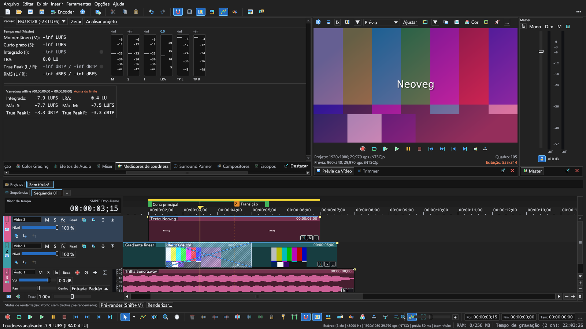

# Neoveg

[Português (BR)](README.md) | [English](README.en.md) | **Español** | [Français](README.fr.md) | [Deutsch](README.de.md) | [日本語](README.ja.md)

Editor de vídeo no lineal (NLE) escrito en **Rust puro**, con interfaz nativa multilingüe (`pt-BR` predeterminado, `en`, `es`, `fr`, `de` y `ja`; `eframe` + `wgpu` con respaldo automático a `glow`), semántica operativa inspirada en VEGAS Pro y política estricta de **cero pánicos en producción**.

## ¿Probaste Neoveg? Cuéntanos cómo te fue

Si instalaste o usaste Neoveg, responde el **[formulario para quienes probaron Neoveg](https://docs.google.com/forms/d/e/1FAIpQLSdpY1-si_e8qwGT9Q3eOkcn9LvvqxQaY1S_HsXk5wJewJi6bw/viewform)**. Las respuestas ayudan a decidir qué corregir y priorizar primero. Los errores con pasos para reproducirlos también pueden enviarse en las *Issues* del repositorio.

Otros idiomas: [Português (BR)](https://docs.google.com/forms/d/e/1FAIpQLScyRCZRUxQ48eokch70fh8RRVbK2zXDYoDH9zeRM06bm7OyjA/viewform) | [English](https://docs.google.com/forms/d/e/1FAIpQLScsDpUJgDH_hfs2KsD5iO-TcgOLnCiZQvpi2jMNGabmddLCUA/viewform) | [Français](https://docs.google.com/forms/d/e/1FAIpQLSdXkSbZPAGymZRSHzz1gRUAaw-kc9IjmlFVU7pFQCYtLvv-7w/viewform) | [Deutsch](https://docs.google.com/forms/d/e/1FAIpQLSf3El0zy7Tc-5EKrlebeuC3KN6BATtO9KnJyTr6F5PzwAn_BQ/viewform) | [日本語](https://docs.google.com/forms/d/e/1FAIpQLSdW8rLZc9LrAnchxxNdaXQgfW57kqqrI00fQ0grnuRtRfrdDA/viewform)

## Capturas de pantalla


| Pantalla de bienvenida | Renderizar como... |
|---|---|
|  |  |

| Efectos de vídeo | Generadores de medios |
|---|---|
|  |  |

| Gradación de color | Osciloscopios de vídeo |
|---|---|
|  |  |

| Mezclador y buses auxiliares | Panoramizador Surround 5.1 |
|---|---|
|  |  |

| Medidores de sonoridad (EBU R128) | Propiedades del evento |
|---|---|
|  |  |


Las imágenes muestran únicamente la interfaz de Neoveg, con medios sintéticos generados por el propio programa (degradado, barras de color, texto y audio sinusoidal).

## Arquitectura del espacio de trabajo (5 Crates)

- **`neoveg_common`** (`crates/neoveg_common`): tipos fundamentales, representación exacta del tiempo (`Ticks`, `FrameRate`, `Rate`, *SMPTE Drop-Frame*), curvas, preferencias y utilidades base.
- **`neoveg_engine`** (`crates/neoveg_engine`): estado de la línea de tiempo, invariantes de edición atómica, mezclador multipista con hasta 26 buses auxiliares (`Bus A`..`Bus Z`), procesamiento DSP mediante `fundsp`, *varispeed* con `rubato`, compositor de vídeo 2D/3D (Pan/Crop con máscara Bézier animable, Track Motion 2D/3D con Sombra/Brillo, jerarquía Padre/Hijo 3D, ordenación en Z y cámara estereoscópica 3D *off-axis*), efectos/transiciones, osciloscopios, secuencias internas en pestañas al estilo Premiere Pro (`Project.sequences` y `.nvegseq` independiente), persistencia `.neoveg`/`.nvp` con recuperación de proyectos anidados, intercambio en Sala Limpia (OpenTimelineIO, FCPXML, FCP7 XML, EDL CMX 3600, AAF, SRT/WebVTT), *Surround* 5.1, host aislado de complementos OFX (teselas, contexto *General* con entradas auxiliares y generadores) y VST3 (`IPlugView`, automatización por muestra e instrumentos MIDI con analizador SMF `.mid`/`.midi` en sala limpia), decodificación de audio y vídeo en Rust puro (`WAV`/`AIFF`/`FLAC`/`Vorbis`/`MP3`, `FFV1 v3`, `media/fallback.rs`), contrato unificado de decodificación del sistema (`media/system.rs`) con backends nativos **Windows Media Foundation**, **Linux VA-API** y **macOS VideoToolbox/AudioToolbox**, y **Tabla Única de Comandos**.
- **`neoveg_scripting`** (`crates/neoveg_scripting`): automatización sin interfaz (`--command`, `--list-commands`) y puente bajo demanda para scripts `.NET`/`C#` (`.cs`/`.dll`) compatibles con `ScriptPortal.Vegas` (Sala Limpia, Protocolo 6) mediante `netcorehost`.
- **`neoveg_ui`** (`crates/neoveg_ui`): interfaz de escritorio nativa en `eframe` + `wgpu`, línea de tiempo interactiva con 22 punteros vectoriales de edición (`cursors.rs`), acoplamiento flexible en `egui_tiles` con ventanas desacoplables multipestaña, acoplamiento persistente de diálogos y pruebas de interacción `egui_kittest`, 7 temas visuales (incluidos 2 temas de Alto Contraste WCAG AAA), gestor de diseños `.neoveglayout`, osciloscopios/vista previa con subtítulos CC1–CC4 y vista 360° equirectangular interactiva, y editores de atajos y preferencias.
- **`neoveg`** (`crates/neoveg`): binario principal e interfaz CLI con inicialización del grupo de hilos `rayon` proporcional al hardware.

## Funciones implementadas

- **Línea de tiempo, audio y edición estilo VEGAS Pro:** múltiples pistas de A/V, mezclador con hasta 26 buses auxiliares (`Bus A`..`Bus Z`) + *Bus Master* (`Mono`/`Dim -20 dB`, envíos *pre/post-fader* y enrutamiento acíclico), DSP con `fundsp`, fundido cruzado automático al superponer eventos en la misma pista, tiradores de fundido en las esquinas superiores, barra de ganancia en dB en la parte superior de eventos de audio, cabezal físico de `1 px`, control continuo de velocidad (*Playback Rate* con remuestreo *Sinc* mediante `rubato`), división (`S`), marcadores (`M`), regiones (`R`), *Auto Ripple* (`Ctrl+L`), ajuste (`F8`) y *scrub* (`J`/`K`/`L`). *Adjustment Track* (`insert.track_adjustment`), *Panoramizador Surround* 5.1 (Master estéreo/5.1, LFE, mezcla descendente ITU y renderizado WAV de 6 canales), medidores de sonoridad EBU R128 y **Carpetas de trabajo del proyecto** (*Archivo → Carpetas de trabajo...*, `file.work_folders`, para mapear de forma persistente capturas, grabaciones, prerrenderizados, proxies y exportaciones).
- **Fotogramas clave de pista en la línea de tiempo:** los fotogramas clave de los efectos de vídeo de la pista y de *Track Motion* aparecen en filas debajo de la pista de vídeo; arrastrar cambia su posición (con ajuste y sin sobrepasar los vecinos), el clic derecho añade, elimina y cambia la interpolación entre las 6 curvas clásicas (*Lineal, Rápida, Lenta, Suave, Brusca, Mantener* tanto para Track Motion como para parámetros de efectos), y el botón de fotogramas clave en la cabecera expande o contrae el área (manual de VEGAS Pro 21, p. 389).
- **Múltiples tomas por evento:** un evento almacena varios medios alternativos (tomas), cada uno con su punto de inicio y nombre; *Añadir como toma a eventos seleccionados* (menú contextual de Medios del proyecto) convierte el nuevo medio en la toma activa conservando las anteriores, `T`/`Shift+T` alternan a la siguiente/anterior, el submenú *Toma* del evento selecciona o elimina la activa, y *Opciones → Deslizar todas las tomas* desplaza todas las tomas al hacer *slip*. Dividir y recortar mantienen las tomas sincronizadas; el renderizado y los exportadores usan la toma activa (manual de VEGAS Pro 21, pp. 346–348).
- **Complementos externos (OFX y VST3):** detección de VST3/OFX en las carpetas estándar y en carpetas mapeadas por el usuario (p. ej., Google Drive, *Gestor de complementos → Carpetas de complementos*) en el *Gestor de complementos* y en el *Plug-In Chooser* en 2 columnas con cadena de píldoras; efectos y generadores de vídeo **OFX** (renderizado por teselas `SupportsTiles = 1`, contexto *General* con múltiples entradas auxiliares, *Filter* y *Generator* en *Generadores de medios → Terceros*, fotogramas clave de parámetros y evaluación completa en el host mediante `getValueAtTime`/`getDerivative`/`getIntegral`) y efectos e instrumentos **VST3** (eventos, pistas, buses y Master, interfaz gráfica nativa `IPlugView`/`IPlugFrame`, automatización en tiempo real por muestra mediante `IParameterChanges`, instrumentos MIDI con `IEventList` y analizador SMF `.mid`/`.midi`, persistencia de estado `IComponent::getState`/`setState` y compensación automática de latencia PDC) ejecutados en el subproceso aislado `neoveg --plugin-host`, de modo que un fallo del complemento no cierre el editor.
- **Tabla Única de Comandos, atajos y scripting `.NET`:** los menús, la barra de herramientas, los atajos y los comandos CLI se despachan por el mismo `id`; los atajos personalizados pueden grabarse o limpiarse en *Ayuda → Atajos de teclado*, y los scripts `.cs`/`.dll` (`ScriptPortal.Vegas` Sala Limpia, Protocolo 6) se ejecutan bajo demanda desde *Herramientas → Ejecutar script (.cs/.dll)...* (`tools.run_script`) o `--run-script`. La API sigue los nombres de la *VEGAS Pro Scripting API Summary* (documentación pública de MAGIX) y las preguntas frecuentes del manual, con implementación propia: proyecto, pistas (nombre, Mute/Solo, selección, `Events`, `Effects`, `Envelopes`), eventos (`Start`/`Length`/`End`, nombre, Mute, Locked, selección, `FadeIn`/`FadeOut`, `Effects`, `Envelopes`; mover entre pistas del mismo tipo y eliminar), parámetros y fotogramas clave de efectos (`Effect.Keyframes`, `Effect.Parameters`, `Effect.Preset`) incluidos OFX/VST3 por identificador descubierto, marcadores, `Vegas.Cursor`, `Transport.CursorPosition`/`SelectionStart`/`SelectionLength` y `Timecode` en ticks exactos con operadores, medios del proyecto (`Project.MediaPool`, `Media`, `VideoStream`/`AudioStream`) y tomas (`Takes`, `ActiveTake`, `AddTake`, `Take.Offset`/`Name`/`MediaPath`), además de crear eventos (`AddVideoEvent`/`AddAudioEvent` + `AddTake`) e importar medios nuevos (`MediaPool.AddMedia` o `new Media(path)`, hasta 64 por ejecución). En Windows con `Microsoft.WindowsDesktop.App`, los scripts usan el `System.Windows.Forms` real en un hilo STA; en Linux, macOS y entornos sin `WindowsDesktop`, los diálogos y formularios (`MessageBox`, `Form.ShowDialog` y selectores de archivos) funcionan mediante la capa propia en `crates/neoveg_ui/src/script_forms.rs`.
- **Interfaz, punteros, personalización y accesibilidad:** diseño visual editorial de alta densidad con 7 temas seleccionables en *Ver → Tema* u *Opciones → Preferencias...* (incluidos Alto Contraste AAA Oscuro y Claro con contraste >= 7:1), **22 punteros vectoriales originales de edición** (`cursors.rs`: recorte izquierdo/derecho/adyacente, estiramiento de tiempo, *Split Trim*, fundido, *Slip*, *Slide*, fundido cruzado, *scrub*, rotación, movimiento libre/X/Y, mano de envolvente, lupa +/-, cuadro de selección y herramientas de pluma/vértice de máscara Bézier), franja lateral de color de 22 px con menú `Más (…)` en las cabeceras de pista, etiquetas en cápsula oscura y botones configurables (`Pan/Crop`, `fx`, `…`) en los eventos, escala dB central en el *Bus Master*, **Pan/Crop** con fila interactiva de **Máscara Bézier** animable, ajustes preestablecidos y píldoras de cadena FX, **Track Motion 2D/3D** completo (pivote, orientación, sombra/brillo 2D, composición Padre/Hijo 3D, ordenación en Z y cámara estereoscópica 3D *off-axis*), **Vista previa de vídeo** con decodificación de subtítulos **CC1–CC4** y **vista 360° equirectangular interactiva**, **Editar → Propiedades → Diseño** con los estilos clásicos (*Clásico*, *Intermedio*, *Reciente* y *Moderno*), **Pantalla de inicio** y **Pantalla de bienvenida**, panel acoplable **Gradación de color**, ventana **Renderizar como...** en 2 columnas, 123 iconos vectoriales nativos a color (`crates/neoveg_ui/src/icons.rs`), barra inferior de transporte/edición en el orden del manual con selección `Inicio`/`Fin`/`Duración`, paneles flotantes multipestaña y acoplamiento persistente de diálogos (`Preferences.docked_dialogs`), `F11`/`Shift+F11`/`Ctrl+F11` y diseños `.neoveglayout`.
- **Neoveg Encoder (cola de codificación por lotes y múltiples salidas):** ventana propia fuera del área acoplable (botón **Encoder** en la barra superior, *Ver → Neoveg Encoder* `Ctrl+Shift+Alt+M`, botón **Enviar al Encoder** en *Renderizar como...* y *Archivo → Enviar a Neoveg Encoder...* `Ctrl+Shift+M`) y CLI `--encode` integrados con los 7 temas de VEGAS Pro: cola persistente (`encoder/queue.json`) con múltiples salidas paralelas por origen, panel *Codificación* en vivo con miniatura y ETA, pausa cooperativa y detención selectiva/total, *Explorador de ajustes preest.* (sistema, `.neovegpreset` personalizados, grupos y alias), *Carpetas vigiladas* (*Watch Folders* con disparo automático y protección contra sobrescritura), ventana *Configuración de exportación* (rango `In`/`Out`, recorte/*Crop* con bloqueo de proporción, 5 modos de escala de origen y vista previa *Origen/Salida*), efectos de precodificación (corrección de color, tablas LUT `.cube` 1D/3D en sala limpia, superposición de imagen/nombre/código de tiempo SMPTE y Ajustador de tiempo) y registros en `logs/neoveg_encoder*.log`.
- **Integración ArtCraft y Blender (*Herramientas → Integraciones*):** detección automática y rutas manuales (*Preferencias → Aplicaciones externas*) para **PhotoCraft**, **VectorCraft**, **FilmCraft**, **EffectCraft**, **AniCraft**, **SoundCraft** y **Blender**. Incluye flujo *Round-Trip* de copias editables como *Tomas* (PNG para PhotoCraft, SVG limpio para VectorCraft y BWF WAV con `bext` `TimeReference` para SoundCraft con recarga automática al guardar), cliente TCP loopback (`127.0.0.1`) con autenticación HMAC-SHA256 para apps de ArtCraft en ejecución, exportación OTIO para FilmCraft, renderizado sin interfaz de escenas `.anicraft`, `.ecproj` y `.blend` directamente a secuencias PNG en la línea de tiempo, generación de scripts `.py` de sincronización de FPS/marcadores/Pan-Crop e importación de cámaras de Blender (`.json`) a fotogramas clave de *Track Motion* / *Pan/Crop*.
- **Formatos compatibles:**
  - **Intercambio (Rust puro, Sala Limpia):** OpenTimelineIO `.otio` (esquema 0.17), Final Cut Pro XML `.fcpxml`, Final Cut Pro 7 XML `.xml` (`xmeml`), AAF `.aaf`, EDL CMX 3600 `.edl` y subtítulos SubRip `.srt` / W3C WebVTT `.vtt` (importación y exportación). Disponible en *Archivo → Intercambio y subtítulos* y mediante arrastrar y soltar; las ediciones de las especificaciones utilizadas constan en [`crates/neoveg_engine/README.md`](crates/neoveg_engine/README.md).
  - **Rust puro (multiplataforma):**
    - *Proyectos, secuencias y vídeo:* `.neoveg` (y el antiguo `.nvp`), secuencias independientes `.nvegseq` (importación/exportación con remapeo de IDs), `AVI` (importación `MJPEG`/`DIB RGB24/32`/`YUY2`/`UYVY`/`I420` + PCM/G.711; exportación `AVI MJPEG` y `AVI sin comprimir RGB24`), `Y4M`, `GIF` animado (importación y exportación), demuxer de contenedores `MP4`/`MOV`/`MKV`/`WEBM` (`media/demux/`), decodificador `FFV1 v3` sin pérdida (`media/ffv1.rs`) y decodificador de respaldo multiplataforma (`media/fallback.rs`).
    - *Imágenes y secuencias:* `PNG`, `JPEG`, `BMP`, `TIFF`, `WebP` (estático y animado), `GIF`, `TGA`/`ICB`/`VDA`/`VST`, `ICO`/`CUR`, `PNM` (`PBM`/`PGM`/`PPM`/`PAM`), `Radiance HDR`, `DDS`, `Farbfeld`, `QOI`, `OpenEXR` (`.exr`), `DPX` (`.dpx`), `Kodak Cineon` (`.cin`), `WBMP`, `XBM`, `XPM` y `Amiga IFF/ILBM` (`.iff`/`.ilbm`/`.lbm`), además de captura y renderizado en secuencia en 10 formatos (`PNG`, `JPEG`, `TIFF`, `TGA`, `BMP`, `WebP`, `PNM`, `QOI`, `DPX`, `EXR`).
    - *Audio y MIDI:* `WAV` / `BWF` / `RF64` (PCM, Float32, ITU-T G.711 µ-law/A-law, IMA/DVI ADPCM), `AIFF`/`AIFC` (importación y exportación), `Sun/NeXT AU/SND`, `Apple CAF`, `Sony Wave64` (`.w64`), `Creative VOC`, `Amiga IFF 8SVX` (PCM 8b y Fibonacci Delta), `QOA` (`.qoa`), `FLAC` (`claxon`), `Ogg Vorbis` (`.ogg`, `.oga`, `lewton`), `MP3` (`puremp3`) y **Standard MIDI File** (`.mid`/`.midi`, formatos 0/1/2, analizador en sala limpia en `midi.rs` con vista previa polifónica de respaldo y enrutamiento a instrumentos VST3).
  - **Backends nativos del sistema (Windows, Linux y macOS):**
    - *Windows (Media Foundation):* importación/decodificación en streaming de `MP4`, `MOV`, `MKV`, `WEBM`, `M4V`, `M4A`, `AAC`, `WMV`, `ASF`, `WMA`, `3GP`, `3G2`, `M2TS`, `MTS`, `TS`, `MPG`, `MPEG`, `MPE`, `VOB`, `MP2`, `MPA`, `M4B` y `ALAC`; exportación nativa mediante `IMFSinkWriter` a `MP4 (H.264/HEVC + AAC)`, `MOV (H.264 + AAC)`, `3GP (H.264 + AAC)`, `WMV` y audio `M4A (AAC)`, `AAC (ADTS)`, `WMA` y `MP3`.
    - *Linux (VA-API):* decodificación acelerada mediante `libva.so.2`/`libva-drm.so.2` cargadas dinámicamente (`media/vaapi.rs`, sin GStreamer/LGPL), con respaldo automático en Rust puro.
    - *macOS (VideoToolbox / AudioToolbox):* decodificación de vídeo H.264/HEVC mediante `VTDecompressionSession` y audio mediante `ExtAudioFile` (`media/videotoolbox.rs`), con respaldo automático en Rust puro.
  - **Conversión a formato compatible (Windows):** cuando un archivo no se abre directamente (extensión fuera de la lista o códec que los lectores propios no decodifican, como un AVI que no es MJPEG), Neoveg ofrece convertirlo con el decodificador del sistema a AVI MJPEG + PCM (vídeo) o WAV de 24 bits (solo audio) e importa el resultado en la misma posición; también en *Archivo → Convertir medios a formato compatible...*. El destino se elige en el diálogo, el archivo se escribe como `.part` hasta terminar, el AVI utiliza extensiones OpenDML (sin el límite de 4 GB; hasta ~250 GB, reduciendo la calidad JPEG de 90 a 50 solo si hace falta para que quepa, con aviso) y nada se rellena ni recorta en silencio (`media/convert.rs`). (`ffmpeg`/`ffprobe` se utilizan exclusivamente como oráculos de prueba externos y generadores de fixtures mediante `tools/gen_media_fixtures.py`, nunca enlazados ni distribuidos.)
- **Informe cuando el programa no se cierra normalmente:** cada sesión de la interfaz mantiene un marcador bloqueado en `logs/sessoes/`; al abrir tras una caída (error interno, cierre forzado o corte de energía), la ventana *Neoveg no se cerró correctamente* indica lo ocurrido (el error y la ubicación, o cierre sin aviso), enumera los errores aislados de esa sesión, ofrece recuperar el proyecto autoguardado y permite copiar el informe o abrir la carpeta de registros. Dos instancias simultáneas no cuentan como caída, y los pánicos de otras instancias o de hosts de complementos no aparecen en el informe.
- **Propiedades del proyecto:** pestañas *Vídeo*, *Audio*, *Regla*, *Resumen* y *CD de audio*, como en VEGAS Pro; el Resumen y el código UPC/EAN se incluyen en la hoja `.cue` exportada.
- **Windows y Linux:** instalador propio en Rust y paquete portátil para ambos sistemas; en Linux, acceso directo en el menú de aplicaciones, comando `neoveg` y asociación de archivos `.neoveg` (véase *Instalador para Linux*).
- **Hardware limitado:** resoluciones de vista previa (*Borrador / Vista previa / Buena / Óptima*), generación de proxies `.avi`, prerrenderizado selectivo por región, límite configurable de RAM/fotogramas en caché y compilación portátil sin `-C target-cpu=native`.

## Cómo ejecutar

```bash
# Abrir interfaz gráfica (pasando opcionalmente un proyecto o medio)
cargo run -p neoveg
cargo run -p neoveg -- mi_proyecto.neoveg

# Interfaz de línea de comandos (CLI)
cargo run -p neoveg -- --list-commands
cargo run -p neoveg -- --probe-integrations
cargo run -p neoveg -- --command insert.marker mi_proyecto.neoveg actualizado.neoveg
cargo run -p neoveg -- --run-script mi_script.cs
cargo run -p neoveg -- --render mi_proyecto.neoveg salida.avi
cargo run -p neoveg -- --encode entrada.mp4 salida.mp4 sys.web_1080p_hq
```

Los registros, autoguardados, preferencias (`preferencias.json`), diseños (`.neoveglayout`), proxies y prerrenderizados se guardan junto al ejecutable en compilaciones portátiles (o en la carpeta temporal del sistema cuando se ejecuta desde un directorio de solo lectura).

## Cómo usar

### Primeros pasos

1. Abre Neoveg (`cargo run -p neoveg` o el ejecutable del paquete portátil). En la **Pantalla de bienvenida**, elige una de las 5 relaciones de aspecto (*Widescreen 16:9*, *Fullscreen 4:3*, *Portrait 9:16*, *Square 1:1* o *Scope 2.4:1*), ajusta resolución, velocidad de fotogramas y *Drop-Frame*, o reabre proyectos en *Abrir proyecto*. La pantalla puede reabrirse desde *Ayuda → Pantalla de bienvenida*.
2. Importa vídeo, audio, imágenes estáticas o secuencias de imágenes con *Archivo → Importar medios...* (`Ctrl+I`) o arrastrando archivos directamente a la ventana. Los clips aparecen en *Medios del proyecto*; arrástralos a la línea de tiempo o haz doble clic para insertarlos en el cursor. Si deseas marcar puntos *In*/*Out* antes de cortar, usa el panel **Recortador** (`Alt+2`).
3. El formato del primer archivo importado establece automáticamente las dimensiones y la velocidad de fotogramas del proyecto si *Propiedades del proyecto* (`Alt+Enter`) aún no ha sido modificado manualmente.
4. En Windows, los archivos con códecs fuera del soporte directo ofrecen automáticamente la conversión segura a `AVI MJPEG + PCM` o `WAV de 24 bits` (*Archivo → Convertir medios a formato compatible...*).
5. Guarda con `Ctrl+S` (o `Ctrl+Shift+S` / `Ctrl+Alt+S` para versiones). El proyecto se guarda en `.neoveg` con recuperación automática ante cierres inesperados.

### Editar en la línea de tiempo

| Acción | Atajo |
|---|---|
| Reproducir / pausar / desde el inicio / detener | `Espacio` / `Shift+Espacio` / `Esc` |
| Scrub inverso, pausa, avance | `J`, `K`, `L` |
| Fotograma anterior / siguiente | `Alt+←` / `Alt+→` |
| Siguiente / anterior herramienta de edición | `D` / `Shift+D` |
| Dividir evento en el cursor | `S` |
| Recortar inicio / fin del evento en el cursor | `Alt+[` / `Alt+]` |
| Recortar a la selección de tiempo | `Ctrl+T` |
| Definir entrada / salida de selección / bucle | `I` / `O` / `Q` (`Shift+Q`) |
| Siguiente / anterior toma | `T` / `Shift+T` |
| Agrupar / desagrupar / seleccionar grupo | `G` / `U` / `Shift+G` |
| Insertar marcador / región | `M` / `R` |
| Envolvente de Volumen / Panoramización en pista | `V` / `P` |
| Silenciar / solo en la pista seleccionada | `Z` / `X` |
| Insertar pista de vídeo / audio / bus | `Ctrl+Shift+Q` / `Ctrl+Q` / `B` |
| Ajuste (`snapping`) / Ripple automático | `F8` / `Ctrl+L` |
| Zoom horizontal / formas de onda vertical | `↑` / `↓` (`Shift+↑` / `Shift+↓`) |
| Deshacer / rehacer | `Ctrl+Z` / `Ctrl+Y` |
| Propiedades del evento | `F2` |
| Neoveg Encoder / Enviar línea de tiempo | `Ctrl+Shift+Alt+M` / `Ctrl+Shift+M` |
| Renderizar en pista nueva | `Ctrl+M` |

- **Herramientas y modos de edición (`D` / `Shift+D`):** en la barra de transporte y en *Editar → Herramienta de edición*, alterna entre **Normal** (movimiento y recorte en modos *Normal* o *Slip*), **Envolvente** (mueve solo puntos de envolvente), **Selección** (marco rectangular; `Shift`/`Ctrl` suman) y **Zoom** (marco acerca; un clic ajusta el proyecto a la ventana).
- **Fundidos, ganancia y fotogramas clave:** superponer eventos en la misma pista crea fundido cruzado automático; los tiradores en las esquinas superiores ajustan fundidos, la barra superior en clips de audio ajusta ganancia en dB y las filas bajo la pista editan fotogramas clave de *Track Motion* y efectos de pista.
- **Cabeceras, transporte y edición tabular:** la barra inferior sigue el orden de VEGAS Pro con lectura/edición de `Inicio`, `Fin` y `Duración`, control de *Playback Rate* (`0.25×`–`4.00×`), botón *Más* (`…`) en la cabecera de pista para configurar los botones visibles y panel **Detalles de edición** (`Ctrl+Alt+4`) para edición en tabla.
- **Secuencias, `.nvegseq` independiente y anidamiento:** pestañas interactivas en la parte superior de la línea de tiempo para múltiples secuencias en el mismo proyecto, importación y exportación de secuencias independientes `.nvegseq` (*Editar → Secuencia → Importar/Exportar secuencia...* o arrastrar a la ventana) y recuperación automática de pestañas de proyectos `.neoveg` anidados modificados (`autosave/recuperacao_aninhados.json`), con propagación en vivo en memoria entre proyectos anidados en varios niveles (incluidos nietos). Arrastra cualquier secuencia desde *Medios del proyecto* a la línea de tiempo activa o usa *Anidar selección en nueva secuencia* (`sequence.nest_selection`); prevención estricta de ciclos y límite de 32 niveles.

### Tomas

Un evento puede guardar múltiples medios alternativos (tomas). En *Medios del proyecto*, haz clic derecho en un medio y elige *Añadir como toma a eventos seleccionados*; cambia la toma activa con `T` / `Shift+T` o desde el submenú *Toma* del evento. Con *Opciones → Deslizar todas las tomas*, los desplazamientos mantienen sincronizadas todas las tomas.

### Efectos, generadores, Gradación de color y osciloscopios

- **Efectos de vídeo, audio y transiciones:** 46 efectos de vídeo nativos en 8 categorías (color, luz, desenfoque y nitidez, estilizar, distorsionar, composición y bordes, estabilización, recorte) y 33 transiciones. Filtra por categoría o búsqueda, haz clic en el elemento y arrastra la miniatura del ajuste preestablecido sobre un evento, pista o transición, o aplica con los botones *Eventos*, *Pista* y *Master*. Usa `★` para marcar favoritos.
- **Generadores de medios:** inserta texto animado con contorno/sombra, colores sólidos, degradados, tablero de ajedrez, barras de color, ruido, **patrones de prueba** (rejilla de convergencia, rampa de grises, placa de zona, rejilla de píxeles), **textura de ruido** fractal y generadores de terceros **OFX** (*Terceros*) desde la pestaña *Generadores de medios* (*Insertar en el cursor* o arrastrando).
- **Gradación de color y osciloscopios:** abre *Gradación de color* (o haz clic en **Color** en la cabecera de *Vista previa de vídeo*) para ajustar ruedas tonales (*Lift*, *Gamma*, *Gain*), panel *Temperatura × Tinte*, saturación y ajustes preestablecidos vinculados a `FxKind::ColorCorrector`. Supervisa la señal en tiempo real en la pestaña **Osciloscopios** (*Histograma RGB + luma*, *Forma de onda*, *Vectorscope* y *RGB Parade*).
- **Complementos externos (OFX y VST3):** administra rutas VST3 y OFX en *Gestor de complementos* (`Ctrl+Alt+1`). Todos los complementos se ejecutan en el subproceso aislado `--plugin-host`, con soporte OFX para teselas, contexto *General* con entradas auxiliares y generadores, y soporte VST3 para interfaz gráfica nativa (`IPlugView`), automatización en tiempo real por muestra, instrumentos MIDI (`.mid`/`.midi`), persistencia de estado (`IComponent::getState`/`setState`) y compensación automática de latencia (PDC) sin poner en riesgo al editor.

### Audio, Mezclador, Surround 5.1 y sonoridad

- **Mezclador y buses auxiliares (`Bus A`..`Bus Z`):** haz clic en **＋ Bus** en el *Mezclador* o usa *Insertar → Bus de audio* para crear hasta 26 buses con envíos *pre/post-fader* y visualización en la línea de tiempo (`B`).
- **Bus Master:** el panel derecho mantiene la monitorización estéreo con controles `fx`, `Mono`, `Dim` (`-20 dB`) y `M` (silencio).
- **Panoramizador Surround 5.1:** en la pestaña *Panoramizador Surround* (o en *Propiedades del proyecto*), cambia el *Modo Master* a `5.1 Surround`, coloca cada pista o bus en el anillo ITU-R BS.775, ajusta el LFE y renderiza en WAV multicanal de 6 canales.
- **Medidores de sonoridad EBU R128 (`Ctrl+Alt+7`):** supervisa `M`, `S`, `I`, `LRA` y `True Peak` con objetivos configurables (*EBU R128 -23 LUFS*, streaming, ATSC, podcast) y análisis fuera de línea (*Analizar proyecto* / *Analizar selección*).

### Renderizar

*Archivo → Renderizar como...* abre la ventana en 2 columnas con búsqueda, ★ favoritos, resumen del intervalo (*Proyecto completo* o *Región de bucle*) y los **31 formatos de salida** admitidos: `MP4 (H.264/HEVC + AAC)`, `MOV`, `3GP` y `WMV` (Windows Media Foundation), `AVI MJPEG` y `AVI sin comprimir RGB24` (con OpenDML), `GIF` animado, `Y4M`, 10 secuencias de imágenes (`PNG`, `JPEG`, `TIFF`, `TGA`, `BMP`, `WebP`, `PNM`, `QOI`, `DPX`, `EXR`) y audio (`WAV`, `BWF`, `RF64`, `Wave64`, `AIFF`, `AU`, `CAF`, `QOA`, `M4A`, `AAC`, `WMA`, `MP3`). Desde la misma ventana puedes hacer clic en **Enviar al Encoder** o renderizar sin interfaz mediante `neoveg --render proyecto.neoveg salida.ext`.

### Neoveg Encoder (cola por lotes y carpetas vigiladas)

Se puede abrir **Neoveg Encoder** directamente desde el botón **Encoder** en la barra superior, en *Ver → Neoveg Encoder* (`Ctrl+Shift+Alt+M`), en *Herramientas → Neoveg Encoder*, con el botón **Enviar al Encoder** en *Renderizar como...*, o mediante *Archivo → Enviar a Neoveg Encoder...* (`Ctrl+Shift+M`, que envía la línea de tiempo o selección actual a la cola). Haz clic en **Desacoplar** en la barra de pestañas para usarlo en su propia ventana amplia fuera del acoplamiento.

- **Paneles (4):** *Cola de codificación* (múltiples salidas paralelas por origen, duplicación, reordenación e interpretación de medios), *Codificación (en vivo)* (miniatura, ETA, pausa cooperativa y detención por elemento o total), *Explorador de ajustes preest.* (sistema, `.neovegpreset` personalizados y grupos multisalida) y *Carpetas vigiladas* (detección automática en directorios de entrada).
- **Configuración de exportación:** recorte de intervalo `In`/`Out`, *Crop* con bloqueo de proporción, 5 modos de escala, corrección de color, tablas LUT `.cube` 1D/3D, superposiciones de imagen/nombre/código de tiempo SMPTE y *Ajustador de tiempo* (%). También disponible en línea de comandos: `neoveg --encode entrada.mp4 salida.mp4 sys.web_1080p_hq`.

### Intercambio y subtítulos

Usa *Archivo → Intercambio y subtítulos* (o arrastra el archivo directamente a Neoveg) para importar y exportar líneas de tiempo en **OpenTimelineIO (`.otio`)**, **Final Cut Pro XML (`.fcpxml`)**, **Final Cut Pro 7 XML (`.xml`, `xmeml`)**, **AAF (`.aaf`)**, **EDL CMX 3600 (`.edl`)** y subtítulos **SubRip (`.srt`)** / **WebVTT (`.vtt`)**.

### Integraciones (ArtCraft y Blender)

Accede a *Herramientas → Integraciones (ArtCraft y Blender)...* (o configura rutas manuales en *Opciones → Preferencias... → Aplicaciones externas*) para trabajar junto con **PhotoCraft**, **VectorCraft**, **FilmCraft**, **EffectCraft**, **AniCraft**, **SoundCraft** y **Blender**. Permite crear copias *Round-Trip* como *Tomas* (PNG, SVG limpio o WAV/BWF con recarga automática al guardar), exportar OTIO a FilmCraft, renderizar escenas `.anicraft`/`.ecproj`/`.blend` como secuencias PNG en la línea de tiempo, generar scripts `.py` de sincronización e importar cámaras JSON de Blender.

### Scripts C# (`.cs`/`.dll`)

*Herramientas → Ejecutar script (.cs/.dll)...* (o `neoveg --run-script mi_script.cs`) ejecuta scripts `.NET` compatibles con la API `ScriptPortal.Vegas` en un único paso de Deshacer. En Windows (con el runtime `Microsoft.WindowsDesktop.App`), los formularios usan `System.Windows.Forms`; en Linux, macOS y entornos sin `WindowsDesktop`, los cuadros y diálogos funcionan mediante la capa propia en `script_forms.rs`.

### Diseño, apariencia y atajos

- **Diseño y ventanas desacoplables:** *Editar → Propiedades → Diseño* alterna entre *Clásico*, *Intermedio* y *Actual* (3 columnas), además de la posición del área acoplable y las pestañas. Todas las pestañas, la *Vista previa de vídeo* y el *Bus Master* pueden reorganizarse arrastrando o desacoplarse en ventanas nativas y guardarse en `.neoveglayout`.
- **Temas y atajos:** elige entre 7 temas (incluidos 2 de Alto Contraste AAA) en *Ver → Tema* y personaliza cualquier comando de la Tabla Única en *Ayuda → Atajos de teclado* u *Opciones → Preferencias...*.

## Empaquetado portátil y controles de calidad

```bash
cargo fmt --all -- --check
cargo clippy --workspace --all-targets -- -D warnings
cargo test --workspace
python tools/check_licenses.py
python build_portable.py
```

La CI de GitHub (`.github/workflows/ci.yml`) ejecuta estos controles en cada pull request, en Windows y en Linux (Ubuntu), corriendo las pruebas una por una con fixtures de medios generados al vuelo.

El script `build_portable.py` compila en modo release y genera el paquete portátil en `dist/` en la raíz del repositorio, con las fuentes abiertas `assets/fonts/` (`OFL-1.1`) y los catálogos `i18n/*.json`, sin depender de instalador, fuentes propietarias ni binarios externos. Tras confirmar y verificar la copia (`SHA-256`), elimina la carpeta de compilación de cargo (`target/` o `CARGO_TARGET_DIR`); si falla la compilación, la verificación o la copia, la carpeta se conserva y se informa el error. Usa `--keep-target` para conservar la carpeta de compilación y `--out` para guardar el paquete en otra ruta. `dist/` y `target/` están en `.gitignore`.

### Instalador para Windows

```bash
python build_installer.py
```

`build_installer.py` genera el paquete portátil mediante `build_portable.py`, comprime la carpeta `dist/` y adjunta el ZIP al final de `neoveg-setup.exe`, el instalador propio escrito en Rust (`crates/neoveg/src/setup/`, licencia `MIT OR Apache-2.0`, sin herramientas de terceros). El resultado se guarda en `dist-installer/Neoveg-Setup-<versión>.exe`, también en `.gitignore`. Acepta las mismas opciones `--no-build` y `--keep-target`.

El instalador pregunta para quién instalar:

- **Solo para mí:** en `%LOCALAPPDATA%\Programs\Neoveg`, sin pedir permisos de administrador.
- **Para todos los usuarios:** en `%ProgramFiles%\Neoveg`, con confirmación de UAC.

Crea el acceso directo en el menú Inicio y, si se marca, en el Escritorio. También puede asociar los archivos `.neoveg` con Neoveg. Neoveg aparece en *Configuración → Aplicaciones* (Agregar o quitar programas) con el desinstalador `desinstalar.exe`.

Una vez instalado, Neoveg guarda preferencias, diseños, registros y copias de recuperación en `%APPDATA%\Neoveg`, y no en la carpeta del programa. La carpeta de datos solo se elimina si se marca esa opción en el desinstalador. El paquete portátil sigue guardando todo junto al ejecutable.

Modo silencioso: `Neoveg-Setup.exe --silent [--user | --all-users] [--dir <carpeta>] [--desktop] [--no-assoc]`. Para desinstalar sin ventana: `desinstalar.exe --uninstall --silent [--remove-data]`.

### Instalador para Linux

```bash
python3 build_installer.py
```

En Linux, el mismo `build_installer.py` genera dos archivos en `dist-installer/`:

- `Neoveg-Setup-<versión>-linux-x86_64`: el mismo instalador en Rust, con la misma ventana y las mismas opciones. Da permiso de ejecución (`chmod +x`) y ábrelo.
- `Neoveg-<versión>-linux-x86_64.tar.gz`: el paquete portátil. Extrae y ejecuta `./neoveg`; los datos permanecen junto al ejecutable.

El instalador pregunta para quién instalar:

- **Solo para mí:** en `~/.local/opt/neoveg`, sin pedir contraseña. El acceso directo va a `~/.local/share/applications` y el comando `neoveg` a `~/.local/bin`.
- **Para todos los usuarios:** en `/opt/neoveg`, pidiendo contraseña de administrador mediante `pkexec`. El acceso directo y el tipo MIME van a `/usr/local/share` y el comando a `/usr/local/bin`. Sin `pkexec`, ejecuta `sudo ./Neoveg-Setup-<versión>-linux-x86_64 --silent --all-users`.

El acceso directo sigue la *Desktop Entry Specification* de freedesktop.org y aparece en el menú de aplicaciones de los entornos compatibles (GNOME, KDE Plasma, Xfce y otros) con el icono de Neoveg. Si se marca, también se añade al Escritorio (solo en instalación para el usuario actual, leída desde `~/.config/user-dirs.dirs`). La opción de abrir archivos `.neoveg` registra el tipo `application/x-neoveg-project` (*Shared MIME-info*). Cuando existen, se usan `update-desktop-database`, `update-mime-database`, `xdg-mime` y `gio`; sin ellas la instalación continúa igualmente. Para desinstalar, usa *Desinstalar Neoveg* en el menú del acceso directo (clic derecho) o ejecuta `desinstalar --uninstall` en la carpeta instalada.

Instalado, Neoveg guarda sus datos en `$XDG_DATA_HOME/Neoveg` (normalmente `~/.local/share/Neoveg`). El modo silencioso acepta las mismas opciones que en Windows: `./Neoveg-Setup-<versión>-linux-x86_64 --silent [--user | --all-users] [--dir <carpeta>] [--desktop] [--no-assoc]` y `desinstalar --uninstall --silent [--remove-data]`.

El ejecutable utiliza la glibc del sistema en el que se compiló: para ejecutarse en distribuciones más antiguas, compila en la más antigua de ellas.

### Idiomas (`i18n/*.json`)

Neoveg admite **portugués de Brasil (`pt-BR`, predeterminado)**, **inglés (`en`)**, **español (`es`)**, **francés (`fr`)**, **alemán (`de`)** y **japonés (`ja`)** mediante los catálogos JSON en `i18n/`. El cambio de idioma puede hacerse en vivo desde **Preferencias → General**, en la **Pantalla de bienvenida** o al iniciar con `--lang <código>` / `NEOVEG_LANG`. En japonés, los glifos CJK se cargan en tiempo de ejecución desde las fuentes instaladas en el sistema operativo. La interfaz usa fuentes del sistema, igual que VEGAS Pro: Segoe UI en Windows (Tahoma como alternativa; Noto Sans, Liberation Sans o DejaVu Sans en Linux) y Consolas o Cascadia Mono en campos monoespaciados, leídas de la carpeta de fuentes del sistema y nunca redistribuidas; **Preferencias → General** permite volver a las fuentes integradas. El tamaño de textos, botones y paneles cambia en **Ver → Escala de la interfaz** (Aumentar, Disminuir, 100%; del 50% al 300%, en pasos del 10%) o en el campo *Escala de la interfaz* de Preferencias; estos comandos vienen sin atajo predeterminado y pueden asignarse en *Atajos de teclado*. El *Visor de tiempo* usa la fuente sans-serif del sistema en negrita (Segoe UI Bold) con números de ancho fijo.

## Seguimiento de paridad

- [Hoja de ruta (Roadmap)](ROADMAP.md)
- [Matriz de paridad VEGAS Pro](docs_obsidian/ui_references/matriz_de_paridade.md)
- [Atribución y licencias de recursos](ATTRIBUTION.md)

## Licencia

Neoveg se distribuye bajo doble licencia, a tu elección:

- MIT ([LICENSE-MIT](LICENSE-MIT))
- Apache 2.0 ([LICENSE-APACHE](LICENSE-APACHE))

Salvo declaración explícita en contrario, toda contribución enviada para su inclusión en el proyecto se licencia bajo estos mismos términos, sin condiciones adicionales.
