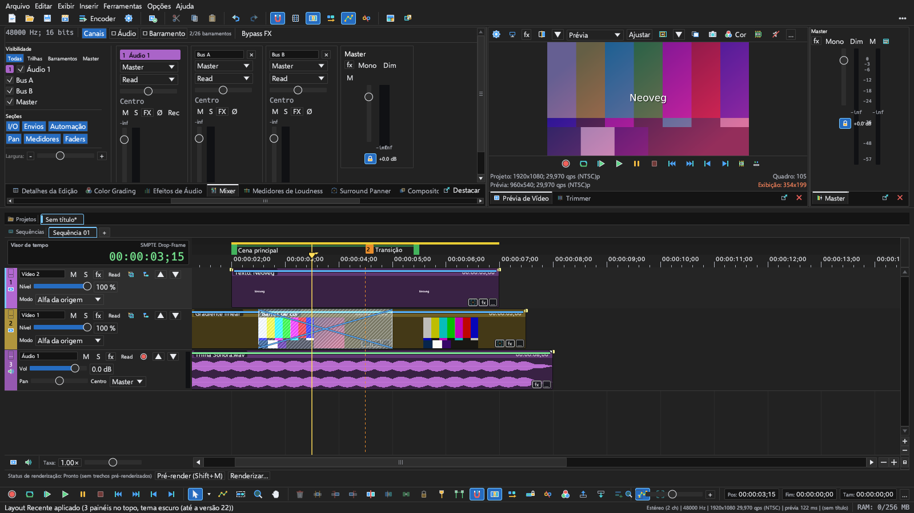

# Neoveg

[Português (BR)](README.md) | [English](README.en.md) | [Español](README.es.md) | **Français** | [Deutsch](README.de.md) | [日本語](README.ja.md)

Logiciel de montage vidéo non linéaire (NLE) écrit en **Rust pur**, doté d'une interface native multilingue (`pt-BR` par défaut, `en`, `es`, `fr`, `de` et `ja` ; `eframe` + `wgpu` avec repli automatique vers `glow`), d'une ergonomie inspirée de VEGAS Pro et d'une politique stricte de **zéro panique en production**.

## Vous avez testé Neoveg ? Racontez-nous votre expérience

Si vous avez installé ou utilisé Neoveg, remplissez le **[formulaire de retour pour les testeurs de Neoveg](https://docs.google.com/forms/d/e/1FAIpQLSdXkSbZPAGymZRSHzz1gRUAaw-kc9IjmlFVU7pFQCYtLvv-7w/viewform)**. Vos réponses aident à décider quoi corriger et prioriser en premier. Les bugs accompagnés d'étapes de reproduction peuvent également être signalés dans les *Issues* du dépôt.

Autres langues : [Português (BR)](https://docs.google.com/forms/d/e/1FAIpQLScyRCZRUxQ48eokch70fh8RRVbK2zXDYoDH9zeRM06bm7OyjA/viewform) | [English](https://docs.google.com/forms/d/e/1FAIpQLScsDpUJgDH_hfs2KsD5iO-TcgOLnCiZQvpi2jMNGabmddLCUA/viewform) | [Español](https://docs.google.com/forms/d/e/1FAIpQLSdpY1-si_e8qwGT9Q3eOkcn9LvvqxQaY1S_HsXk5wJewJi6bw/viewform) | [Deutsch](https://docs.google.com/forms/d/e/1FAIpQLSf3El0zy7Tc-5EKrlebeuC3KN6BATtO9KnJyTr6F5PzwAn_BQ/viewform) | [日本語](https://docs.google.com/forms/d/e/1FAIpQLSdW8rLZc9LrAnchxxNdaXQgfW57kqqrI00fQ0grnuRtRfrdDA/viewform)

## Captures d'écran


| Écran d'accueil | Rendre en tant que... |
|---|---|
|  |  |

| Effets vidéo | Générateurs de média |
|---|---|
|  |  |

| Étalonnage | Oscilloscopes vidéo |
|---|---|
|  |  |

| Mixeur et bus auxiliaires | Panoramique Surround 5.1 |
|---|---|
|  |  |

| Mesureurs de loudness (EBU R128) | Propriétés de l'événement |
|---|---|
|  |  |


Les captures montrent uniquement l'interface de Neoveg, avec des médias synthétiques générés par le programme lui-même (dégradé, barres de couleur, texte et signal audio sinusoïdal).

## Architecture de l'espace de travail (5 Crates)

- **`neoveg_common`** (`crates/neoveg_common`) : types fondamentaux, représentation exacte du temps (`Ticks`, `FrameRate`, `Rate`, *SMPTE Drop-Frame*), courbes, préférences et utilitaires de base.
- **`neoveg_engine`** (`crates/neoveg_engine`) : état de la timeline, invariants d'édition atomique, mixeur multipiste avec jusqu'à 26 bus auxiliaires (`Bus A`..`Bus Z`), traitement DSP via `fundsp`, *varispeed* avec `rubato`, compositeur vidéo 2D/3D (Pan/Crop avec masque Bézier animable, Track Motion 2D/3D avec Ombre/Lueur, hiérarchie Parent/Enfant 3D, tri en profondeur Z et caméra stéréoscopique 3D *off-axis*), effets/transitions, oscilloscopes, séquences internes en onglets façon Premiere Pro (`Project.sequences` et `.nvegseq` autonome), persistance `.neoveg`/`.nvp` avec récupération de projets imbriqués, échange en Salle Blanche (OpenTimelineIO, FCPXML, FCP7 XML, EDL CMX 3600, AAF, SRT/WebVTT), *Surround* 5.1, hôte isolé de plug-ins OFX (tuiles, contexte *General* avec entrées auxiliaires et générateurs) et VST3 (`IPlugView`, automatisation à l'échantillon près et instruments MIDI avec analyseur SMF `.mid`/`.midi` en salle blanche), décodage audio et vidéo en Rust pur (`WAV`/`AIFF`/`FLAC`/`Vorbis`/`MP3`, `FFV1 v3`, `media/fallback.rs`), contrat unifié de décodage système (`media/system.rs`) avec backends natifs **Windows Media Foundation**, **Linux VA-API** et **macOS VideoToolbox/AudioToolbox**, et **Table Unique de Commandes**.
- **`neoveg_scripting`** (`crates/neoveg_scripting`) : automatisation sans interface (`--command`, `--list-commands`) et pont à la demande pour scripts `.NET`/`C#` (`.cs`/`.dll`) compatibles avec `ScriptPortal.Vegas` (Salle Blanche, Protocole 6) via `netcorehost`.
- **`neoveg_ui`** (`crates/neoveg_ui`) : interface bureau native en `eframe` + `wgpu`, timeline interactive avec 22 curseurs vectoriels d'édition (`cursors.rs`), ancrage flexible `egui_tiles` avec fenêtres détachables multi-onglets, ancrage persistant des dialogues et tests d'interaction `egui_kittest`, 7 thèmes visuels (dont 2 thèmes Contraste Élevé WCAG AAA), gestionnaire de dispositions `.neoveglayout`, oscilloscopes/prévisualisation avec sous-titres CC1–CC4 et vue 360° équirectangulaire interactive, ainsi que des éditeurs de raccourcis et préférences.
- **`neoveg`** (`crates/neoveg`) : binaire principal et interface CLI avec initialisation du pool `rayon` proportionnelle au matériel.

## Fonctionnalités implémentées

- **Timeline, audio et montage style VEGAS Pro :** pistes A/V multiples, mixeur jusqu'à 26 bus auxiliaires (`Bus A`..`Bus Z`) + *Bus Master* (`Mono`/`Dim -20 dB`, départs *pre/post-fader* et routage acyclique), DSP via `fundsp`, fondu enchaîné automatique lors du chevauchement d'événements sur la même piste, poignées de fondu dans les coins supérieurs, poignée de gain en dB en haut des événements audio, tête de lecture physique de `1 px`, contrôle continu de vitesse (*Playback Rate* avec rééchantillonnage *Sinc* via `rubato`), découpe (`S`), marqueurs (`M`), régions (`R`), *Auto Ripple* (`Ctrl+L`), magnétisme (`F8`) et *scrub* (`J`/`K`/`L`). *Adjustment Track* (`insert.track_adjustment`), *Panoramique Surround* 5.1 (Master stéréo/5.1, LFE, downmix ITU et rendu WAV 6 canaux), mesureurs de loudness EBU R128 et **Dossiers de travail du projet** (*Fichier → Dossiers de travail...*, `file.work_folders`, pour associer durablement captures, enregistrements, pré-rendus, proxys et exports).
- **Images clés de piste sur la timeline :** les images clés des effets vidéo de piste et de *Track Motion* s'affichent sous la piste vidéo ; le glisser-déposer ajuste leur position (avec magnétisme et sans dépasser les voisines), le clic droit ajoute, supprime et choisit l'interpolation parmi les 6 courbes classiques (*Linéaire, Rapide, Lente, Douce, Brusque, Maintenir* pour Track Motion comme pour les paramètres d'effets), et le bouton d'images clés dans l'en-tête déplie ou replie la zone (manuel VEGAS Pro 21, p. 389).
- **Prises multiples par événement :** un événement peut contenir plusieurs médias alternatifs (prises), chacun avec son décalage et son nom ; *Ajouter comme prise aux événements sélectionnés* (menu contextuel de Média de projet) active le nouveau média tout en conservant les précédents, `T`/`Shift+T` passent à la prise suivante/précédente, le sous-menu *Prise* de l'événement permet de choisir ou supprimer la prise active, et *Options → Glisser toutes les prises* décale toutes les prises lors d'un *slip*. La découpe et le rognage gardent les prises synchronisées ; le rendu et les exportateurs utilisent la prise active (manuel VEGAS Pro 21, pp. 346–348).
- **Plug-ins externes (OFX et VST3) :** détection des VST3/OFX dans les dossiers standard et dans les dossiers mappés par l'utilisateur (ex. : Google Drive, *Gestionnaire de plug-ins → Dossiers de plug-ins*) dans le *Gestionnaire de plug-ins* et le *Plug-In Chooser* en 2 colonnes avec pastilles de chaîne ; effets et générateurs vidéo **OFX** (rendu par tuiles `SupportsTiles = 1`, contexte *General* avec entrées auxiliaires multiples, *Filter* et *Generator* dans *Générateurs de média → Tiers*, images clés de paramètres et évaluation complète par l'hôte via `getValueAtTime`/`getDerivative`/`getIntegral`) et effets et instruments **VST3** (événements, pistes, bus et Master, interface graphique native `IPlugView`/`IPlugFrame`, automatisation en temps réel à l'échantillon près via `IParameterChanges`, instruments MIDI avec `IEventList` et analyseur SMF `.mid`/`.midi`, persistance d'état `IComponent::getState`/`setState` et compensation automatique de latence PDC) exécutés dans le sous-processus isolé `neoveg --plugin-host`, garantissant qu'un plantage de plug-in ne fasse pas planter l'éditeur.
- **Table Unique de Commandes, raccourcis et scripting `.NET` :** menus, barre d'outils, raccourcis clavier et commandes CLI passent tous par le même `id` ; les raccourcis personnalisés s'enregistrent ou s'effacent dans *Aide → Raccourcis clavier*, et les scripts `.cs`/`.dll` (`ScriptPortal.Vegas` Salle Blanche, Protocole 6) s'exécutent à la demande via *Outils → Exécuter un script (.cs/.dll)...* (`tools.run_script`) ou `--run-script`. L'API reprend les noms de la *VEGAS Pro Scripting API Summary* (documentation publique MAGIX) et de la FAQ du manuel, avec une implémentation propre : projet, pistes (nom, Mute/Solo, sélection, `Events`, `Effects`, `Envelopes`), événements (`Start`/`Length`/`End`, nom, Mute, Locked, sélection, `FadeIn`/`FadeOut`, `Effects`, `Envelopes` ; déplacement entre pistes de même type et suppression), paramètres et images clés d'effets (`Effect.Keyframes`, `Effect.Parameters`, `Effect.Preset`) y compris OFX/VST3 par identifiant découvert, marqueurs, `Vegas.Cursor`, `Transport.CursorPosition`/`SelectionStart`/`SelectionLength` et `Timecode` en ticks exacts avec opérateurs, médias du projet (`Project.MediaPool`, `Media`, `VideoStream`/`AudioStream`) et prises (`Takes`, `ActiveTake`, `AddTake`, `Take.Offset`/`Name`/`MediaPath`), ainsi que la création d'événements (`AddVideoEvent`/`AddAudioEvent` + `AddTake`) et l'importation de nouveaux médias (`MediaPool.AddMedia` ou `new Media(path)`, jusqu'à 64 par exécution). Sous Windows avec le runtime `Microsoft.WindowsDesktop.App`, les scripts utilisent le vrai `System.Windows.Forms` sur un thread STA ; sous Linux, macOS et sans `WindowsDesktop`, les dialogues et formulaires (`MessageBox`, `Form.ShowDialog` et sélecteurs de fichiers) s'appuient sur la couche interne dans `crates/neoveg_ui/src/script_forms.rs`.
- **Interface, curseurs, personnalisation et accessibilité :** design éditorial haute densité avec 7 thèmes dans *Affichage → Thème* ou *Options → Préférences...* (dont Contraste Élevé AAA Sombre et Clair >= 7:1), **22 curseurs vectoriels originaux d'édition** (`cursors.rs` : rognage gauche/droit/adjacent, étirement temporel, *Split Trim*, fondu, *Slip*, *Slide*, fondu enchaîné, *scrub*, rotation, déplacement libre/X/Y, main d'enveloppe, loupe +/-, rectangle de sélection et outils plume/sommet de masque Bézier), bande latérale colorée de 22 px avec menu `Plus (…)` sur les en-têtes de piste, étiquettes en capsule sombre et boutons configurables (`Pan/Crop`, `fx`, `…`) sur les événements, échelle dB centrale dans le *Bus Master*, **Pan/Crop** avec piste interactive de **Masque Bézier** animable, préréglages et pastilles de chaîne FX, **Track Motion 2D/3D** complet (pivot, orientation, Ombre/Lueur 2D, composition Parent/Enfant 3D, tri en Z et caméra stéréoscopique 3D *off-axis*), **Prévisualisation vidéo** avec décodage des sous-titres **CC1–CC4** et **vue 360° équirectangulaire interactive**, **Édition → Propriétés → Disposition** avec les styles classiques (*Classique*, *Intermédiaire*, *Récent* et *Moderne*), **Écran de démarrage** et **Écran d'accueil**, panneau ancrable **Étalonnage**, fenêtre **Rendre en tant que...** en 2 colonnes, 123 icônes vectorielles natives en couleur (`crates/neoveg_ui/src/icons.rs`), barre inférieure de transport/édition dans l'ordre du manuel avec sélection `Début`/`Fin`/`Durée`, docks flottants multi-onglets et ancrage persistant des dialogues (`Preferences.docked_dialogs`), `F11`/`Shift+F11`/`Ctrl+F11` et dispositions `.neoveglayout`.
- **Neoveg Encoder (file d'encodage par lots et sorties multiples) :** fenêtre dédiée hors de la zone d'ancrage (bouton **Encoder** dans la barre supérieure, *Affichage → Neoveg Encoder* `Ctrl+Shift+Alt+M`, bouton **Envoyer vers l'Encoder** dans *Rendre en tant que...* et *Fichier → Envoyer vers Neoveg Encoder...* `Ctrl+Shift+M`) et CLI `--encode` intégrés aux 7 thèmes VEGAS Pro : file persistante (`encoder/queue.json`) avec sorties parallèles multiples par source, panneau *Encodage* en direct avec miniature et temps restant, pause coopérative et arrêt sélectif/total, *Navigateur de préréglages* (système, `.neovegpreset` personnalisés, groupes et alias), *Dossiers surveillés* (*Watch Folders* avec déclenchement automatique et protection anti-écrasement), fenêtre *Paramètres d'exportation* (plage `In`/`Out`, recadrage/*Crop* avec verrouillage de ratio, 5 modes de mise à l'échelle source et aperçu *Source/Sortie*), effets de pré-encodage (correction colorimétrique, LUT `.cube` 1D/3D en salle blanche, incrustation image/nom/timecode SMPTE et Ajustement temporel) et journaux dans `logs/neoveg_encoder*.log`.
- **Intégration ArtCraft et Blender (*Outils → Intégrations*) :** détection automatique et chemins manuels (*Préférences → Applications externes*) pour **PhotoCraft**, **VectorCraft**, **FilmCraft**, **EffectCraft**, **AniCraft**, **SoundCraft** et **Blender**. Inclut le flux *Round-Trip* de copies éditables en tant que *Prises* (PNG pour PhotoCraft, SVG propre pour VectorCraft et BWF WAV avec `bext` `TimeReference` pour SoundCraft avec rechargement automatique à l'enregistrement), client TCP loopback (`127.0.0.1`) avec authentification HMAC-SHA256 pour les apps ArtCraft actives, export OTIO vers FilmCraft, rendu sans interface de scènes `.anicraft`, `.ecproj` et `.blend` directement en séquences PNG sur la timeline, génération de scripts `.py` de synchronisation FPS/marqueurs/Pan-Crop et importation de caméras Blender (`.json`) en images clés *Track Motion* / *Pan/Crop*.
- **Formats pris en charge :**
  - **Échange (Rust pur, Salle Blanche) :** OpenTimelineIO `.otio` (schéma 0.17), Final Cut Pro XML `.fcpxml`, Final Cut Pro 7 XML `.xml` (`xmeml`), AAF `.aaf`, EDL CMX 3600 `.edl` et sous-titres SubRip `.srt` / W3C WebVTT `.vtt` (import et export). Accessible dans *Fichier → Échange & Sous-titres* et par glisser-déposer ; les éditions des spécifications suivies figurent dans [`crates/neoveg_engine/README.md`](crates/neoveg_engine/README.md).
  - **Rust pur (multiplateforme) :**
    - *Projets, séquences et vidéo :* `.neoveg` (et l'ancien `.nvp`), séquences autonomes `.nvegseq` (import/export avec remappage des identifiants), `AVI` (import `MJPEG`/`DIB RGB24/32`/`YUY2`/`UYVY`/`I420` + PCM/G.711 ; export `AVI MJPEG` et `AVI RGB24 non compressé`), `Y4M`, `GIF` animé (import et export), démuxeur de conteneurs `MP4`/`MOV`/`MKV`/`WEBM` (`media/demux/`), décodeur `FFV1 v3` sans perte (`media/ffv1.rs`) et décodeur de secours multiplateforme (`media/fallback.rs`).
    - *Images et séquences :* `PNG`, `JPEG`, `BMP`, `TIFF`, `WebP` (statique et animé), `GIF`, `TGA`/`ICB`/`VDA`/`VST`, `ICO`/`CUR`, `PNM` (`PBM`/`PGM`/`PPM`/`PAM`), `Radiance HDR`, `DDS`, `Farbfeld`, `QOI`, `OpenEXR` (`.exr`), `DPX` (`.dpx`), `Kodak Cineon` (`.cin`), `WBMP`, `XBM`, `XPM` et `Amiga IFF/ILBM` (`.iff`/`.ilbm`/`.lbm`), ainsi que la capture et le rendu en séquences d'images dans 10 formats (`PNG`, `JPEG`, `TIFF`, `TGA`, `BMP`, `WebP`, `PNM`, `QOI`, `DPX`, `EXR`).
    - *Audio et MIDI :* `WAV` / `BWF` / `RF64` (PCM, Float32, ITU-T G.711 µ-law/A-law, IMA/DVI ADPCM), `AIFF`/`AIFC` (import et export), `Sun/NeXT AU/SND`, `Apple CAF`, `Sony Wave64` (`.w64`), `Creative VOC`, `Amiga IFF 8SVX` (PCM 8 bits et Fibonacci Delta), `QOA` (`.qoa`), `FLAC` (`claxon`), `Ogg Vorbis` (`.ogg`, `.oga`, `lewton`), `MP3` (`puremp3`) et **Standard MIDI File** (`.mid`/`.midi`, formats 0/1/2, analyseur en salle blanche dans `midi.rs` avec synthèse polyphonique de secours et routage vers les instruments VST3).
  - **Backends natifs du système (Windows, Linux et macOS) :**
    - *Windows (Media Foundation) :* import/décodage en flux continu de `MP4`, `MOV`, `MKV`, `WEBM`, `M4V`, `M4A`, `AAC`, `WMV`, `ASF`, `WMA`, `3GP`, `3G2`, `M2TS`, `MTS`, `TS`, `MPG`, `MPEG`, `MPE`, `VOB`, `MP2`, `MPA`, `M4B` et `ALAC` ; export natif via `IMFSinkWriter` vers `MP4 (H.264/HEVC + AAC)`, `MOV (H.264 + AAC)`, `3GP (H.264 + AAC)`, `WMV` et audio `M4A (AAC)`, `AAC (ADTS)`, `WMA` et `MP3`.
    - *Linux (VA-API) :* décodage accéléré via `libva.so.2`/`libva-drm.so.2` chargées dynamiquement (`media/vaapi.rs`, sans GStreamer/LGPL), avec repli automatique sur le décodeur Rust pur.
    - *macOS (VideoToolbox / AudioToolbox) :* décodage vidéo H.264/HEVC via `VTDecompressionSession` et audio via `ExtAudioFile` (`media/videotoolbox.rs`), avec repli automatique sur le décodeur Rust pur.
  - **Conversion vers un format compatible (Windows) :** lorsqu'un fichier ne s'ouvre pas directement (extension non répertoriée ou codec non décodé par les lecteurs internes, comme un AVI non MJPEG), Neoveg propose de le convertir via le décodeur système en AVI MJPEG + PCM (vidéo) ou WAV 24 bits (audio seul) et importe le résultat au même emplacement ; également disponible via *Fichier → Convertir le média au format compatible...*. La destination est choisie dans la boîte de dialogue, l'écriture passe par un fichier `.part` jusqu'à la fin, l'AVI utilise les extensions OpenDML (sans limite de 4 Go ; jusqu'à ~250 Go, en abaissant la qualité JPEG de 90 à 50 uniquement si nécessaire pour tenir, avec avertissement) et rien n'est rempli ni tronqué silencieusement (`media/convert.rs`). (`ffmpeg`/`ffprobe` servent uniquement d'oracles de test externes et de générateurs de fixtures via `tools/gen_media_fixtures.py`, jamais liés ni distribués.)
- **Rapport en cas de fermeture anormale :** chaque session d'interface conserve un marqueur verrouillé dans `logs/sessoes/` ; au lancement suivant après un plantage, un arrêt forcé ou une coupure de courant, la fenêtre *Neoveg ne s'est pas fermé normalement* explique ce qui s'est passé (erreur et emplacement, ou fermeture brusque), liste les erreurs isolées de la session, propose de récupérer le projet sauvegardé automatiquement et permet de copier le rapport ou d'ouvrir le dossier des journaux. Deux instances ouvertes simultanément ne comptent pas comme un crash, et les paniques d'autres instances ou des hôtes de plug-ins sont exclues.
- **Propriétés du projet :** onglets *Vidéo*, *Audio*, *Règle*, *Résumé* et *CD audio*, comme dans VEGAS Pro ; le Résumé et le code UPC/EAN sont intégrés dans la feuille `.cue` exportée.
- **Windows et Linux :** installateur propre en Rust et paquet portable pour les deux systèmes ; sous Linux, raccourci dans le menu des applications, commande `neoveg` et association des fichiers `.neoveg` (voir *Installateur pour Linux*).
- **Adapté au matériel modeste :** résolutions d'aperçu (*Brouillon / Prévisualisation / Bonne / Optimale*), génération de proxys `.avi`, pré-rendu sélectif de région, limite configurable de RAM/images en cache et compilation portable sans `-C target-cpu=native`.

## Exécution

```bash
# Ouvrir l'interface graphique (en passant éventuellement un projet ou un média)
cargo run -p neoveg
cargo run -p neoveg -- mon_projet.neoveg

# Interface en ligne de commande (CLI)
cargo run -p neoveg -- --list-commands
cargo run -p neoveg -- --probe-integrations
cargo run -p neoveg -- --command insert.marker mon_projet.neoveg mis_a_jour.neoveg
cargo run -p neoveg -- --run-script mon_script.cs
cargo run -p neoveg -- --render mon_projet.neoveg sortie.avi
cargo run -p neoveg -- --encode entree.mp4 sortie.mp4 sys.web_1080p_hq
```

Les journaux, sauvegardes automatiques, préférences (`preferencias.json`), dispositions (`.neoveglayout`), proxys et pré-rendus sont enregistrés à côté de l'exécutable dans les builds portables (ou dans le dossier temporaire du système en cas d'exécution depuis un répertoire en lecture seule).

## Guide d'utilisation

### Premiers pas

1. Lancez Neoveg (`cargo run -p neoveg` ou l'exécutable du paquet portable). Sur l'**Écran d'accueil**, choisissez l'un des 5 formats (*Widescreen 16:9*, *Fullscreen 4:3*, *Portrait 9:16*, *Square 1:1* ou *Scope 2.4:1*), réglez la résolution, la cadence et le *Drop-Frame*, ou rouvrez un projet via *Ouvrir un projet*. Cet écran reste accessible dans *Aide → Écran d'accueil*.
2. Importez vidéo, audio, images fixes ou séquences d'images avec *Fichier → Importer un média...* (`Ctrl+I`) ou par glisser-déposer direct dans la fenêtre. Les clips apparaissent dans *Média de projet* ; glissez-les sur la timeline ou double-cliquez pour les insérer au curseur. Pour définir des points *In*/*Out* avant découpe, utilisez le panneau **Découpeur** (`Alt+2`).
3. Le format du premier fichier importé définit automatiquement les dimensions et la fréquence d'images du projet si *Propriétés du projet* (`Alt+Enter`) n'a pas encore été modifié manuellement.
4. Sous Windows, les fichiers utilisant des codecs non pris en charge directement proposent automatiquement une conversion sûre en `AVI MJPEG + PCM` ou `WAV 24 bits` (*Fichier → Convertir le média au format compatible...*).
5. Enregistrez avec `Ctrl+S` (ou `Ctrl+Shift+S` / `Ctrl+Alt+S` pour des versions). Le projet est enregistré en `.neoveg` avec récupération automatique en cas de fermeture inattendue.

### Montage sur la timeline

| Action | Raccourci |
|---|---|
| Lecture / pause / depuis le début / arrêt | `Espace` / `Shift+Espace` / `Esc` |
| Scrub arrière, pause, avance | `J`, `K`, `L` |
| Image précédente / suivante | `Alt+←` / `Alt+→` |
| Outil d'édition suivant / précédent | `D` / `Shift+D` |
| Scinder l'événement au curseur | `S` |
| Rogner le début / la fin de l'événement au curseur | `Alt+[` / `Alt+]` |
| Rogner sur la sélection temporelle | `Ctrl+T` |
| Définir entrée / sortie de sélection / boucle | `I` / `O` / `Q` (`Shift+Q`) |
| Prise suivante / précédente | `T` / `Shift+T` |
| Grouper / dégrouper / sélectionner le groupe | `G` / `U` / `Shift+G` |
| Insérer marqueur / région | `M` / `R` |
| Enveloppe Volume / Panoramique de piste | `V` / `P` |
| Muet / solo sur la piste sélectionnée | `Z` / `X` |
| Insérer piste vidéo / audio / bus | `Ctrl+Shift+Q` / `Ctrl+Q` / `B` |
| Magnétisme (`snapping`) / Ripple automatique | `F8` / `Ctrl+L` |
| Zoom horizontal / zoom vertical des formes d'onde | `↑` / `↓` (`Shift+↑` / `Shift+↓`) |
| Annuler / rétablir | `Ctrl+Z` / `Ctrl+Y` |
| Renommer l'événement | `F2` |
| Neoveg Encoder / Envoyer la timeline | `Ctrl+Shift+Alt+M` / `Ctrl+Shift+M` |
| Rendre vers une nouvelle piste | `Ctrl+M` |
| Aligner sur les marqueurs / sur tous les événements | `Shift+F8` / `Ctrl+Shift+F8` |
| Ripple après édition : pistes concernées / avec bus, marqueurs et régions / tout | `F` / `Ctrl+F` / `Ctrl+Shift+F` |
| Coller en répétition | `Ctrl+B` |
| Restaurer la sélection temporelle précédente (jusqu'à 5) | `Backspace` |
| Déplacer le curseur selon la grille (gauche / droite) | `PageUp` / `PageDown` |
| Curseur au bord de l'événement sélectionné précédent / suivant | `Ctrl+[` / `Ctrl+]` |
| Aller au début du projet | `W` / `Ctrl+Home` |
| Effacer le groupe / muet et solo seulement sur la piste sélectionnée | `Ctrl+U` / `Shift+Z` / `Shift+X` |
| Hauteur tonale +1 / −1 cent / hauteur de toutes les pistes | `Ctrl+=` / `Ctrl+-` / `Ctrl+Shift+↑` / `Ctrl+Shift+↓` |
| Afficher / masquer les en-têtes d'événement | `Ctrl+Alt+M` |
| Atténuer la sortie Master (Dim) / reconstruire les crêtes audio | `Ctrl+Shift+F12` / `Shift+F5` |
| Fermer le projet | `Ctrl+F4` |

- **Outils et modes d'édition (`D` / `Shift+D`) :** dans la barre de transport et sous *Édition → Outil d'édition*, alternez entre **Normal** (déplacement et rognage en mode *Normal* ou *Slip*), **Enveloppe** (ne déplace que les points d'enveloppe), **Sélection** (cadre rectangulaire ; `Shift`/`Ctrl` ajoutent) et **Zoom** (cadre pour zoomer ; un clic ajuste le projet à la fenêtre).
- **Fondus, gain et images clés :** chevaucher deux événements sur la même piste crée un fondu enchaîné automatique ; les poignées aux coins supérieurs ajustent les fondus, la barre supérieure des clips audio règle le gain en dB et les lignes sous la piste éditent les images clés de *Track Motion* et d'effets de piste.
- **En-têtes, transport et édition tabulaire :** la barre inférieure suit l'ordre de VEGAS Pro avec champs modifiables `Début`, `Fin` et `Durée`, contrôle de *Playback Rate* (`0.25×`–`4.00×`), bouton *Plus* (`…`) sur l'en-tête de piste pour personnaliser les boutons visibles et panneau **Détails d'édition** (`Ctrl+Alt+4`) pour l'édition en tableau.
- **Séquences, `.nvegseq` autonome et imbrication :** onglets interactifs en haut de la timeline pour gérer plusieurs séquences dans le même projet, import et export de séquences autonomes `.nvegseq` (*Édition → Séquence → Importer/Exporter une séquence...* ou glisser-déposer dans la fenêtre) et récupération automatique des onglets de projets `.neoveg` imbriqués modifiés (`autosave/recuperacao_aninhados.json`), avec propagation en direct en mémoire sur plusieurs niveaux d'imbrication (y compris petits-enfants). Glissez n'importe quelle séquence depuis *Média de projet* sur la timeline active ou utilisez *Imbriquer la sélection dans une nouvelle séquence* (`sequence.nest_selection`) ; prévention stricte des cycles et limite de 32 niveaux.

### Prises

Un événement peut stocker plusieurs médias alternatifs (prises). Dans *Média de projet*, faites un clic droit sur un média et sélectionnez *Ajouter comme prise aux événements sélectionnés* ; changez la prise active avec `T` / `Shift+T` ou via le sous-menu *Prise* de l'événement. Avec *Options → Glisser toutes les prises*, le décalage *slip* garde toutes les prises synchronisées.

### Effets, générateurs, Étalonnage et oscilloscopes

- **Effets vidéo, audio et transitions :** 46 effets vidéo natifs répartis en 8 catégories (couleur, lumière, flou et netteté, styliser, déformer, composition et bordures, stabilisation, recadrage) et 33 transitions. Filtrez par catégorie ou recherche, cliquez sur l'élément et glissez la miniature du préréglage sur un événement, une piste ou une transition, ou appliquez via les boutons *Événements*, *Piste* et *Master*. Utilisez `★` pour mettre en favori.
- **Générateurs de média :** insérez du texte animé avec contour/ombre, couleurs unies, dégradés, damier, barres de couleur, bruit, **mires de test** (grille de convergence, rampe de gris, zone plate, grille de pixels), **texture de bruit** fractale et générateurs tiers **OFX** (*Tiers*) depuis l'onglet *Générateurs de média* (*Insérer au curseur* ou glisser-déposer).
- **Étalonnage et oscilloscopes :** ouvrez *Étalonnage* (ou cliquez sur **Couleur** dans l'en-tête de *Prévisualisation vidéo*) pour régler les roues tonales (*Lift*, *Gamma*, *Gain*), le pavé *Température × Teinte*, la saturation et les préréglages liés à `FxKind::ColorCorrector`. Contrôlez le signal en temps réel dans l'onglet **Oscilloscopes** (*Histogramme RGB + luma*, *Forme d'onde*, *Vectorscope* et *RGB Parade*).
- **Plug-ins externes (OFX et VST3) :** gérez les dossiers VST3 et OFX dans *Gestionnaire de plug-ins* (`Ctrl+Alt+1`). Tous les plug-ins tournent dans le sous-processus isolé `--plugin-host`, avec prise en charge OFX des tuiles, du contexte *General* à entrées auxiliaires et des générateurs, et prise en charge VST3 de l'interface graphique native (`IPlugView`), de l'automatisation temps réel à l'échantillon près, des instruments MIDI (`.mid`/`.midi`), de la persistance d'état (`IComponent::getState`/`setState`) et de la compensation automatique de latence (PDC) sans risque pour l'éditeur.

### Audio, Mixeur, Surround 5.1 et Loudness

- **Mixeur et bus auxiliaires (`Bus A`..`Bus Z`) :** cliquez sur **＋ Bus** dans le *Mixeur* ou utilisez *Insertion → Bus audio* pour créer jusqu'à 26 bus avec départs *pre/post-fader* et affichage sur la timeline (`B`).
- **Bus Master :** le panneau de droite assure le monitoring stéréo avec les commandes `fx`, `Mono`, `Dim` (`-20 dB`) et `M` (muet).
- **Panoramique Surround 5.1 :** dans l'onglet *Panoramique Surround* (ou *Propriétés du projet*), passez le *Mode Master* en `5.1 Surround`, placez chaque piste ou bus dans l'anneau ITU-R BS.775, ajustez le LFE et effectuez un rendu WAV multicanal 6 canaux.
- **Mesureurs de loudness EBU R128 (`Ctrl+Alt+7`) :** suivez `M`, `S`, `I`, `LRA` et `True Peak` avec des cibles configurables (*EBU R128 -23 LUFS*, streaming, ATSC, podcast) et analyse hors ligne (*Analyser le projet* / *Analyser la sélection*).

### Rendu

*Fichier → Rendre en tant que...* ouvre la fenêtre en 2 colonnes avec recherche, ★ favoris, résumé de plage (*Projet entier* ou *Région de boucle*) et les **31 formats de sortie** pris en charge : `MP4 (H.264/HEVC + AAC)`, `MOV`, `3GP` et `WMV` (Windows Media Foundation), `AVI MJPEG` et `AVI RGB24 non compressé` (avec OpenDML), `GIF` animé, `Y4M`, 10 séquences d'images (`PNG`, `JPEG`, `TIFF`, `TGA`, `BMP`, `WebP`, `PNM`, `QOI`, `DPX`, `EXR`) et audio (`WAV`, `BWF`, `RF64`, `Wave64`, `AIFF`, `AU`, `CAF`, `QOA`, `M4A`, `AAC`, `WMA`, `MP3`). Vous pouvez également cliquer sur **Envoyer vers l'Encoder** ou lancer un rendu sans interface avec `neoveg --render projet.neoveg sortie.ext`.

### Neoveg Encoder (file par lots et dossiers surveillés)

Accédez à **Neoveg Encoder** depuis le bouton **Encoder** de la barre supérieure, via *Affichage → Neoveg Encoder* (`Ctrl+Shift+Alt+M`), *Outils → Neoveg Encoder*, le bouton **Envoyer vers l'Encoder** dans *Rendre en tant que...*, ou *Fichier → Envoyer vers Neoveg Encoder...* (`Ctrl+Shift+M`, qui ajoute la timeline ou la sélection actuelle à la file). Cliquez sur **Détacher** sur la barre d'onglets pour l'ouvrir dans sa propre grande fenêtre dédiée.

- **Panneaux (4) :** *File d'encodage* (sorties parallèles multiples par source, duplication, réorganisation et interprétation du métrage), *Encodage (en direct)* (miniature, ETA, pause coopérative et arrêt par élément ou global), *Navigateur de préréglages* (système, `.neovegpreset` personnalisés et groupes multi-sorties) et *Dossiers surveillés* (détection automatique dans les dossiers d'entrée).
- **Paramètres d'exportation :** plage `In`/`Out`, *Crop* avec verrouillage de ratio, 5 modes d'échelle, correction colorimétrique, LUT `.cube` 1D/3D, incrustations d'image/nom/timecode SMPTE et *Ajustement temporel* (%). Également disponible en ligne de commande : `neoveg --encode entree.mp4 sortie.mp4 sys.web_1080p_hq`.

### Échange et sous-titres

Utilisez *Fichier → Échange & Sous-titres* (ou glissez le fichier directement dans Neoveg) pour importer et exporter des timelines aux formats **OpenTimelineIO (`.otio`)**, **Final Cut Pro XML (`.fcpxml`)**, **Final Cut Pro 7 XML (`.xml`, `xmeml`)**, **AAF (`.aaf`)**, **EDL CMX 3600 (`.edl`)** ainsi que des sous-titres **SubRip (`.srt`)** / **WebVTT (`.vtt`)**.

### Intégrations (ArtCraft et Blender)

Ouvrez *Outils → Intégrations (ArtCraft et Blender)...* (ou configurez des chemins manuels dans *Options → Préférences... → Applications externes*) pour travailler avec **PhotoCraft**, **VectorCraft**, **FilmCraft**, **EffectCraft**, **AniCraft**, **SoundCraft** et **Blender**. Vous pouvez créer des copies *Round-Trip* en tant que *Prises* (PNG, SVG propre ou WAV/BWF avec rechargement automatique à l'enregistrement), exporter en OTIO vers FilmCraft, rendre des scènes `.anicraft`/`.ecproj`/`.blend` en séquences PNG sur la timeline, générer des scripts `.py` de synchronisation et importer des caméras Blender au format JSON.

### Scripts C# (`.cs`/`.dll`)

*Outils → Exécuter un script (.cs/.dll)...* (ou `neoveg --run-script mon_script.cs`) exécute des scripts `.NET` compatibles avec l'API `ScriptPortal.Vegas` en une seule étape d'Annulation. Sous Windows (avec le runtime `Microsoft.WindowsDesktop.App`), les formulaires utilisent `System.Windows.Forms` ; sous Linux, macOS et sans `WindowsDesktop`, les boîtes et dialogues tournent via la couche propre dans `script_forms.rs`.

### Disposition, apparence et raccourcis

- **Disposition et fenêtres détachables :** *Édition → Propriétés → Disposition* bascule entre *Classique*, *Intermédiaire* et *Actuel* (3 colonnes), ainsi que la position de la zone d'ancrage et des onglets. Tous les onglets, la *Prévisualisation vidéo* et le *Bus Master* peuvent être réorganisés par glisser-déposer ou détachés en fenêtres natives et enregistrés dans `.neoveglayout`.
- **Thèmes et raccourcis :** choisissez parmi 7 thèmes (dont 2 Contraste Élevé AAA) dans *Affichage → Thème* et personnalisez toute commande de la Table Unique dans *Aide → Raccourcis clavier* ou *Options → Préférences...*.

## Empaquetage portable et contrôles qualité

```bash
cargo fmt --all -- --check
cargo clippy --workspace --all-targets -- -D warnings
cargo test --workspace
python tools/check_licenses.py
python build_portable.py
```

La CI GitHub (`.github/workflows/ci.yml`) exécute ces vérifications sur chaque pull request, sous Windows et sous Linux (Ubuntu), avec des tests lancés un par un et des fixtures média générées à la volée.

Le script `build_portable.py` compile en mode release et produit le paquet portable dans `dist/` à la racine du dépôt, incluant les polices libres `assets/fonts/` (`OFL-1.1`) et les catalogues `i18n/*.json`, sans dépendre d'un installateur, de polices propriétaires ni de binaires externes. Après contrôle et vérification de la copie (`SHA-256`), il supprime le dossier de build cargo (`target/` ou `CARGO_TARGET_DIR`) ; en cas d'échec de compilation, de vérification ou de copie, le dossier est conservé et l'erreur est signalée. Utilisez `--keep-target` pour conserver le dossier de build et `--out` pour choisir une autre destination. `dist/` et `target/` figurent dans `.gitignore`.

### Installateur pour Windows

```bash
python build_installer.py
```

`build_installer.py` génère le paquet portable via `build_portable.py`, compresse `dist/` et ajoute le ZIP à la fin de `neoveg-setup.exe`, l'installateur propre écrit en Rust (`crates/neoveg/src/setup/`, licence `MIT OR Apache-2.0`, sans outil tiers). Le résultat est placé dans `dist-installer/Neoveg-Setup-<version>.exe`, également dans `.gitignore`. Il accepte les mêmes options `--no-build` et `--keep-target`.

L'installateur demande pour qui installer :

- **Pour moi uniquement :** dans `%LOCALAPPDATA%\Programs\Neoveg`, sans demande administrateur.
- **Pour tous les utilisateurs :** dans `%ProgramFiles%\Neoveg`, avec confirmation UAC.

Il crée un raccourci dans le menu Démarrer et, si l'option est cochée, sur le Bureau. Il peut également associer les fichiers `.neoveg` à Neoveg. Neoveg apparaît dans *Paramètres → Applications* (Ajouter ou supprimer des programmes) avec le désinstallateur `desinstalar.exe`.

Une fois installé, Neoveg enregistre préférences, dispositions, journaux et fichiers de récupération dans `%APPDATA%\Neoveg` et non dans le dossier du programme. Le dossier de données n'est supprimé que si l'option est cochée lors de la désinstallation. Le paquet portable continue de tout stocker à côté de l'exécutable.

Mode silencieux : `Neoveg-Setup.exe --silent [--user | --all-users] [--dir <dossier>] [--desktop] [--no-assoc]`. Désinstallation sans fenêtre : `desinstalar.exe --uninstall --silent [--remove-data]`.

### Installateur pour Linux

```bash
python3 build_installer.py
```

Sous Linux, le même `build_installer.py` génère deux fichiers dans `dist-installer/` :

- `Neoveg-Setup-<version>-linux-x86_64` : le même installateur en Rust, avec la même fenêtre et les mêmes options. Rendez-le exécutable (`chmod +x`) puis lancez-le.
- `Neoveg-<version>-linux-x86_64.tar.gz` : le paquet portable. Extrayez et lancez `./neoveg` ; les données restent à côté de l'exécutable.

L'installateur demande pour qui installer :

- **Pour moi uniquement :** dans `~/.local/opt/neoveg`, sans mot de passe. Le raccourci va dans `~/.local/share/applications` et la commande `neoveg` dans `~/.local/bin`.
- **Pour tous les utilisateurs :** dans `/opt/neoveg`, avec demande de mot de passe administrateur via `pkexec`. Le raccourci et le type MIME vont dans `/usr/local/share` et la commande dans `/usr/local/bin`. Sans `pkexec`, exécutez `sudo ./Neoveg-Setup-<version>-linux-x86_64 --silent --all-users`.

Le raccourci suit la *Desktop Entry Specification* de freedesktop.org et apparaît dans le menu des applications des environnements conformes (GNOME, KDE Plasma, Xfce, etc.) avec l'icône de Neoveg. S'il est coché, il est aussi ajouté sur le Bureau (installation utilisateur uniquement, chemin lu dans `~/.config/user-dirs.dirs`). L'association des fichiers `.neoveg` enregistre le type `application/x-neoveg-project` (*Shared MIME-info*). Les utilitaires `update-desktop-database`, `update-mime-database`, `xdg-mime` et `gio` sont invoqués lorsqu'ils existent ; l'installation se poursuit même sans eux. Pour désinstaller, utilisez *Désinstaller Neoveg* dans le menu contextuel du raccourci ou lancez `desinstalar --uninstall` dans le dossier d'installation.

Une fois installé, Neoveg stocke ses données dans `$XDG_DATA_HOME/Neoveg` (généralement `~/.local/share/Neoveg`). Le mode silencieux accepte les mêmes options que sous Windows : `./Neoveg-Setup-<version>-linux-x86_64 --silent [--user | --all-users] [--dir <dossier>] [--desktop] [--no-assoc]` et `desinstalar --uninstall --silent [--remove-data]`.

L'exécutable utilise la glibc du système de compilation : pour cibler des distributions plus anciennes, compilez sur la plus ancienne d'entre elles.

### Langues (`i18n/*.json`)

Neoveg prend en charge le **portugais du Brésil (`pt-BR`, par défaut)**, l'**anglais (`en`)**, l'**espagnol (`es`)**, le **français (`fr`)**, l'**allemand (`de`)** et le **japonais (`ja`)** via les catalogues JSON dans `i18n/`. Le changement de langue se fait à chaud dans **Préférences → Général**, sur l'**Écran d'accueil** ou au lancement via `--lang <code>` / `NEOVEG_LANG`. En japonais, les glyphes CJK sont chargés à l'exécution depuis les polices installées sur le système. L'interface utilise les polices système comme VEGAS Pro : Segoe UI sous Windows (Tahoma en secours ; Noto Sans, Liberation Sans ou DejaVu Sans sous Linux) et Consolas ou Cascadia Mono pour les champs à chasse fixe, lues depuis le dossier système sans jamais être redistribuées ; **Préférences → Général** permet de revenir aux polices intégrées. La taille des textes, boutons et panneaux se règle dans **Affichage → Échelle de l'interface** (Augmenter, Diminuer, 100 % ; de 50 % à 300 % par pas de 10 %) ou dans *Échelle de l'interface* des Préférences ; ces commandes n'ont pas de raccourci par défaut et peuvent être configurées dans *Raccourcis clavier*. L'*Affichage temporel* utilise la police sans-serif système en gras (Segoe UI Bold) avec chiffres à chasse fixe.

## Suivi de parité

- [Feuille de route (Roadmap)](ROADMAP.md)
- [Matrice de parité VEGAS Pro](docs_obsidian/ui_references/matriz_de_paridade.md)
- [Attribution et licences des ressources](ATTRIBUTION.md)

## Licence

Neoveg est distribué sous double licence, au choix :

- MIT ([LICENSE-MIT](LICENSE-MIT))
- Apache 2.0 ([LICENSE-APACHE](LICENSE-APACHE))

Sauf mention contraire explicite, toute contribution soumise pour inclusion dans le projet est placée sous ces mêmes termes, sans conditions supplémentaires.
