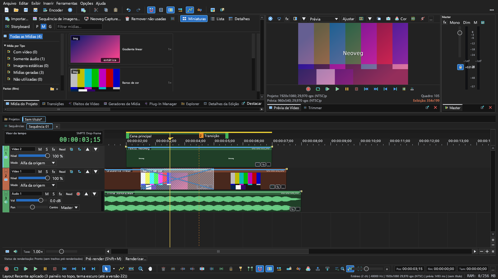

# Neoveg

Editor de vídeo não-linear (NLE) escrito em **Rust puro**, com interface nativa em português (`eframe` + `wgpu` com fallback automático para `glow`), semântica operacional inspirada no VEGAS Pro e política estrita de **zero pânico em produção**.

## Imagens



| Efeitos de Vídeo | Geradores de Mídia |
|---|---|
|  |  |


As imagens mostram só a interface do Neoveg, com mídia gerada pelo próprio programa.

## Arquitetura do Workspace (5 Crates)

- **`neoveg_common`** (`crates/neoveg_common`): tipos fundamentais, representação exata de tempo (`Ticks`, `FrameRate`, `Rate`, *SMPTE Drop-Frame*), curvas, preferências e utilitários base.
- **`neoveg_engine`** (`crates/neoveg_engine`): estado da timeline, invariantes de edição atômica, mixer multifaixa com até 26 barramentos auxiliares (`Bus A`..`Bus Z`), processamento DSP via `fundsp`, *varispeed* com `rubato`, compositor de vídeo, efeitos/transições, escopos, persistência `.neoveg`/`.nvp`, intercâmbio em Sala Limpa (OpenTimelineIO, FCPXML, FCP7 XML, EDL CMX 3600, AAF, SRT/WebVTT), *Surround* 5.1, host isolado de plug-ins OFX/VST3 (`neoveg --plugin-host`), decodificação de áudio em Rust puro (leitor WAVE/AIFF próprio, `claxon`, `lewton`, `puremp3`), contrato unificado de decodificação de sistema (`media/system.rs`) com backend Windows Media Foundation (`media/mf.rs`) e **Tabela Única de Comandos**.
- **`neoveg_scripting`** (`crates/neoveg_scripting`): automação headless (`--command`, `--list-commands`) e ponte sob demanda para scripts `.NET`/`C#` (`.cs`/`.dll`) compatíveis com `ScriptPortal.Vegas` (Clean Room) via `netcorehost`.
- **`neoveg_ui`** (`crates/neoveg_ui`): interface desktop nativa em `eframe` + `wgpu`, timeline interativa, dock flexível em `egui_tiles` com janelas destacáveis e testes de interação `egui_kittest`, 7 temas visuais (incluindo 2 temas de Alto Contraste WCAG AAA), gerenciador de layouts `.neoveglayout` e editores de atalhos e preferências.
- **`neoveg`** (`crates/neoveg`): binário principal e interface CLI com inicialização do pool `rayon` proporcional ao hardware.

## Recursos Implementados

- **Timeline, Áudio e Edição VEGAS Pro:** múltiplas trilhas A/V, mixer com até 26 barramentos auxiliares (`Bus A`..`Bus Z`) + *Master Bus* (`Mono`/`Dim -20 dB`, envios *pre/post-fader* e roteamento acíclico), DSP com `fundsp`, auto-crossfade ao sobrepor eventos na mesma faixa, alças de fade nos cantos superiores, alça de ganho em dB no topo de eventos de áudio, playhead físico de `1 px`, controle contínuo de taxa (*Playback Rate* com reamostragem *Sinc* via `rubato`), divisão (`S`), marcações (`M`), regiões (`R`), *Auto Ripple* (`Ctrl+L`), encaixe (`F8`) e *scrub* (`J`/`K`/`L`). *Adjustment Track* (`insert.track_adjustment`), *Surround Panner* 5.1 (Master estéreo/5.1, LFE, downmix ITU e render WAV de 6 canais) e medidores de Loudness EBU R128.
- **Quadros-chave de trilha na linha do tempo:** os quadros-chave dos efeitos de vídeo da trilha e do *Track Motion* aparecem em linhas abaixo da trilha de vídeo; arrastar muda a posição (com encaixe e sem passar dos vizinhos), o clique direito adiciona, exclui e muda a interpolação (*Track Motion*), e o botão de quadro-chave no cabeçalho expande ou recolhe a área (manual do VEGAS Pro 21, p. 389).
- **Takes múltiplos por evento:** um evento guarda várias mídias alternativas (takes), cada uma com o seu ponto de início e nome; *Adicionar como take aos eventos selecionados* (menu da Mídia do projeto) torna a nova mídia o take ativo e mantém a anterior, `T`/`Shift+T` trocam para o próximo/anterior, o submenu *Take* do evento escolhe o ativo numa lista e exclui o ativo, e *Opções → Slip em todos os takes* faz o slip deslocar todos os takes. Dividir e aparar mantêm os takes sincronizados; render e exportadores usam o take ativo (manual do VEGAS Pro 21, pp. 346–348).
- **Plug-ins externos (Windows):** descoberta de VST3/OFX nas pastas padrão no *Plug-In Manager*; efeitos de vídeo OFX (keyframes de parâmetros, avaliação no host via `getValueAtTime`/`getDerivative`/`getIntegral` e tempo na taxa do projeto) e efeitos de áudio VST3 (eventos, trilhas, barramentos e Master, com persistência de estado `IComponent::getState`/`setState` e compensação automática de latência PDC) processados no subprocesso isolado `neoveg --plugin-host`, de modo que uma falha do plug-in não derruba o editor.
- **Tabela Única de Comandos, Atalhos e Scripting `.NET`:** menus, barra de ferramentas, atalhos e comandos CLI despacham pelo mesmo `id`; atalhos personalizados podem ser gravados/limpos em *Ajuda → Atalhos de teclado*, e scripts `.cs`/`.dll` (`ScriptPortal.Vegas` Clean Room) podem ser executados sob demanda via *Ferramentas → Executar script (.cs/.dll)...* (`tools.run_script`) ou `--run-script`. A API dos scripts segue os nomes da *VEGAS Pro Scripting API Summary* (documentação pública da MAGIX) e do FAQ do manual, com implementação própria: projeto, trilhas (nome, Mute/Solo, seleção, `Events`), eventos (`Start`/`Length`/`End`, nome, Mute, Locked, seleção, `FadeIn`/`FadeOut`; mover entre trilhas do mesmo tipo e apagar), marcadores, `Vegas.Cursor`, `Transport.CursorPosition`/`SelectionStart`/`SelectionLength` e `Timecode` em ticks exatos com operadores, mídia do projeto (`Project.MediaPool`, `Media`, `VideoStream`/`AudioStream`) e takes (`Takes`, `ActiveTake`, `AddTake`, `Take.Offset`/`Name`/`MediaPath`), além de criar eventos com `AddVideoEvent`/`AddAudioEvent` + `AddTake` e importar um arquivo novo com `MediaPool.AddMedia` ou `new Media(path)` (o arquivo é aberto pelo Neoveg durante o script e só entra no projeto se o script terminar sem erro; até 64 por execução). No Windows, os scripts podem usar o `System.Windows.Forms` real (caixas de mensagem, diálogos de arquivo e janelas próprias), com o runtime `Microsoft.WindowsDesktop.App` e numa thread STA; no Linux e no macOS, uma camada própria está planejada. Ainda não: efeitos, envelopes e extensões.
- **Personalização e Acessibilidade:** 7 temas selecionáveis em *Exibir → Tema* ou *Opções → Preferências...* (incluindo *Alto Contraste AAA Escuro* e *Claro* com contraste >= 7:1), **Editar → Propriedades → Layout** com os três tipos clássicos de disposição (*Clássico*, *Intermediário* e *Atual*, o padrão, em 3 colunas com **Prévia de Vídeo**, **Master Bus** dedicado e abas na base via `egui_tiles`), **Tela de abertura (Splash Screen)** (`crates/neoveg_ui/src/splash.rs`), **Tela de boas-vindas (Welcome Screen)** estilo VEGAS com navegação lateral (*Novo Projeto*, *Abrir Projeto* com **Projetos recentes** persistidos, *Primeiros Passos*), banner vetorial original de câmera, seletor de 5 proporções (`16:9`, `4:3`, `9:16`, `1:1`, `2.4:1`) e combos de resolução/taxa de quadros + *Drop Frame* (`crates/neoveg_ui/src/welcome.rs`), painel acoplável **Color Grading** ligado ao `FxKind::ColorCorrector` (`crates/neoveg_ui/src/color_grading.rs`), janela **Renderizar como...** em 2 colunas com modelos e favoritos, 73 ícones vetoriais nativos coloridos (`crates/neoveg_ui/src/icons.rs`), barra inferior de transporte/edição na ordem do manual (Excluir, Aparar, Aparar início/fim, Dividir, Travar, Inserir marcador/região, Encaixe, Ripple automático, Ignorar agrupamento e Color Grading) com seleção `In`/`Fim`/`Tam`, painéis acopláveis/destacáveis em janelas nativas e 4 presets + arquivos `.neoveglayout` salvos pelo usuário.
- **Neoveg Encoder (Fila de Codificação em Lote e Múltiplas Saídas):** painel acoplável/destacável (*Exibir → Neoveg Encoder*, `Ctrl+Alt+M` e *Arquivo → Enviar para o Neoveg Encoder...*, `Ctrl+Shift+M`) e CLI `--encode` integrados aos 7 temas VEGAS Pro: fila persistente (`encoder/queue.json`) com múltiplas saídas paralelas por origem, painel *Codificação* ao vivo com miniatura e ETA, pausa cooperativa e interrupção seletiva/total, *Navegador de Predefinições* (sistema, personalizadas `.neovegpreset`, grupos e apelidos), *Pastas Monitoradas* (*Watch Folders* com disparo automático e anti-sobrescrita), janela *Configurações de Exportação* (intervalo `In`/`Out`, corte/Crop com bloqueio de proporção, 5 modos de escala de origem e prévia *Origem/Saída*), efeitos de pré-codificação (correção de cor, tabela LUT `.cube` 1D/3D em sala limpa, sobreposição de imagem/nome/timecode SMPTE e Ajustador de Tempo) e logs em `logs/neoveg_encoder*.log`.
- **Formatos Suportados:**
  - **Intercâmbio (Rust puro, Sala Limpa):** OpenTimelineIO `.otio` (esquema 0.17), Final Cut Pro XML `.fcpxml`, Final Cut Pro 7 XML `.xml` (`xmeml`), AAF `.aaf`, EDL CMX 3600 `.edl` e legendas SubRip `.srt` / W3C WebVTT `.vtt` (importação e exportação). Disponível em *Arquivo → Intercâmbio & Legendas* e por arrastar-e-soltar; as edições das especificações usadas estão em [`crates/neoveg_engine/README.md`](crates/neoveg_engine/README.md).
  - **Rust puro (multiplataforma):**
    - *Projetos e vídeo:* `.neoveg` (e legado `.nvp`), `AVI` (importação `MJPEG`/`DIB RGB24/32`/`YUY2`/`UYVY`/`I420` + PCM/G.711; exportação `AVI MJPEG` e `AVI Não Comprimido RGB24`), `Y4M`, `GIF` animado (importação e exportação).
    - *Imagens e sequências:* `PNG`, `JPEG`, `BMP`, `TIFF`, `WebP` (estático e animado), `GIF`, `TGA`/`ICB`/`VDA`/`VST`, `ICO`/`CUR`, `PNM` (`PBM`/`PGM`/`PPM`/`PAM`), `Radiance HDR`, `DDS`, `Farbfeld`, `QOI`, `OpenEXR` (`.exr`), `DPX` (`.dpx`), `Kodak Cineon` (`.cin`), `WBMP`, `XBM`, `XPM` e `Amiga IFF/ILBM` (`.iff`/`.ilbm`/`.lbm`), além de captura e renderização em sequência para 10 formatos (`PNG`, `JPEG`, `TIFF`, `TGA`, `BMP`, `WebP`, `PNM`, `QOI`, `DPX`, `EXR`).
    - *Áudio:* `WAV` / `BWF` / `RF64` (PCM, Float32, ITU-T G.711 µ-law/A-law, IMA/DVI ADPCM), `AIFF`/`AIFC` (importação e exportação), `Sun/NeXT AU/SND`, `Apple CAF`, `Sony Wave64` (`.w64`), `Creative VOC`, `Amiga IFF 8SVX` (PCM 8b e Fibonacci Delta), `QOA` (`.qoa`), `FLAC` (`claxon`), `Ogg Vorbis` (`.ogg`, `.oga`, `lewton`) e `MP3` (`puremp3`).
  - **Windows nativo (Media Foundation):** importação/decodificação em streaming de `MP4`, `MOV`, `MKV`, `WEBM`, `M4V`, `M4A`, `AAC`, `WMV`, `ASF`, `WMA`, `3GP`, `3G2`, `M2TS`, `MTS`, `TS`, `MPG`, `MPEG`, `MPE`, `VOB`, `MP2`, `MPA`, `M4B` e `ALAC`; exportação nativa via `IMFSinkWriter` para `MP4 (H.264/HEVC + AAC)`, `MOV (H.264 + AAC)`, `3GP (H.264 + AAC)`, `WMV` e áudio `M4A (AAC)`, `AAC (ADTS)`, `WMA` e `MP3`.
  - **Conversão para formato compatível (Windows):** quando um arquivo não abre diretamente (extensão fora da lista ou codec que os leitores próprios não decodificam, como um AVI que não é MJPEG), o Neoveg oferece convertê-lo com o decodificador do sistema para AVI MJPEG + PCM (vídeo) ou WAV 24 bits (só áudio) e importa o resultado na mesma posição; também em *Arquivo → Converter mídia para formato compatível...*. O destino é escolhido no diálogo, o arquivo é gravado como `.part` até terminar, o AVI é gravado com as extensões OpenDML (sem o limite de 4 GB; até ~250 GB, e a qualidade JPEG cai de 90 até 50 só se for preciso para caber, com aviso), e nada é preenchido ou cortado em silêncio (`media/convert.rs`). (`ffmpeg`/`ffprobe` são utilizados exclusivamente como oráculos de teste externos e geradores de fixtures em `target/fixtures/`, nunca linkados nem distribuídos.) (`ffmpeg`/`ffprobe` são utilizados exclusivamente como oráculos de teste externos e geradores de fixtures em `target/fixtures/`, nunca linkados nem distribuídos.)
- **Relatório quando o programa não fecha normalmente:** cada sessão da interface mantém um marcador travado em `logs/sessoes/`; na abertura seguinte a uma queda (erro interno, fechamento forçado, falta de energia), a janela *O Neoveg não foi fechado normalmente* diz o que aconteceu (o erro e o local, ou que o programa foi fechado sem aviso), lista os erros isolados daquela sessão, oferece a recuperação do projeto salvo automaticamente e permite copiar o relatório ou abrir a pasta de logs. Duas instâncias abertas ao mesmo tempo não contam como queda, e os pânicos de outras instâncias e dos hosts de plug-in não entram no relatório.
- **Hardware Limitado:** resoluções de prévia (*Rascunho / Prévia / Boa / Melhor*), geração de proxies `.avi`, pré-renderização seletiva de região, limite configurável de RAM/quadros em cache e compilação portátil sem `-C target-cpu=native`.

## Como Executar

```bash
# Abrir interface gráfica (opcionalmente passando um projeto ou mídia)
cargo run -p neoveg
cargo run -p neoveg -- meu_projeto.neoveg

# Interface de linha de comando (CLI)
cargo run -p neoveg -- --list-commands
cargo run -p neoveg -- --command insert.marker meu_projeto.neoveg atualizado.neoveg
cargo run -p neoveg -- --run-script meu_script.cs
cargo run -p neoveg -- --render meu_projeto.neoveg saida.avi
cargo run -p neoveg -- --encode entrada.mp4 saida.mp4 sys.web_1080p_hq
```

Logs, autosave, preferências (`preferencias.json`), layouts (`.neoveglayout`), proxies e pré-renderizações são gravados ao lado do executável em builds portáteis (ou na pasta temporária do sistema quando executado em diretório somente leitura).

## Como usar

### Primeiros passos

1. Abra o Neoveg (`cargo run -p neoveg` ou o executável do pacote portátil). A tela de boas-vindas oferece *Novo Projeto* (com proporção, resolução e taxa de quadros) e *Abrir Projeto*, com a lista de projetos recentes.
2. Importe a mídia com *Arquivo → Importar mídia...* (`Ctrl+I`) ou arrastando arquivos para a janela. A mídia aparece em *Mídia do Projeto*; arraste-a para a linha do tempo ou dê um duplo clique para adicioná-la no cursor.
3. Salve com `Ctrl+S`. O projeto é um arquivo `.neoveg`; o salvamento automático protege o trabalho e, se o programa fechar sem aviso, a próxima abertura oferece a recuperação.

Arquivos que o Neoveg não abre diretamente podem ser convertidos para um formato compatível (no Windows): o programa oferece a conversão ao importar, ou use *Arquivo → Converter mídia para formato compatível...*.

### Editar na linha do tempo

| Ação | Atalho |
|---|---|
| Reproduzir / pausar | `Espaço` |
| Reproduzir do início | `Shift+Espaço` |
| Parar | `Esc` |
| Scrub para trás, pausar, para frente | `J`, `K`, `L` |
| Quadro anterior / próximo | `Alt+←` / `Alt+→` |
| Dividir o evento no cursor | `S` |
| Aparar início / fim do evento no cursor | `Alt+[` / `Alt+]` |
| Aparar para a seleção de tempo | `Ctrl+T` |
| Excluir | `Delete` |
| Agrupar / desagrupar | `G` / `U` |
| Inserir marcador / região | `M` / `R` |
| Mudo / solo na trilha selecionada | `Z` / `X` |
| Encaixe (snapping) | `F8` |
| Ripple automático | `Ctrl+L` |
| Zoom da linha do tempo | `↑` / `↓` |
| Desfazer / refazer | `Ctrl+Z` / `Ctrl+Y` |
| Propriedades do evento | `F2` |

- A barra de transporte e edição, abaixo da linha do tempo, tem os mesmos comandos em botões, na ordem do manual do VEGAS Pro, e as caixas *Pos*, *Fim* e *Tam* da seleção de tempo.
- Eventos que se sobrepõem na mesma trilha ganham crossfade automático; as alças nos cantos superiores do evento ajustam os fades.
- O botão *Mais* (`…`) do cabeçalho de cada trilha reúne os comandos da trilha e permite escolher quais botões ficam visíveis.
- Todos os atalhos podem ser trocados em *Ajuda → Atalhos de teclado*.

### Takes

Um evento pode ter várias mídias alternativas (takes). Na *Mídia do Projeto*, clique com o botão direito numa mídia e use *Adicionar como take aos eventos selecionados*; `T` e `Shift+T` trocam para o próximo take e para o anterior, e o submenu *Take* do evento escolhe o take ativo.

### Efeitos e geradores

- **Efeitos de Vídeo:** escolha a categoria no alto ou busque pelo nome, clique no efeito e arraste a miniatura do preset para um evento ou uma trilha, ou use os botões *Eventos*, *Trilha* e *Master*. A estrela marca o efeito como favorito.
- **Geradores de Mídia:** texto, títulos, cores sólidas, gradientes e padrões de teste. Arraste a miniatura para a linha do tempo ou use *Inserir no cursor*; o editor do gerador abre para ajustar texto, fonte, cores e animação.
- **Plug-ins externos (Windows):** efeitos OFX e VST3 instalados aparecem no *Plug-In Manager* e rodam num processo isolado, então uma falha do plug-in não fecha o editor.

### Layout e aparência

- *Editar → Propriedades → Layout* escolhe a disposição (*Clássico*, *Intermediário* ou *Atual*) e a posição da área de janelas e das abas.
- Os painéis podem ser arrastados pela aba para outra posição ou destacados em janela própria.
- *Exibir → Tema* tem 7 temas, inclusive dois de Alto Contraste AAA.

### Renderizar

*Arquivo → Renderizar como...* (`Ctrl+M`) abre a lista de formatos e modelos (AVI Motion-JPEG, sequência de imagens PNG, Y4M e WAV), com favoritos e a opção de renderizar só a região de loop. Pela linha de comando: `neoveg --render projeto.neoveg saida.avi`.

### Scripts

*Ferramentas → Executar script (.cs/.dll)...* executa scripts C# no formato dos scripts do VEGAS Pro (exige o .NET instalado). O script pode ler e alterar trilhas, eventos, takes, marcadores, cursor e seleção, e importar mídia; tudo o que ele muda vira um único passo de Desfazer. Pela linha de comando: `neoveg --run-script meu_script.cs`.

## Empacotamento Portátil e Verificações de Qualidade

```bash
cargo fmt --all -- --check
cargo clippy --workspace --all-targets -- -D warnings
cargo test --workspace
python tools/check_licenses.py
python build_portable.py
```

O script `build_portable.py` gera o pacote portátil em `<target-dir>/portable/neoveg-portable/` (a pasta de build do cargo, que respeita `CARGO_TARGET_DIR`) sem dependência de instalador, fontes proprietárias ou binários externos.

## Acompanhamento de Paridade

- [Roadmap](ROADMAP.md)
- [Matriz de Paridade VEGAS Pro](docs_obsidian/ui_references/matriz_de_paridade.md)
- [Atribuição e Licenças de Assets](ATTRIBUTION.md)

## Licença

O Neoveg é distribuído sob licença dupla, à sua escolha:

- MIT ([LICENSE-MIT](LICENSE-MIT))
- Apache 2.0 ([LICENSE-APACHE](LICENSE-APACHE))

Salvo declaração explícita em contrário, toda contribuição enviada para inclusão no projeto é licenciada
sob esses mesmos termos, sem condições adicionais.
