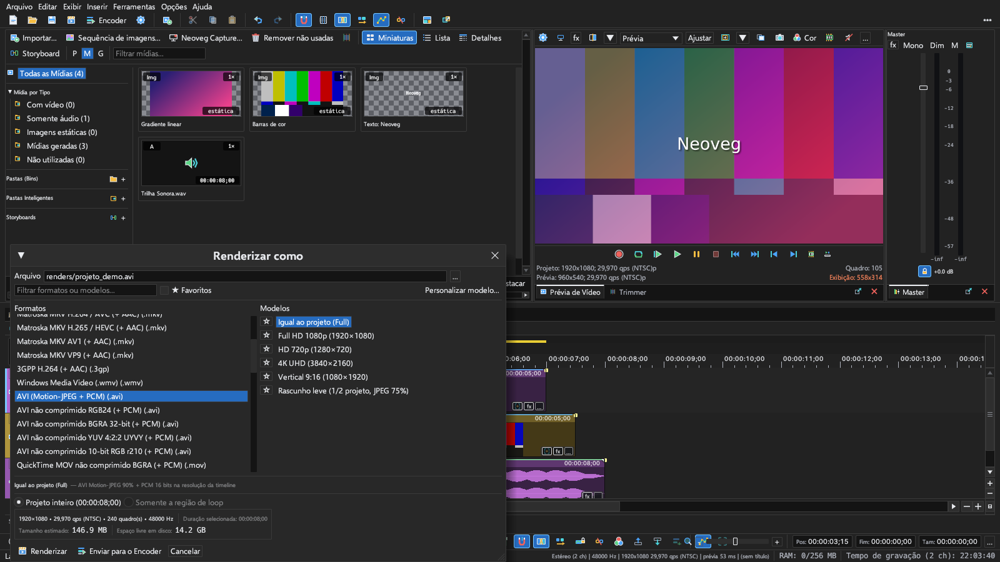

# Neoveg

Editor de vídeo não-linear (NLE) escrito em **Rust puro**, com interface nativa em português (`eframe` + `wgpu` com fallback automático para `glow`), semântica operacional inspirada no VEGAS Pro e política estrita de **zero pânico em produção**.

## Imagens


| Tela de Boas-Vindas | Renderizar como... |
|---|---|
|  |  |

| Efeitos de Vídeo | Geradores de Mídia |
|---|---|
|  |  |

| Color Grading | Escopos de Vídeo |
|---|---|
|  |  |

| Mixer e Barramentos Auxiliares | Surround Panner 5.1 |
|---|---|
|  |  |

| Medidores de Loudness (EBU R128) | Propriedades do Evento |
|---|---|
|  |  |


As imagens mostram só a interface do Neoveg, com mídia sintética gerada pelo próprio programa (gradiente, barras de cor, texto e áudio senoidal).

## Arquitetura do Workspace (5 Crates)

- **`neoveg_common`** (`crates/neoveg_common`): tipos fundamentais, representação exata de tempo (`Ticks`, `FrameRate`, `Rate`, *SMPTE Drop-Frame*), curvas, preferências e utilitários base.
- **`neoveg_engine`** (`crates/neoveg_engine`): estado da timeline, invariantes de edição atômica, mixer multifaixa com até 26 barramentos auxiliares (`Bus A`..`Bus Z`), processamento DSP via `fundsp`, *varispeed* com `rubato`, compositor de vídeo, efeitos/transições, escopos, persistência `.neoveg`/`.nvp`, intercâmbio em Sala Limpa (OpenTimelineIO, FCPXML, FCP7 XML, EDL CMX 3600, AAF, SRT/WebVTT), *Surround* 5.1, host isolado de plug-ins OFX/VST3 (`neoveg --plugin-host`), decodificação de áudio em Rust puro (leitor WAVE/AIFF próprio, `claxon`, `lewton`, `puremp3`), contrato unificado de decodificação de sistema (`media/system.rs`) com backend Windows Media Foundation (`media/mf.rs`) e **Tabela Única de Comandos**.
- **`neoveg_scripting`** (`crates/neoveg_scripting`): automação headless (`--command`, `--list-commands`) e ponte sob demanda para scripts `.NET`/`C#` (`.cs`/`.dll`) compatíveis com `ScriptPortal.Vegas` (Clean Room) via `netcorehost`.
- **`neoveg_ui`** (`crates/neoveg_ui`): interface desktop nativa em `eframe` + `wgpu`, timeline interativa, dock flexível em `egui_tiles` com janelas destacáveis e testes de interação `egui_kittest`, 7 temas visuais (incluindo 2 temas de Alto Contraste WCAG AAA), gerenciador de layouts `.neoveglayout` e editores de atalhos e preferências.
- **`neoveg`** (`crates/neoveg`): binário principal e interface CLI com inicialização do pool `rayon` proporcional ao hardware.

## Recursos Implementados

- **Timeline, Áudio e Edição VEGAS Pro:** múltiplas trilhas A/V, mixer com até 26 barramentos auxiliares (`Bus A`..`Bus Z`) + *Master Bus* (`Mono`/`Dim -20 dB`, envios *pre/post-fader* e roteamento acíclico), DSP com `fundsp`, auto-crossfade ao sobrepor eventos na mesma faixa, alças de fade nos cantos superiores, alça de ganho em dB no topo de eventos de áudio, playhead físico de `1 px`, controle contínuo de taxa (*Playback Rate* com reamostragem *Sinc* via `rubato`), divisão (`S`), marcações (`M`), regiões (`R`), *Auto Ripple* (`Ctrl+L`), encaixe (`F8`) e *scrub* (`J`/`K`/`L`). *Adjustment Track* (`insert.track_adjustment`), *Surround Panner* 5.1 (Master estéreo/5.1, LFE, downmix ITU e render WAV de 6 canais) e medidores de Loudness EBU R128.
- **Quadros-chave de trilha na linha do tempo:** os quadros-chave dos efeitos de vídeo da trilha e do *Track Motion* aparecem em linhas abaixo da trilha de vídeo; arrastar muda a posição (com encaixe e sem passar dos vizinhos), o clique direito adiciona, exclui e muda a interpolação (*Track Motion*), e o botão de quadro-chave no cabeçalho expande ou recolhe a área (manual do VEGAS Pro 21, p. 389).
- **Takes múltiplos por evento:** um evento guarda várias mídias alternativas (takes), cada uma com o seu ponto de início e nome; *Adicionar como take aos eventos selecionados* (menu da Mídia do projeto) torna a nova mídia o take ativo e mantém a anterior, `T`/`Shift+T` trocam para o próximo/anterior, o submenu *Take* do evento escolhe o ativo numa lista e exclui o ativo, e *Opções → Slip em todos os takes* faz o slip deslocar todos os takes. Dividir e aparar mantêm os takes sincronizados; render e exportadores usam o take ativo (manual do VEGAS Pro 21, pp. 346–348).
- **Plug-ins externos (Windows):** descoberta de VST3/OFX nas pastas padrão no *Plug-In Manager*; efeitos de vídeo OFX (keyframes de parâmetros, avaliação no host via `getValueAtTime`/`getDerivative`/`getIntegral` e tempo na taxa do projeto) e efeitos de áudio VST3 (eventos, trilhas, barramentos e Master, com persistência de estado `IComponent::getState`/`setState` e compensação automática de latência PDC) processados no subprocesso isolado `neoveg --plugin-host`, de modo que uma falha do plug-in não derruba o editor.
- **Tabela Única de Comandos, Atalhos e Scripting `.NET`:** menus, barra de ferramentas, atalhos e comandos CLI despacham pelo mesmo `id`; atalhos personalizados podem ser gravados/limpos em *Ajuda → Atalhos de teclado*, e scripts `.cs`/`.dll` (`ScriptPortal.Vegas` Clean Room) podem ser executados sob demanda via *Ferramentas → Executar script (.cs/.dll)...* (`tools.run_script`) ou `--run-script`. A API dos scripts segue os nomes da *VEGAS Pro Scripting API Summary* (documentação pública da MAGIX) e do FAQ do manual, com implementação própria: projeto, trilhas (nome, Mute/Solo, seleção, `Events`), eventos (`Start`/`Length`/`End`, nome, Mute, Locked, seleção, `FadeIn`/`FadeOut`; mover entre trilhas do mesmo tipo e apagar), marcadores, `Vegas.Cursor`, `Transport.CursorPosition`/`SelectionStart`/`SelectionLength` e `Timecode` em ticks exatos com operadores, mídia do projeto (`Project.MediaPool`, `Media`, `VideoStream`/`AudioStream`) e takes (`Takes`, `ActiveTake`, `AddTake`, `Take.Offset`/`Name`/`MediaPath`), além de criar eventos com `AddVideoEvent`/`AddAudioEvent` + `AddTake` e importar um arquivo novo com `MediaPool.AddMedia` ou `new Media(path)` (o arquivo é aberto pelo Neoveg durante o script e só entra no projeto se o script terminar sem erro; até 64 por execução). No Windows com runtime `Microsoft.WindowsDesktop.App`, os scripts usam o `System.Windows.Forms` real numa thread STA; no Linux, macOS e em ambientes sem `WindowsDesktop`, os diálogos e formulários (`MessageBox`, `Form.ShowDialog` e seletores de arquivo) funcionam pela camada própria em `crates/neoveg_ui/src/script_forms.rs`. Ainda não: efeitos, envelopes e extensões.
- **Personalização e Acessibilidade:** 7 temas selecionáveis em *Exibir → Tema* ou *Opções → Preferências...* (incluindo *Alto Contraste AAA Escuro* e *Claro* com contraste >= 7:1), **Editar → Propriedades → Layout** com os três tipos clássicos de disposição (*Clássico*, *Intermediário* e *Atual*, o padrão, em 3 colunas com **Prévia de Vídeo**, **Master Bus** dedicado e abas na base via `egui_tiles`), **Tela de abertura (Splash Screen)** (`crates/neoveg_ui/src/splash.rs`), **Tela de boas-vindas (Welcome Screen)** estilo VEGAS com navegação lateral (*Novo Projeto*, *Abrir Projeto* com **Projetos recentes** persistidos, *Primeiros Passos*), banner vetorial original de câmera, seletor de 5 proporções (`16:9`, `4:3`, `9:16`, `1:1`, `2.4:1`) e combos de resolução/taxa de quadros + *Drop Frame* (`crates/neoveg_ui/src/welcome.rs`), painel acoplável **Color Grading** ligado ao `FxKind::ColorCorrector` (`crates/neoveg_ui/src/color_grading.rs`), janela **Renderizar como...** em 2 colunas com modelos e favoritos, 74 ícones vetoriais nativos coloridos (`crates/neoveg_ui/src/icons.rs`), barra inferior de transporte/edição na ordem do manual (Excluir, Aparar, Aparar início/fim, Dividir, Travar, Inserir marcador/região, Encaixe, Ripple automático, Ignorar agrupamento e Color Grading) com seleção `In`/`Fim`/`Tam`, painéis acopláveis/destacáveis em janelas nativas (arrastar a aba mostra 5 alvos de encaixe, meio e 4 lados, e soltar fora da área destaca; duplo clique maximiza o painel; `F11`, `Shift+F11` e `Ctrl+F11` minimizam a área de janelas, a lista de trilhas e maximizam a timeline) e 4 presets + arquivos `.neoveglayout` salvos pelo usuário.
- **Neoveg Encoder (Fila de Codificação em Lote e Múltiplas Saídas):** painel acoplável/destacável (botão **Encoder** na barra superior, *Exibir → Neoveg Encoder* `Ctrl+Alt+M`, botão **Enviar para o Encoder** em *Renderizar como...* e *Arquivo → Enviar para o Neoveg Encoder...* `Ctrl+Shift+M`) e CLI `--encode` integrados aos 7 temas VEGAS Pro: fila persistente (`encoder/queue.json`) com múltiplas saídas paralelas por origem, painel *Codificação* ao vivo com miniatura e ETA, pausa cooperativa e interrupção seletiva/total, *Navegador de Predefinições* (sistema, personalizadas `.neovegpreset`, grupos e apelidos), *Pastas Monitoradas* (*Watch Folders* com disparo automático e anti-sobrescrita), janela *Configurações de Exportação* (intervalo `In`/`Out`, corte/Crop com bloqueio de proporção, 5 modos de escala de origem e prévia *Origem/Saída*), efeitos de pré-codificação (correção de cor, tabela LUT `.cube` 1D/3D em sala limpa, sobreposição de imagem/nome/timecode SMPTE e Ajustador de Tempo) e logs em `logs/neoveg_encoder*.log`.
- **Integração ArtCraft & Blender (*Ferramentas → Integrações*):** descoberta automática e caminhos manuais (*Preferências → Aplicativos externos*) para **PhotoCraft**, **VectorCraft**, **FilmCraft**, **EffectCraft**, **AniCraft**, **SoundCraft** e **Blender**. Inclui fluxo *Round-Trip* de cópias editáveis como *Takes* (PNG para PhotoCraft, SVG limpo para VectorCraft e BWF WAV com `bext` `TimeReference` para SoundCraft com recarga automática ao salvar), cliente TCP loopback (`127.0.0.1`) com autenticação HMAC-SHA256 para apps ArtCraft em execução, exportação OTIO para FilmCraft, renderização headless de cenas `.anicraft`, `.ecproj` e `.blend` direto para sequências PNG na timeline, geração de script `.py` de sincronização de FPS/marcadores/Pan-Crop e importação de câmera Blender (`.json`) para keyframes de *Track Motion* / *Pan/Crop*.
- **Formatos Suportados:**
  - **Intercâmbio (Rust puro, Sala Limpa):** OpenTimelineIO `.otio` (esquema 0.17), Final Cut Pro XML `.fcpxml`, Final Cut Pro 7 XML `.xml` (`xmeml`), AAF `.aaf`, EDL CMX 3600 `.edl` e legendas SubRip `.srt` / W3C WebVTT `.vtt` (importação e exportação). Disponível em *Arquivo → Intercâmbio & Legendas* e por arrastar-e-soltar; as edições das especificações usadas estão em [`crates/neoveg_engine/README.md`](crates/neoveg_engine/README.md).
  - **Rust puro (multiplataforma):**
    - *Projetos e vídeo:* `.neoveg` (e legado `.nvp`), `AVI` (importação `MJPEG`/`DIB RGB24/32`/`YUY2`/`UYVY`/`I420` + PCM/G.711; exportação `AVI MJPEG` e `AVI Não Comprimido RGB24`), `Y4M`, `GIF` animado (importação e exportação). Demuxer de contêineres `MP4`/`MOV`/`MKV`/`WEBM` (`media/demux/`).
    - *Imagens e sequências:* `PNG`, `JPEG`, `BMP`, `TIFF`, `WebP` (estático e animado), `GIF`, `TGA`/`ICB`/`VDA`/`VST`, `ICO`/`CUR`, `PNM` (`PBM`/`PGM`/`PPM`/`PAM`), `Radiance HDR`, `DDS`, `Farbfeld`, `QOI`, `OpenEXR` (`.exr`), `DPX` (`.dpx`), `Kodak Cineon` (`.cin`), `WBMP`, `XBM`, `XPM` e `Amiga IFF/ILBM` (`.iff`/`.ilbm`/`.lbm`), além de captura e renderização em sequência para 10 formatos (`PNG`, `JPEG`, `TIFF`, `TGA`, `BMP`, `WebP`, `PNM`, `QOI`, `DPX`, `EXR`).
    - *Áudio:* `WAV` / `BWF` / `RF64` (PCM, Float32, ITU-T G.711 µ-law/A-law, IMA/DVI ADPCM), `AIFF`/`AIFC` (importação e exportação), `Sun/NeXT AU/SND`, `Apple CAF`, `Sony Wave64` (`.w64`), `Creative VOC`, `Amiga IFF 8SVX` (PCM 8b e Fibonacci Delta), `QOA` (`.qoa`), `FLAC` (`claxon`), `Ogg Vorbis` (`.ogg`, `.oga`, `lewton`) e `MP3` (`puremp3`).
  - **Windows nativo (Media Foundation):** importação/decodificação em streaming de `MP4`, `MOV`, `MKV`, `WEBM`, `M4V`, `M4A`, `AAC`, `WMV`, `ASF`, `WMA`, `3GP`, `3G2`, `M2TS`, `MTS`, `TS`, `MPG`, `MPEG`, `MPE`, `VOB`, `MP2`, `MPA`, `M4B` e `ALAC`; exportação nativa via `IMFSinkWriter` para `MP4 (H.264/HEVC + AAC)`, `MOV (H.264 + AAC)`, `3GP (H.264 + AAC)`, `WMV` e áudio `M4A (AAC)`, `AAC (ADTS)`, `WMA` e `MP3`.
  - **Conversão para formato compatível (Windows):** quando um arquivo não abre diretamente (extensão fora da lista ou codec que os leitores próprios não decodificam, como um AVI que não é MJPEG), o Neoveg oferece convertê-lo com o decodificador do sistema para AVI MJPEG + PCM (vídeo) ou WAV 24 bits (só áudio) e importa o resultado na mesma posição; também em *Arquivo → Converter mídia para formato compatível...*. O destino é escolhido no diálogo, o arquivo é gravado como `.part` até terminar, o AVI é gravado com as extensões OpenDML (sem o limite de 4 GB; até ~250 GB, e a qualidade JPEG cai de 90 até 50 só se for preciso para caber, com aviso), e nada é preenchido ou cortado em silêncio (`media/convert.rs`). (`ffmpeg`/`ffprobe` são utilizados exclusivamente como oráculos de teste externos e geradores de fixtures via `tools/gen_media_fixtures.py`, nunca linkados nem distribuídos.)
- **Relatório quando o programa não fecha normalmente:** cada sessão da interface mantém um marcador travado em `logs/sessoes/`; na abertura seguinte a uma queda (erro interno, fechamento forçado, falta de energia), a janela *O Neoveg não foi fechado normalmente* diz o que aconteceu (o erro e o local, ou que o programa foi fechado sem aviso), lista os erros isolados daquela sessão, oferece a recuperação do projeto salvo automaticamente e permite copiar o relatório ou abrir a pasta de logs. Duas instâncias abertas ao mesmo tempo não contam como queda, e os pânicos de outras instâncias e dos hosts de plug-in não entram no relatório.
- **Hardware Limitado:** resoluções de prévia (*Rascunho / Prévia / Boa / Melhor*), geração de proxies `.avi`, pré-renderização seletiva de região, limite configurável de RAM/quadros em cache e compilação portátil sem `-C target-cpu=native`.

## Como Executar

```bash
# Abrir interface gráfica (opcionalmente passando um projeto ou mídia)
cargo run -p neoveg
cargo run -p neoveg -- meu_projeto.neoveg

# Interface de linha de comando (CLI)
cargo run -p neoveg -- --list-commands
cargo run -p neoveg -- --probe-integrations
cargo run -p neoveg -- --command insert.marker meu_projeto.neoveg atualizado.neoveg
cargo run -p neoveg -- --run-script meu_script.cs
cargo run -p neoveg -- --render meu_projeto.neoveg saida.avi
cargo run -p neoveg -- --encode entrada.mp4 saida.mp4 sys.web_1080p_hq
```

Logs, autosave, preferências (`preferencias.json`), layouts (`.neoveglayout`), proxies e pré-renderizações são gravados ao lado do executável em builds portáteis (ou na pasta temporária do sistema quando executado em diretório somente leitura).

## Como usar

### Primeiros passos

1. Abra o Neoveg (`cargo run -p neoveg` ou o executável do pacote portátil). Na **Tela de boas-vindas**, escolha uma das 5 proporções (*Widescreen 16:9*, *Fullscreen 4:3*, *Portrait 9:16*, *Square 1:1* ou *Scope 2.4:1*), ajuste resolução, taxa de quadros e *Drop-Frame*, ou reabra projetos em *Abrir Projeto*. A tela pode ser reaberta em *Ajuda → Tela de boas-vindas*.
2. Importe vídeo, áudio, imagens estáticas ou sequências de imagens com *Arquivo → Importar mídia...* (`Ctrl+I`) ou arrastando os arquivos diretamente para a janela. Os clipes aparecem em *Mídia do Projeto*; arraste-os para a linha do tempo ou dê um duplo clique para inseri-los no cursor. Se desejar marcar pontos *In*/*Out* antes de cortar, use o painel **Trimmer** (`Alt+2`).
3. O formato do primeiro arquivo importado define automaticamente as dimensões e a taxa de quadros do projeto se *Propriedades do projeto* (`Alt+Enter`) ainda não tiver sido alterado manualmente.
4. No Windows, arquivos fora dos codecs suportados diretamente exibem opção automática de conversão segura para `AVI MJPEG + PCM` ou `WAV 24 bits` (*Arquivo → Converter mídia para formato compatível...*).
5. Salve com `Ctrl+S` (ou `Ctrl+Shift+S` / `Ctrl+Alt+S` para versões). O projeto é salvo em `.neoveg` com recuperação automática caso o editor seja fechado inesperadamente.

### Editar na linha do tempo

| Ação | Atalho |
|---|---|
| Reproduzir / pausar / do início / parar | `Espaço` / `Shift+Espaço` / `Esc` |
| Scrub reverso, pausar, avanço | `J`, `K`, `L` |
| Quadro anterior / próximo | `Alt+←` / `Alt+→` |
| Próxima / anterior ferramenta de edição | `D` / `Shift+D` |
| Dividir o evento no cursor | `S` |
| Aparar início / fim do evento no cursor | `Alt+[` / `Alt+]` |
| Aparar para a seleção de tempo | `Ctrl+T` |
| Definir entrada / saída da seleção / loop | `I` / `O` / `Q` (`Shift+Q`) |
| Próximo / anterior take | `T` / `Shift+T` |
| Agrupar / desagrupar / selecionar grupo | `G` / `U` / `Shift+G` |
| Inserir marcador / região | `M` / `R` |
| Envelope de Volume / Pan na trilha | `V` / `P` |
| Mudo / solo na trilha selecionada | `Z` / `X` |
| Inserir trilha de vídeo / áudio / barramentos | `Ctrl+Shift+Q` / `Ctrl+Q` / `Ctrl+B` |
| Encaixe (`snapping`) / Ripple automático | `F8` / `Ctrl+L` |
| Zoom horizontal / formas de onda vertical | `↑` / `↓` (`Shift+↑` / `Shift+↓`) |
| Desfazer / refazer | `Ctrl+Z` / `Ctrl+Y` |
| Propriedades do evento | `F2` |
| Neoveg Encoder / Enviar timeline | `Ctrl+Alt+M` / `Ctrl+Shift+M` |
| Renderizar como... | `Ctrl+M` |

- **Ferramentas e modos de edição (`D` / `Shift+D`):** na barra de transporte e em *Editar → Ferramenta de edição*, alterne entre **Normal** (movimentação e aparo nos modos *Normal* ou *Slip*), **Envelope** (move apenas pontos de envelope), **Seleção** (caixa retangular; `Shift`/`Ctrl` somam) e **Zoom** (caixa aproxima; clique único ajusta o projeto à janela).
- **Fades, ganho e quadros-chave:** sobrepor eventos na mesma trilha cria crossfade automático; as alças nos cantos superiores ajustam fades, a barra superior em clipes de áudio regula ganho em dB, e as linhas abaixo da trilha editam keyframes de *Track Motion* e efeitos de trilha.
- **Cabeçalhos, transporte e edição tabular:** a barra inferior segue a ordem do VEGAS Pro com leitura/edição de `In`, `Fim` e `Tam`, controle de *Playback Rate* (`0.25×`–`4.00×`), botão *Mais* (`…`) no cabeçalho de trilha para configurar os botões visíveis, e painel **Detalhes da Edição** (`Alt+3`) para edição em tabela.

### Takes

Um evento pode guardar múltiplas mídias alternativas (takes). Em *Mídia do Projeto*, clique com o botão direito numa mídia e selecione *Adicionar como take aos eventos selecionados*; alterne o take ativo com `T` / `Shift+T` ou pelo submenu *Take* do evento. Com *Opções → Slip em todos os takes*, ajustes de deslocamento mantêm todas as tomadas sincronizadas.

### Efeitos, geradores, Color Grading e escopos

- **Efeitos de Vídeo, Áudio e Transições:** filtre por categoria ou busca, clique no item e arraste a miniatura do preset para um evento, trilha ou transição, ou aplique pelos botões *Eventos*, *Trilha* e *Master*. Use `★` para favoritar.
- **Geradores de Mídia:** insira texto animado com contorno/sombra, cores sólidas, gradientes, xadrez, barras de cor e ruído pela guia *Geradores de Mídia* (*Inserir no cursor* ou arrastando).
- **Color Grading e Escopos:** abra *Color Grading* (ou clique em **Cor** no cabeçalho da *Prévia de Vídeo*) para ajustar rodas tonais (*Lift*, *Gamma*, *Gain*), pad *Temperatura × Tonalidade*, saturação e predefinições ligadas ao `FxKind::ColorCorrector`. Acompanhe o sinal em tempo real pela aba **Escopos** (*Histograma RGB + luma*, *Forma de onda*, *Vectorscope* e *RGB Parade*).
- **Plug-ins externos (Windows):** gerencie caminhos VST3 e OFX em *Plug-In Manager* (`Ctrl+Alt+1`). Todos os plug-ins rodam no subprocesso isolado `--plugin-host`, preservando estado (`IComponent::getState`/`setState`) e compensação automática de latência (PDC) sem risco ao editor.

### Áudio, Mixer, Surround 5.1 e Loudness

- **Mixer e Barramentos Auxiliares (`Bus A`..`Bus Z`):** clique em **＋ Barramento** no *Mixer* ou use *Inserir → Barramento de áudio* para criar até 26 barramentos com envios *pre/post-fader* e visualização na timeline (`Ctrl+B`).
- **Master Bus:** o painel à direita mantém monitoração estéreo com controles `fx`, `Mono`, `Dim` (`-20 dB`) e `M` (mudo).
- **Surround Panner 5.1:** na aba *Surround Panner* (ou em *Propriedades do projeto*), alterne o *Modo do Master* para `5.1 Surround`, posicione cada trilha ou barramento no anel ITU-R BS.775, ajuste LFE e renderize em WAV multicanal de 6 canais.
- **Medidores de Loudness EBU R128 (`Ctrl+Alt+7`):** acompanhe `M`, `S`, `I`, `LRA` e `True Peak` com metas configuráveis (*EBU R128 -23 LUFS*, streaming, ATSC, podcast) e varredura offline (*Analisar projeto* / *Analisar seleção*).

### Renderizar

*Arquivo → Renderizar como...* (`Ctrl+M`) abre a janela em 2 colunas com busca, ★ favoritos, resumo do intervalo (*Projeto inteiro* ou *Região de loop*) e todos os **31 formatos de saída** suportados: `MP4 (H.264/HEVC + AAC)`, `MOV`, `3GP` e `WMV` (Windows Media Foundation), `AVI MJPEG` e `AVI Não Comprimido RGB24` (com OpenDML), `GIF` animado, `Y4M`, 10 sequências de imagens (`PNG`, `JPEG`, `TIFF`, `TGA`, `BMP`, `WebP`, `PNM`, `QOI`, `DPX`, `EXR`) e áudio (`WAV`, `BWF`, `RF64`, `Wave64`, `AIFF`, `AU`, `CAF`, `QOA`, `M4A`, `AAC`, `WMA`, `MP3`). Pela mesma janela também é possível clicar em **Enviar para o Encoder** ou executar sem interface via `neoveg --render projeto.neoveg saida.ext`.

### Neoveg Encoder (fila em lote e pastas monitoradas)

O **Neoveg Encoder** pode ser acessado diretamente pelo botão **Encoder** na barra superior, em *Exibir → Neoveg Encoder* (`Ctrl+Alt+M`), em *Ferramentas → Neoveg Encoder*, pelo botão **Enviar para o Encoder** na janela *Renderizar como...*, ou com *Arquivo → Enviar para o Neoveg Encoder...* (`Ctrl+Shift+M`, que envia a timeline ou seleção atual para a fila). Clique em **Destacar** na faixa da aba para utilizá-lo em sua própria janela ampla fora da dock.

- **Painéis (4):** *Fila de Codificação* (múltiplas saídas paralelas por origem, duplicação, reordenação e interpretação de mídia), *Codificação (Ao Vivo)* (miniatura, ETA, pausa cooperativa e interrupção por item ou total), *Navegador de Predefinições* (sistema, `.neovegpreset` personalizadas e grupos multi-saída) e *Pastas Monitoradas* (detecção automática em diretórios de entrada).
- **Configurações de Exportação:** recorte de intervalo `In`/`Out`, *Crop* com trava de proporção, 5 modos de escala, correção de cor, tabela LUT `.cube` 1D/3D, sobreposições de imagem/nome/timecode SMPTE e *Ajustador de Tempo* (%). Também disponível em linha de comando: `neoveg --encode entrada.mp4 saida.mp4 sys.web_1080p_hq`.

### Intercâmbio e legendas

Use *Arquivo → Intercâmbio & Legendas* (ou arraste o arquivo diretamente para o Neoveg) para importar e exportar timelines em **OpenTimelineIO (`.otio`)**, **Final Cut Pro XML (`.fcpxml`)**, **Final Cut Pro 7 XML (`.xml`, `xmeml`)**, **AAF (`.aaf`)**, **EDL CMX 3600 (`.edl`)** e legendas **SubRip (`.srt`)** / **WebVTT (`.vtt`)**.

### Integrações (ArtCraft & Blender)

Acesse *Ferramentas → Integrações (ArtCraft & Blender)...* (ou configure caminhos manuais em *Opções → Preferências... → Aplicativos externos*) para trabalhar em conjunto com **PhotoCraft**, **VectorCraft**, **FilmCraft**, **EffectCraft**, **AniCraft**, **SoundCraft** e **Blender**. É possível criar cópias *Round-Trip* como *Takes* (PNG, SVG limpo ou WAV/BWF com recarga automática ao salvar), exportar OTIO para o FilmCraft, renderizar cenas `.anicraft`/`.ecproj`/`.blend` como sequências PNG na timeline, gerar scripts `.py` de sincronização e importar câmeras JSON do Blender.

### Scripts C# (.cs/.dll)

*Ferramentas → Executar script (.cs/.dll)...* (ou `neoveg --run-script meu_script.cs`) executa scripts `.NET` compatíveis com a API `ScriptPortal.Vegas` em um único passo de Desfazer. No Windows (com runtime `Microsoft.WindowsDesktop.App`), os formulários usam `System.Windows.Forms`; no Linux, macOS e em ambientes sem `WindowsDesktop`, as caixas e diálogos rodam pela camada própria em `script_forms.rs`.

### Layout, aparência e atalhos

- **Disposição e janelas destacáveis:** *Editar → Propriedades → Layout* alterna entre *Clássico*, *Intermediário* e *Atual* (3 colunas), além da posição da área acoplável e das abas. Todas as abas, a *Prévia de Vídeo* e o *Master Bus* podem ser reorganizados por arraste ou destacados em janelas nativas e salvos em `.neoveglayout`.
- **Temas e atalhos:** escolha entre 7 temas (incluindo 2 de Alto Contraste AAA) em *Exibir → Tema* e personalize qualquer comando da Tabela Única em *Ajuda → Atalhos de teclado* ou *Opções → Preferências...*.

## Empacotamento Portátil e Verificações de Qualidade

```bash
cargo fmt --all -- --check
cargo clippy --workspace --all-targets -- -D warnings
cargo test --workspace
python tools/check_licenses.py
python build_portable.py
```

O script `build_portable.py` gera o pacote portátil em `<target-dir>/portable/neoveg-portable/` (a pasta de build do cargo, que respeita `CARGO_TARGET_DIR`) sem dependência de instalador, fontes proprietárias ou binários externos.

## Acompanhamento de Paridade

- [Roadmap](ROADMAP.md)
- [Matriz de Paridade VEGAS Pro](docs_obsidian/ui_references/matriz_de_paridade.md)
- [Atribuição e Licenças de Assets](ATTRIBUTION.md)

## Licença

O Neoveg é distribuído sob licença dupla, à sua escolha:

- MIT ([LICENSE-MIT](LICENSE-MIT))
- Apache 2.0 ([LICENSE-APACHE](LICENSE-APACHE))

Salvo declaração explícita em contrário, toda contribuição enviada para inclusão no projeto é licenciada
sob esses mesmos termos, sem condições adicionais.
