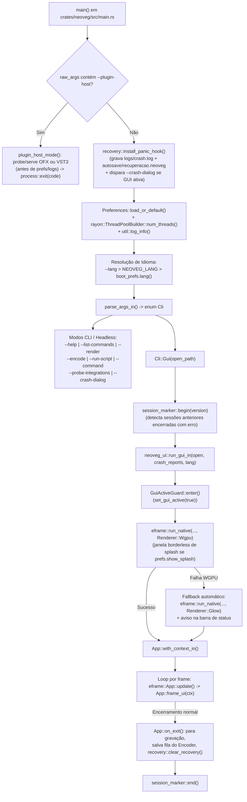
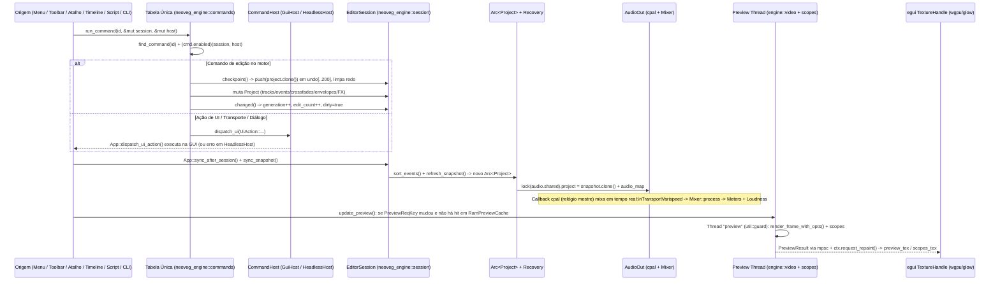
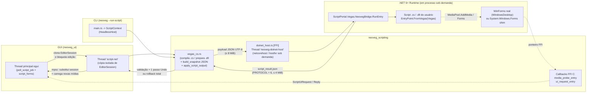

# Árvore de Funcionamento do Neoveg (Ponta a Ponta)

> Documento técnico de mapeamento arquitetural gerado a partir da inspeção direta do workspace Rust do **Neoveg** (`v0.4.1`, Rust 2021, 5 crates).
> Referência interna mantida fora do versionamento em `plan/`.

---

## Visão Geral das 5 Crates e Regras Estruturais

O workspace é organizado em **5 crates** com separação estrita de camadas (`AGENTS.md` §3.2), política global **`unsafe_code = "forbid"`** e lints **`#![deny(clippy::unwrap_used, clippy::expect_used, clippy::panic, clippy::unimplemented, clippy::todo, clippy::unreachable)]`** em todas as raízes de crate de produção:

```text
neoveg (binários: `neoveg` e `neoveg-setup`)
 ├──► neoveg_ui        (interface nativa `eframe` + `wgpu`/`glow` + `egui_tiles`)
 │     ├──► neoveg_scripting (ponte `.NET Host` `netcorehost` / `ScriptPortal.Vegas`)
 │     ├──► neoveg_engine    (motor de edição, composição, DSP, mídia, render, comandos)
 │     └──► neoveg_common    (tempo exato em ticks, curvas, erros, preferências, i18n, util)
 ├──► neoveg_scripting ──► neoveg_engine ──► neoveg_common
 ├──► neoveg_engine    ──► neoveg_common
 └──► neoveg_common    (zero dependência de UI, GPU ou áudio de SO)
```

### Fronteiras `unsafe` Isoladas (`AGENTS.md` §0.3)

Nenhum código de lógica de edição ou UI utiliza `unsafe`. As únicas fronteiras `#[allow(unsafe_code)]` do repositório são:

1. **Decodificação/Codificação de Mídia do SO (`neoveg_engine::media`):** `media/mf/` (Windows Media Foundation), `media/vaapi.rs` (Linux VA-API via `libloading`) e `media/videotoolbox.rs` (macOS VideoToolbox/AudioToolbox).
2. **Host de Plug-ins Externos (`neoveg_engine::plugin_host`):** `plugin_host.rs`, `plugin_host/ofx.rs` e `plugin_host/vst3.rs` — executados exclusivamente em subprocessos descartáveis (`neoveg --plugin-host ...`).
3. **Hospedagem `.NET` sob Demanda (`neoveg_scripting::dotnet_host`):** chamada `ComponentEntryPoint` via `netcorehost` (`hostfxr`) e callbacks FFI (`media_probe_entry`, `ui_request_entry`) protegidos por `catch_isolated`.

---

## 1. Árvore de Diretórios e Módulos

### 1.1 `crates/neoveg_common/` — Núcleo Compartilhado (Zero UI/GPU/SO-Áudio)

```text
crates/neoveg_common/src/
├── lib.rs              # Raiz da crate; reexporta os 7 módulos base com `#![forbid(unsafe_code)]`.
├── time.rs             # Tempo exato em inteiros (`Ticks`, 1_411_200_000 ticks/s), `FrameRate` racional,
│                       # conversão para amostras/quadros e formatação/parse SMPTE (incl. Drop-Frame).
├── curve.rs            # Identificadores (`Id`), tipos de curva (`Curve`: Linear, Fast, Slow, Smooth,
│                       # Sharp, Hold), fades e interpolação para envelopes, Pan/Crop e Track Motion.
├── error.rs            # `NeovegError` e `Result<T>` compartilhados (política Zero Panic §0.1).
├── prefs.rs            # `Preferences` (`preferencias.json`), matriz de qualidade da prévia (`PreviewQuality`),
│                       # layout (`EditLayoutPrefs`, `LayoutType`), atalhos customizados, `AdvancedSavePrefs`,
│                       # limites de cache/RAM/workers e estilo de ícones/temas.
├── i18n/
│   └── mod.rs          # Internacionalização (`Language`: `PtBr`, `En`, `Es`, `Fr`, `De`, `Ja`),
│                       # funções `tr`, `tr_args`, `tr_menu_path` e estado `active_language()`.
├── session_marker.rs   # Marcador de sessão ativa da GUI (`begin`, `end`, `mark_isolated`,
│                       # `other_instance_active`) para detectar encerramentos anormais na abertura seguinte.
└── util.rs             # Primitivas de robustez (§0): `lock` (anti-poison), `clampf`, `catch_isolated`,
                        # `guard`, `spawn`, `choose_base_dir` (portátil vs instalado), logs (`neoveg.log`,
                        # `crash.log`) com `redact()` de dados sensíveis e `CrashDialogPayload`.
```

### 1.2 `crates/neoveg_engine/` — Motor de Edição, Composição, Áudio, Mídia e Intercâmbio

```text
crates/neoveg_engine/src/
├── lib.rs              # Raiz da crate (32 módulos); impõe `#[forbid(unsafe_code)]` em todos os módulos
│                       # exceto as fronteiras FFI isoladas (`media` e `plugin_host`).
├── model.rs            # Modelo de dados do projeto (`Project`, `Sequence`, `Track`, `Event`, `Take`,
│                       # `MediaItem`, `MediaSource`, `FxInstance`, `Envelope`, `AudioBus`, `MasterBus`,
│                       # `Marker`, `Region`, `WorkFolders`, `ProjectSettings`, sanitização hostil).
├── session.rs          # `EditorSession`: estado mutável da timeline (projeto, `snapshot: Arc<Project>`,
│                       # `generation`/`sent_generation`, `edit_count`, pilhas `undo`/`redo` até `MAX_UNDO=200`,
│                       # seleção, cursor, clipboard, `EditorOptions`, modos `EditMode`/`EditTool`).
├── commands.rs         # Tabela Única de Comandos (`COMMANDS`: 281 `CommandDef`), `CommandHost`,
│                       # `HeadlessHost`, `UiAction`, `CommandOutcome`, `run_command`, `resolved_shortcut`.
├── crossfade.rs        # Matemática e regras de auto-crossfade, conversão corte↔sobreposição e curvas.
├── env_lock.rs         # *Lock Envelopes to Events* (move pontos de envelope e keyframes junto com eventos).
├── takes.rs            # Gerenciamento de múltiplos takes por evento e alternância de take ativo.
├── track_keyframes.rs  # Quadros-chave de efeitos de trilha expandidos diretamente na timeline.
├── mask.rs             # Máscaras Bézier animáveis (formas geométricas, forma livre, pena/feather).
├── color.rs            # Gerenciamento de cor profissional (ACES, espaços de cor, curvas Log, `ViewTransform`).
├── slideshow.rs        # Criador automático de apresentação de slides com transições/crossfades.
├── package.rs          # Persistência do contêiner `.neoveg` (ZIP: `manifest.json`, `project.json`,
│                       # `sequences/*.nvegseq`) com proteção contra ZIP bombs e entradas hostis.
├── archive.rs          # *Arquivar projeto com mídias* (cópia autocontida do `.neoveg` + mídias).
├── recovery.rs         # `install_panic_hook`, snapshots em memória (`LAST_SNAPSHOT`, `LAST_NESTED_SNAPSHOTS`),
│                       # gravação atômica de `autosave/recuperacao.neoveg` e backups avançados (Live Save).
├── playback.rs         # Motor em tempo real: `AudioOut` (`cpal`/WASAPI + relógio mestre), `Shared`,
│                       # `Preview` (thread dedicada de prévia de vídeo) e `RamPreviewCache` (`Shift+B`).
├── scopes.rs           # Escopos de vídeo (`ScopeConfig`, `ScopeImages`: Histograma, Waveform, Vectorscope, RGB Parade).
├── render.rs           # Renderização final (`Render As`): 52 `RenderFormat`, `render::run` / `render::spawn`,
│                       # `WavWriter`, paralelismo `rayon` e captura de quadros (`save_snapshot`).
├── midi.rs             # Parser SMF (`.mid`/`.midi`), sintetizador auxiliar e eventos `Vst3MidiEvent`.
├── plugins.rs          # Descoberta declarativa (sem carregar binários) de plug-ins VST3 e OFX no sistema.
├── plugin_host.rs      # Protocolo binário (`u32 json + u64 bytes`) e orquestração dos subprocessos `--plugin-host`.
├── plugin_host/
│   ├── ofx.rs          # [FFI] Host OpenFX em processo (só roda dentro do subprocesso `--plugin-host`).
│   └── vst3.rs         # [FFI] Host VST3 em processo + janela nativa `IPlugView` (só no subprocesso).
├── engine/             # Pipeline de composição de vídeo e DSP/mixagem de áudio
│   ├── mod.rs          # Tipo `Frame` (RGBA float 32-bit linear) e ponto de unificação do motor.
│   ├── video.rs        # Composição top-down: `render_frame_with_opts`, Pan/Crop, máscaras, crossfades,
│   │                   # Video FX, modos de mesclagem (`BlendMode`), pai/filho, 3D, Master Video FX.
│   ├── motion3d.rs     # *3D Source Alpha*: projeção em espaço 3D (posição/rotação/perspectiva) por trilha.
│   ├── transition.rs   # Transições de vídeo entre eventos sobrepostos na mesma trilha.
│   ├── vfx.rs          # Efeitos de vídeo nativos (núcleo).
│   ├── vfx_extra.rs    # Efeitos de vídeo nativos complementares (cor, desfoque, distorção, luz, estilo).
│   ├── fx_preview.rs   # Renderização de miniaturas de presets na janela *Efeitos de Vídeo*.
│   ├── scene_detect.rs # Detecção automática de cortes/cenas por diferença de luminância.
│   ├── audio.rs        # `Mixer` multifaixa + `TransportVarispeed` (J-K-L/rate) + reamostragem Sinc `rubato`
│   │                   # + envelopes + sends pré/pós-fader + 26 barramentos auxiliares + Master + `Meters`.
│   ├── afx.rs          # Efeitos de áudio nativos (Audio FX) com grafos DSP `fundsp`.
│   ├── audio_tools.rs  # Ferramentas avançadas: *Auto Normalize*, *Auto Ducking* e *Beat Detection*.
│   ├── loudness.rs     # Medição EBU R128 / ITU-R BS.1770-4 (`ebur128`) e RMS deslizante (`dasp`).
│   └── surround.rs     # Surround Panner 5.1 (ITU-R BS.775-3) para trilhas e barramentos.
├── media/              # Decodificação, geração, muxing e cache de mídia
│   ├── mod.rs          # `MediaCache`, importação, proxies, cache limitado de quadros e mapa de áudio.
│   ├── system.rs       # Contrato `SystemVideoReader` e seleção de backend por SO com fallback Rust puro.
│   ├── mf/             # [FFI Windows] `mod.rs` (leitura) e `encode.rs` (`IMFSinkWriter` H.264/HEVC/AV1/AAC).
│   ├── vaapi.rs        # [FFI Linux] Decodificação hardware VA-API via `libloading` (`libva`/`libva-drm`).
│   ├── videotoolbox.rs # [FFI macOS] Decodificação hardware VideoToolbox e áudio AudioToolbox.
│   ├── demux/          # Demuxers em Rust puro (`mod.rs`, `mp4.rs` ISO BMFF, `mkv.rs` EBML/Matroska).
│   ├── fallback.rs     # Decodificador fallback em Rust puro sobre `media::demux`.
│   ├── audio.rs        # Decodificação de áudio em Rust puro (WAVE/BWF/RF64/AIFF/FLAC/etc.).
│   ├── audio_extra.rs  # Codecs/escritores adicionais em Rust puro (AU/SND, CAF, Wave64, QOA, etc.).
│   ├── wav.rs          # Leitor PCM/G.711/ADPCM em RIFF WAVE, RF64, BWF e AIFF.
│   ├── flac.rs         # Codificador FLAC em Rust puro (RFC 9639).
│   ├── avi.rs          # Leitura/escrita AVI (MJPEG / RGB / BGRA / YUV422 / RGB10 + PCM).
│   ├── mov.rs          # Multiplexador QuickTime `.mov` em Rust puro.
│   ├── mkv.rs          # Multiplexador Matroska `.mkv` em Rust puro.
│   ├── ffv1.rs         # Codificador sem perdas FFV1 v3 em Rust puro.
│   ├── y4m.rs          # Leitor/escritor YUV4MPEG2 (`.y4m`).
│   ├── img_extra.rs    # Decodificadores/codificadores de imagem (PNG, JPEG, TIFF, TGA, WebP, QOI, DPX, EXR...).
│   ├── generate.rs     # Geradores de mídia (cor sólida, gradientes, xadrez, barras, ruído, texto animado).
│   └── convert.rs      # Conversão assistida de mídias não nativas para formatos editáveis.
├── encoder/            # Subsistema **Neoveg Encoder** (fila de transcodificação multi-saída)
│   ├── mod.rs          # Estado persistente da fila, grupos e preferências do encoder.
│   ├── presets.rs      # Catálogo de predefinições de sistema e customizadas (`.neovegpreset`).
│   ├── effects.rs      # Efeitos pré-codificação (Crop, escala, LUT `.cube` 1D/3D, overlays de imagem/TC).
│   ├── watch.rs        # Pastas monitoradas (*Watch Folders*) com disparo automático.
│   └── worker.rs       # Execução paralela de saídas, miniatura ao vivo, pausa/cancelamento e CLI `--encode`.
├── speech/             # Transcrição de fala por IA e edição orientada a texto
│   ├── mod.rs          # Orquestração da transcrição e integração com a timeline.
│   ├── transcript.rs   # Modelo de segmentos e palavras com timestamps exatos em ticks.
│   ├── model_cache.rs  # Gerenciamento sob demanda de modelos Whisper (fora do repositório).
│   └── edit.rs         # Edição da timeline por remoção/seleção de trechos do texto transcrito.
├── integrations/       # Integração fora do processo com suíte ArtCraft e Blender
│   ├── mod.rs          # Enum `ExternalApp` (7 apps) e `ControlProtocolKind`.
│   ├── discovery.rs    # Descoberta multiplataforma de binários, `agent-connection.json` e tokens.
│   ├── craft_rpc.rs    # Cliente TCP loopback (`127.0.0.1`) JSON-lines (HMAC-SHA256 / token / plain).
│   ├── blender.rs      # Automação CLI (`--background --python`) para render, marcadores e câmera 3D.
│   └── workflows.rs    # Fluxos round-trip (gravação WAV/BWF `bext`, quadros PNG/EXR, SVG, OTIO).
├── aaf.rs / aaf_metadict.rs # Importação/exportação Clean Room de AAF (Compound File Binary + MetaDict).
├── edl.rs              # Importação/exportação Clean Room de CMX 3600 EDL.
├── fcp7xml.rs          # Importação/exportação Clean Room de Final Cut Pro 7 XML (`xmeml` v4/v5).
├── fcpxml.rs           # Importação/exportação Clean Room de Final Cut Pro XML (`.fcpxml`).
├── otio.rs             # Importação/exportação Clean Room de OpenTimelineIO (`.otio`).
├── subtitles.rs        # Importação/exportação Clean Room de legendas SubRip (`.srt`) e WebVTT (`.vtt`).
└── fuzz_tests.rs       # (`#[cfg(test)]`) Fuzzing por mutação sob `catch_unwind` dos parsers e comandos (§0.8).
```

### 1.3 `crates/neoveg_scripting/` — Ponte `.NET Host` (`ScriptPortal.Vegas`) e Automação Headless

```text
crates/neoveg_scripting/src/
├── lib.rs              # API pública: `ScriptContext`, `ScriptRunOptions`, `run_cs_script_on_session(_with)`,
│                       # `run_cs_script`, `run_command_headless(_in)`, `list_commands(_in)`. Validação de
│                       # limites (`.cs` ≤ 4 MiB, `.dll` ≤ 64 MiB), rollback atômico e testes de integração.
├── dotnet_host.rs      # [FFI] Descoberta do .NET 6+ (`find_dotnet_env`), carregamento sob demanda de
│                       # `hostfxr` na thread dedicada `"neoveg-dotnet-host"`, `invoke_component` e
│                       # trampolins FFI `media_probe_entry` / `ui_request_entry`.
├── vegas_cs.rs         # Código C# embutido da ponte `namespace ScriptPortal.Vegas` (`NeovegBridge.RunEntry`),
│                       # compilação sob demanda via `dotnet` SDK, protocolo `SCRIPT_OUTPUT_PROTOCOL = 6`
│                       # e aplicador transacional de mutações no `EditorSession` (sem `unsafe`).
├── script_ui.rs        # Protocolo JSON de janelas solicitadas por scripts (`ScriptUi`, `ScriptUiRequest`,
│                       # `ScriptUiReply`, `FormSpec`, `ControlSpec`) com `sanitize()` contra entradas hostis.
└── winforms_shim.rs    # Camada Clean Room `namespace System.Windows.Forms` compilada junto ao script
                        # quando não há WinForms real (Linux, macOS ou Windows sem WindowsDesktop runtime).
```

### 1.4 `crates/neoveg_ui/` — Interface Gráfica Nativa (`eframe` + `wgpu`/`glow`)

```text
crates/neoveg_ui/src/
├── lib.rs              # Raiz da crate (43 módulos); `run_gui_in()` (tenta `Renderer::Wgpu`, fallback
│                       # automático para `Renderer::Glow`), `run_crash_dialog()` e `GuiActiveGuard`.
├── app.rs              # `App` (implementa `eframe::App`), `with_context_in()`, loop `frame_ui()`,
│                       # `GuiHost`/`GuiQueryHost`, `exec_cmd()`, `dispatch_ui_action()`, `handle_shortcuts()`,
│                       # `update_preview()`, `sync_snapshot()`, `poll_loader()`, `poll_script_job()`, `poll_render()`.
├── timeline.rs         # Renderização e interação completa da timeline (régua SMPTE, marcadores/regiões,
│                       # track headers, waveforms amostra a amostra, miniaturas, envelopes, crossfades, arraste).
├── timeline/
│   └── keyframes.rs    # Linhas expansíveis de quadros-chave de efeitos na timeline.
├── panels.rs           # Área de janelas acopláveis (*Window Docking Area*), Prévia de Vídeo, Master Bus,
│                       # Console de Mixagem, Explorer, Transições, Escopos e Medidores de Loudness.
├── dock.rs             # Motor de acoplamento em 3 colunas baseado em `egui_tiles` (`DockPane`).
├── dock_drop.rs        # Alvos de arraste de abas (5 zonas: centro/topo/base/esquerda/direita).
├── float_dock.rs       # Reacoplamento de janelas destacadas ao arrastar de volta para a doca.
├── layout.rs           # Gerenciador de layouts (`.neoveglayout`), presets e geometria de janelas flutuantes.
├── doc_tabs.rs         # Abas de edição de projetos `.neoveg` aninhados dentro da janela principal.
├── edit.rs             # Ponte fina da UI para operações diretas da timeline em `neoveg_engine::session`.
├── dialogs.rs          # Diálogos principais (Propriedades do Projeto/Evento, Cadeias FX, Mídia Gerada,
│                       # Renderizar Como, Preferências, Atalhos, Sobre, Personalizar Barra, etc.).
├── dialog_window.rs    # `DialogWindow`: promove diálogos para janelas nativas próprias (multi-viewport).
├── dlg_advanced_save.rs# Diálogos *Salvamento Avançado (Live Save/Backups)*, *Restaurar* e *Arquivar*.
├── dlg_audio_tools.rs  # Diálogos *Auto Ducking* e *Detecção de Batidas (BPM)*.
├── dlg_slideshow.rs    # Diálogo *Criador de Apresentação de Slides*.
├── dlg_work_folders.rs # Diálogo *Pastas de Trabalho do Projeto*.
├── convert_dialog.rs   # Diálogo de oferta/progresso de conversão para mídias não nativas.
├── crash_report.rs     # Diálogo clássico de relatório de erro (`--crash-dialog` e pós-queda).
├── project_media.rs    # Painel *Mídia do Projeto* (bins, smart bins, storyboards, hover-scrub).
├── trimmer_panel.rs    # Painel *Trimmer* (`Alt+2`) com transporte independente e inserção I/O.
├── edit_details.rs     # Painel tabular *Detalhes da Edição* (`Alt+3`).
├── color_grading.rs    # Painel *Color Grading* (rodas Lift/Gamma/Gain, temperatura/tinta, curvas).
├── fx_browser.rs       # Navegador *Efeitos de Vídeo* com categorias, busca e miniaturas de presets.
├── gen_browser.rs      # Navegador *Geradores de Mídia* com categorias e miniaturas.
├── plugin_manager.rs   # Painéis *Plug-In Manager* (nativos + OFX/VST3) e *Compositores*.
├── surround_panel.rs   # Painel *Surround Panner 5.1* interativo.
├── project_notes.rs    # Painel *Notas do Projeto* vinculadas ao timecode.
├── encoder_panel.rs    # Interface completa do *Neoveg Encoder* (fila, presets, watch folders, efeitos).
├── transcript_panel.rs # Painel de *Transcrição de Fala por IA* e edição pelo texto.
├── integrations_ui.rs  # Interface de status e envio/round-trip com ArtCraft e Blender.
├── kf_window.rs        # Primitivas compartilhadas das janelas de keyframes (linha do tempo de chaves).
├── pan_crop_window.rs  # Janela *Pan/Crop do Evento* (enquadramento, máscara Bézier, keyframes).
├── pan_crop_geom.rs    # Geometria e alças do retângulo de enquadramento do Pan/Crop.
├── track_motion_window.rs # Janela *Movimento da Trilha* (2D/3D, sombra e brilho).
├── preview_overlays.rs # Sobreposições da prévia (isolamento R/G/B/A, grade, réguas, CC1–CC4, 360°).
├── preview_toolbar.rs  # Barra de ferramentas compacta da Prévia de Vídeo com menu de transbordo.
├── script_forms.rs     # Renderização `egui` das janelas solicitadas pelo `winforms_shim` (Linux/macOS).
├── scrollbars.rs       # Barras de rolagem e botões direcionais/zoom clássicos estilo VEGAS Pro.
├── splash.rs           # Tela de abertura vetorial nativa (zero bitmap externo) e ícone da janela.
├── welcome.rs          # Tela de boas-vindas (Novo/Abrir/Recentes/Primeiros Passos).
├── theme.rs            # Catálogo dos 11 temas (Clássico, Prata, Escuro/Médio/Claro/Branco, High Contrast AAA...).
├── icons.rs            # Ícones vetoriais originais desenhados via `egui::Painter` com estilos por era.
├── cursors.rs          # Cursores vetoriais originais para ferramentas da timeline/Pan-Crop.
├── fonts.rs            # Carregamento de fontes abertas (`OFL-1.1`: Selawik, Inter, Noto Sans) ou fonte do SO.
├── tests.rs            # Testes headless de fumaça da UI (simulação de mouse/teclado e diálogos).
└── kittest_tests.rs    # Testes de interação real da interface com `egui_kittest` e AccessKit.
```

### 1.5 `crates/neoveg/` — Binário Principal, CLI e Instalador Próprio

```text
crates/neoveg/
├── Cargo.toml          # Declara 2 binários: `neoveg` (`src/main.rs`) e `neoveg-setup` (`src/setup/main.rs`).
├── src/
│   ├── main.rs         # Ponto de entrada do editor: interceptação `--plugin-host`, hook de pânico,
│   │                   # preferências, pool `rayon`, i18n, parser CLI (`Cli`) e boot da GUI.
│   └── setup/          # Binário autônomo do instalador (`Neoveg-Setup`, sem `unsafe`)
│       ├── main.rs     # Entrada do instalador (modo gráfico ou silencioso).
│       ├── gui.rs      # Interface gráfica compacta do instalador (`eframe`).
│       ├── ops.rs      # Fluxos de instalação e desinstalação.
│       ├── payload.rs  # Leitura do payload ZIP anexado ao fim do executável (`tools/build_installer.py`).
│       ├── system.rs   # Integração Windows (`reg.exe`, atalhos PowerShell, `instalado.json`).
│       └── linux.rs    # Integração Linux (freedesktop.org `.desktop`, ícones PNG, associação MIME).
└── tests/
    └── plugin_host.rs  # Testes de integração do subprocesso isolado `--plugin-host`.
```

---

## 2. Fluxo de Execução (Boot ao Frame)

### 2.1 Sequência de Inicialização (`main.rs` → `eframe`)



### 2.2 Construção do Estado Inicial (`App::with_context_in`)

Dentro do callback de criação do `eframe`:

1. **Preferências, Idioma e Visual:** recarrega `Preferences`, aplica `lang_override` se fornecido via CLI, desabilita zoom por teclado do `egui` (`zoom_with_keyboard = false` para preservar `Ctrl+=`/`Ctrl+-`/`Ctrl+0` do VEGAS), carrega fontes (`fonts::configure_fonts`), aplica o tema (`ThemeId` → `theme::apply_theme`) e restaura o layout `.neoveglayout` (`egui_tiles::Tree<DockPane>`).
2. **Sessão e Cache de Mídia:** cria `Project::new_default()` (com `default_sample_rate`), instancia `EditorSession::new_in()` (que registra o primeiro snapshot em `recovery::remember_snapshot`), cria `Arc<MediaCache>` respeitando `frame_cache_cap` e `ram_preview_mb`.
3. **Subsystems em Segundo Plano:**
   - `AudioOut::new(session.snapshot.clone())`: no Windows sobe a thread guardiã `"audio-com"` (mantém o apartamento COM do enumerador WASAPI vivo), abre o dispositivo padrão via `cpal` e inicia o callback de áudio em tempo real (que atua como relógio mestre).
   - `Preview::new(media.clone(), || ctx.request_repaint())`: sobe a thread `"preview"` que renderiza quadros e escopos sob demanda.
   - Canal `loader_tx`/`loader_rx` (`LoadMsg`) para importação assíncrona de mídia, proxies, reconstrução de projetos aninhados, prévia em RAM, pré-render e análise de loudness.
4. **Recuperação / Splash / Boas-vindas:** verifica se existem `autosave/recuperacao.neoveg` ou `recuperacao_aninhados.json` sem outra instância ativa (`!session_marker::other_instance_active()`). Se houver recuperação, suprime splash/welcome para oferecer restauração imediata; caso contrário, inicia `SplashState` e/ou `welcome_open`, além de abrir o arquivo passado em `--open`.

### 2.3 Ciclo de Cada Frame (`eframe::App::update` → `App::frame_ui`)

A cada quadro desenhado pelo `eframe`, `App::frame_ui(ctx)` executa em ordem determinística:

1. **Estilo e Preferências Dinâmicas:** aplica força/estilo de ícones (`icons::set_display_prefs`, `icons::set_icon_style`), contexto de diálogos multi-viewport (`dialog_window::set_context`), fator de escala da UI (`ctx.set_zoom_factor`) e atraso de tooltips.
2. **Relógio e Polling de Workers Assíncronos:**
   - `audio.tick_without_device(dt)` (avança relógio apenas se não houver dispositivo de áudio).
   - `poll_loader()` (drena `LoadMsg`: mídia importada/convertida/proxy/RAM preview/loudness).
   - `poll_integrations()` (status de sondagem/jobs ArtCraft e Blender).
   - `poll_script_job(ctx)` (renderiza modal de script em execução ou formulários `script_forms`, e comita o `EditorSession` resultante ao término).
   - `poll_render()` e `encoder.tick(...)` (progresso da renderização final e fila/Watch Folders do Neoveg Encoder).
3. **Transição de Splash / Geometria Inicial:** enquanto `startup_window` estiver ativo, desenha apenas a splash borderless; ao encerrar, chama `leave_startup_window(ctx)` para restaurar decorações, tamanho mínimo e centralizar/maximizar no monitor (`main_window_geometry`).
4. **Entrada do Usuário:** `handle_dropped_files(ctx)` (arrastar mídia/projeto do SO) e `handle_shortcuts(ctx)` (despacha teclas pela Tabela Única `COMMANDS` respeitando foco do Trimmer, modais e scripts ativos).
5. **Medidores e Transporte:** `update_meters(dt)` (decaimento de picos VU e leitura de `LoudnessSnapshot`), leitura de gravação ativa (`recorder`), acompanhamento da agulha na timeline durante reprodução (`tl.follow_with`) e parada automática no fim do projeto (se sem loop).
6. **Layout e Desenho `egui`:**
   - Topo: `menu_bar` + `toolbar`.
   - Base: `status_bar` (e `transport_bar` no topo ou base conforme `EditLayoutPrefs`).
   - Área de docas (`show_dock_panel` via `egui_tiles`) + `CentralPanel` (`timeline_ui`).
   - Janelas flutuantes (`floating_panel_windows`), diálogos (`show_dialogs`, integrações, encoder, crash report, recuperação, welcome/splash).
7. **Persistência e Sincronização de Saída:**
   - `autosave()` (grava recuperação periódica e backups avançados Live Save).
   - `update_preview(ctx)` (consome `PreviewResult` em texturas GPU `TextureHandle` e dispara novo `PreviewRequest` se `PreviewReqKey` mudou).
   - `sync_snapshot()` (quando `generation != sent_generation`, ordena eventos, gera novo `Arc<Project>` imutável e atualiza `audio.shared` e `recovery`).
   - `update_title(ctx)` e interceptação de `close_requested()` para confirmar alterações não salvas (`any_doc_dirty()`).

---

## 3. Fluxo de Dados e Edição

### 3.1 Da Ação do Usuário à Atualização de Vídeo e Áudio



### 3.2 Tabela Única de Comandos (`neoveg_engine::commands`)

- **Catálogo centralizado (`COMMANDS`):** contém **281** entradas estáticas `CommandDef` com:
  - `id: &'static str` (ex.: `"edit.split"`, `"edit.undo"`, `"edit.cut_to_overlap"`, `"transport.toggle_play"`, `"view.tab.mixer"`),
  - `label` e `menu_path` localizados sob demanda via `neoveg_common::i18n`,
  - `default_shortcut: Option<Shortcut>` (independente de UI e regravável em `prefs.shortcuts` via `resolved_shortcut`),
  - `needs_ui: bool`, `enabled(&EditorSession, &dyn CommandHost) -> bool` e `run(&mut EditorSession, &mut dyn CommandHost) -> Result<CommandOutcome, String>`.
- **Despacho unificado:**
  - **Menus e Barras de Ferramentas:** chamam `App::exec_cmd(Some(ctx), id)` e consultam `App::cmd_enabled(id)` usando `GuiQueryHost` (somente leitura) / `GuiHost` (coleta `Vec<UiAction>`, `removed_media` e `pending_generated`).
  - **Atalhos de Teclado (`App::handle_shortcuts`):** traduz modificadores + `egui::Key` (via `to_egui_key`), itera `COMMANDS` aplicando `resolved_shortcut`, valida `cmd_enabled` e chama `exec_cmd`.
  - **Scripts C# e CLI (`--command <id>`):** chamam `run_command(id, &mut session, &mut HeadlessHost)`. Comandos que exigem interface retornam erro limpo em `HeadlessHost::dispatch_ui`.

### 3.3 Estado da Timeline, Histórico Undo/Redo e Persistência

- **`EditorSession` (`crates/neoveg_engine/src/session.rs`):**
  - Mantém o estado editável `project: Project`, o snapshot imutável compartilhado `snapshot: Arc<Project>`, contadores monotônicos `generation` / `sent_generation` / `edit_count`, flag `dirty`, cursor `Ticks`, seleção de eventos (`sel_events`), seleção de faixa (`sel_track`), intervalo de tempo (`time_sel`), área de transferência (`clipboard`), opções (`EditorOptions`) e modo de edição (`EditMode`: Normal, Shuffle, Slip, Slide, Stretch, SplitTrim, Roll, Ripple).
  - **Undo/Redo:** toda mutação chama `checkpoint()` antes de alterar o projeto, empilhando um clone de `Project` em `undo` (capacidade máxima `MAX_UNDO = 200`) e limpando `redo`. `undo()`/`redo()` trocam `self.project` via `std::mem::replace`, podam seleções órfãs (`after_history`), incrementam `generation` e `edit_count`, marcam `dirty = true` e invalidam trechos pré-renderizados (`prerendered_ranges.clear()`).
  - **Invariantes de Edição (`AGENTS.md` §3.1):** aritmética 100% em `Ticks` inteiros (`1_411_200_000` ticks/s); movimentações validam unicidade de IDs atomicamente antes de mutar; projetos/sequências aninhados validam aciclicidade (`validate_no_sequence_cycle`).
- **Persistência (`.neoveg`):** `package.rs` serializa o projeto em ZIP seguro contendo `manifest.json`, `project.json` e `sequences/<nome>.nvegseq`, enquanto `recovery.rs` mantém recuperação automática em `autosave/recuperacao.neoveg` (com rotação de histórico) e backups temporizados `.neoveg.bak`.

### 3.4 Pipeline de Vídeo (Prévia em Tempo Real e Renderização Final)

1. **Detecção de Demanda (`App::update_preview`):** monta uma chave `PreviewReqKey` combinando `(t quantizado, generation, w, h, scopes, prefer_proxy, split_mode, mute_video, expanded_ab, channel, view_360)`.
2. **Atalho de Cache em RAM (`RamPreviewCache`):** se o modo de prévia for normal e o quadro `(generation, frame_idx, w, h)` estiver em `ram_preview` (`Shift+B`), atualiza `preview_tex` diretamente sem acionar a thread de vídeo.
3. **Worker de Prévia (`playback::Preview`):**
   - Recebe `PreviewRequest` via canal `mpsc` e descarta imediatamente pedidos antigos acumulados (`while let Ok(r) = rx_req.try_recv() { req = r; }`), mantendo baixa latência durante *scrub*.
   - Executa sob `util::guard("prévia de vídeo", ...)` — qualquer falha vira quadro vermelho de erro sem matar o worker.
   - Chama `engine::video::render_frame_with_opts` (em espaço linear `Frame` RGBA f32):
     - Carrega quadros do `MediaCache` (usando proxy quando `prefer_proxy` está ativo, ou `MediaSource::Generated` / `MediaSource::Sequence` aninhada), decodificados via `media::system::open_media` (`Media Foundation` no Windows, `VA-API` no Linux, `VideoToolbox` no macOS, ou fallback Rust puro sobre `media::demux`).
     - Aplica por evento: Pan/Crop, máscaras Bézier (`mask.rs`), efeitos de vídeo do evento (`vfx`/`vfx_extra`/OFX), velocidade/reverso, fades e crossfades/transições (`crossfade.rs`/`transition.rs`) entre eventos sobrepostos na mesma trilha.
     - Compõe trilhas na ordem semântica do VEGAS (trilha superior sobre inferior), aplicando composição pai/filho, `motion3d` (*3D Source Alpha*), envelopes de opacidade/composto, modos de mesclagem (`BlendMode`) e Video FX de trilha.
     - Aplica efeitos do barramento mestre de vídeo (`MasterVideo`), gera versão sem FX se `PreviewSplitMode::FxBypass`, renderiza par A/B no *Expanded Edit Mode*, calcula os 4 escopos (`scopes::compute_with_config`) se o painel de Escopos/Color Grading estiver aberto e aplica a transformação de visualização (`color::ViewTransform`) antes da conversão `to_rgba8()`.
   - Envia `PreviewResult` para a UI e invoca `ctx.request_repaint()`, que carrega as imagens em `TextureHandle` (`preview_tex`, `preview_split_tex`, `expanded_ab_tex`, `scopes_tex`).
4. **Renderização Offline (`render.rs` e `encoder/`):**
   - `render::run` / `render::spawn` renderiza quadros em lote com `rayon` + `engine::video::render_frame` e áudio com `engine::audio::Mixer`, suportando **52 formatos** (`RenderFormat::ALL`: MP4/MOV/MKV/3GP/WMV via Media Foundation ou muxers Rust puros, AVI, FFV1, GIF, Y4M, sequências PNG/JPEG/TIFF/TGA/BMP/WebP/PNM/QOI/DPX/Cineon/EXR, WAV/BWF/RF64/Wave64/AIFF/AU/CAF/QOA/FLAC/AAC/WMA/MP3).
   - O **Neoveg Encoder** (`encoder/worker.rs`) reaproveita a mesma base de decodificação/efeitos pré-codificação (`encoder/effects.rs`: Crop, escala, LUT `.cube`, overlays) para filas persistentes com múltiplas saídas por item e *Watch Folders*.

### 3.5 Pipeline de Áudio e Relógio Mestre (`playback::AudioOut` + `engine::audio::Mixer`)

1. **Saída e Relógio Mestre:** `AudioOut` abre o dispositivo padrão via `cpal` (WASAPI no Windows, ALSA/Pulse/PipeWire no Linux, CoreAudio no macOS). A posição `Shared::pos` (em amostras na taxa `sr` do dispositivo) avançada no callback de áudio serve de **relógio mestre** para a timeline e a prévia de vídeo durante a reprodução (garantindo sincronismo A/V). Sem dispositivo de áudio, `AudioOut::tick_without_device(dt)` assume o relógio por tempo decorrido.
2. **Isolamento no Callback:** o callback `fill` envolve `mix_into` em `util::guard("mixagem de áudio", ...)`; em caso de erro interno, silencia o buffer, interrompe a reprodução, reseta o DSP e reporta a mensagem à barra de status.
3. **Cadeia de Sinal (`mix_into`):**
   - **Timeline ativa (`s.playing`):** `TransportVarispeed::process` controla reprodução normal, *Playback Rate* contínuo e *shuttle* J-K-L (incluindo reverso e loop de região), invocando `Mixer::process(&project, &audio, sample_pos, chunk)`.
   - **Mixagem (`engine::audio::Mixer`):**
     1. *Eventos:* leitura de `AudioData` com reamostragem Sinc (`rubato`), velocidade/pitch, fades e crossfades de áudio, ganho/normalização e Audio FX de evento (`afx.rs` via `fundsp` ou VST3 via `--plugin-host`).
     2. *Trilhas:* envelopes de volume/pan/mute, pan estéreo ou Surround 5.1 (`surround.rs`), Audio FX de trilha, Mute/Solo e *sends* pré/pós-fader.
     3. *Barramentos:* até 26 barramentos auxiliares com cadeias de Audio FX e roteamento acíclico → Barramento Master (`MasterBus` com volume, pan/balanço, FX de Master).
   - **Monitoração e Medição:** atualiza `Meters` (picos por trilha, barramento e master), alimenta `LoudnessAnalyzer` (`ebur128` EBU R128 + RMS `dasp`), aplica opções de monitoração de saída (`mono_downmix`, `dim` = −20 dB, `preview_muted`) sem afetar a renderização.
   - **Audição do Trimmer (`s.trimmer_audio`):** quando a timeline está parada e o Trimmer está tocando, o mesmo callback reproduz a mídia do Trimmer pelo ganho `preview_bus_gain` do barramento Preview.

---

## 4. Arquitetura de Extensões, Scripting e Integrações

### 4.1 Ponte `.NET Host` (`neoveg_scripting` — `ScriptPortal.Vegas`)

> **Nota de conformidade com o código atual:** Toda a API gerenciada de scripting está consolidada sob **`namespace ScriptPortal.Vegas`** (espelhando em sala limpa a documentação pública *VEGAS Pro Scripting API Summary*, com ponto de entrada interno `ScriptPortal.Vegas.NeovegBridge.RunEntry` e ponte `Vegas.RunCommand(id)` para a Tabela Única). Não existe um namespace separado `Neoveg.Api` na base de código atual.



**Etapas exatas da execução de um script (`.cs` ou `.dll`):**

1. **Descoberta e Carregamento Sob Demanda:** o runtime `.NET` **nunca é carregado no boot**. Apenas ao executar um script, `dotnet_host::find_dotnet_env()` localiza o `.NET Core 6+` (`hostfxr.dll`/`.so`/`.dylib`), verifica se há SDK e, no Windows, detecta `Microsoft.WindowsDesktop.App` da mesma versão principal. O `HostfxrContext` é inicializado uma única vez na thread dedicada `"neoveg-dotnet-host"`.
2. **Preparação do Assembly:**
   - **Arquivo `.cs` (≤ 4 MiB):** `vegas_cs::compile_cs_project()` gera um projeto temporário em `temp_dir/neoveg_cs_<pid>_<seq>`, injeta `SCRIPT_PORTAL_VEGAS_CS` (e `WINFORMS_SHIM_CS` quando não há WinForms nativo ou `force_forms_shim = true`) e compila via `dotnet build` em `NeovegScript.dll`.
   - **Arquivo `.dll` pré-compilado (≤ 64 MiB):** valida cabeçalho PE/CLR (`validate_managed_dll_header`). Com SDK presente, compila/reutiliza em cache a ponte (`ensure_bridge_dll`) que carrega o assembly alvo; sem SDK, faz *shadow copy* temporária e invoca diretamente `ScriptPortal.Vegas.NeovegBridge.RunEntry`.
3. **Snapshot e Callbacks Bidirecionais:** `build_snapshot()` serializa o estado do `EditorSession` (FPS racional, cursor, seleção, trilhas, eventos com tempos em `Ticks` inteiros, takes, efeitos/parâmetros/keyframes, envelopes, marcadores, barramentos, mídias e catálogo de plug-ins) junto com endereços FFI (`probe_fn` para `MediaPool.AddMedia` e `ui_fn` para `ScriptUi`).
4. **Camada de UI Multiplataforma para Scripts (`script_ui.rs` + `winforms_shim.rs` + `script_forms.rs`):**
   - No Windows com `Microsoft.WindowsDesktop.App`, scripts usam WinForms nativo (`net*-windows`).
   - No Linux, macOS ou Windows sem runtime Desktop, o shim Clean Room `System.Windows.Forms` serializa `MessageBox`, `Form.ShowDialog` (10 tipos de controle) e diálogos de arquivo em JSON via `ui_request_entry`. Na GUI, `App::poll_script_job` recebe o pedido em `ui_rx`, sanitiza com `ScriptUiRequest::sanitize()` e desenha a janela em `egui` (`script_forms.rs`), respondendo à thread bloqueada do script. Em CLI/headless, retorna `ScriptUiReply::NoUi`.
5. **Commit Transacional e Segurança (§0):**
   - O script grava `script_result.json` (`SCRIPT_OUTPUT_PROTOCOL = 6`, limite 4 MiB). Versões incompatíveis são recusadas.
   - `apply_script_output()` valida tudo antes de aplicar (tipos de trilha, IDs duplicados, durações > 0, limites `MAX_SCRIPT_ITEMS`, comandos da Tabela Única via `Vegas.RunCommand`) e aplica todas as mudanças em **um único passo de Desfazer** (`checkpoint()`). Qualquer erro ou exceção faz **rollback completo** — na GUI, o script ainda roda em uma cópia isolada de `EditorSession` na thread `"script-net"` sob `catch_isolated`, só substituindo `self.session` em caso de sucesso.

### 4.2 Automação por Linha de Comando (CLI)

Todos os modos de execução disponíveis em `crates/neoveg/src/main.rs`:

| Comando CLI | Fluxo interno |
|---|---|
| `neoveg [--lang <cod>] [--open] [projeto \| mídia]` | Inicia a GUI (`session_marker::begin` → `neoveg_ui::run_gui_in`), abrindo o projeto ou importando a mídia. |
| `neoveg --render projeto.neoveg saida.ext` | Carrega projeto/mídia sem GUI e executa `neoveg_engine::render::run()` no formato inferido pela extensão. |
| `neoveg --encode entrada saida [predefinicao]` | Executa transcodificação síncrona via `neoveg_engine::encoder::worker::encode_item_sync()`. |
| `neoveg --run-script script.<cs\|dll>` | Instancia `neoveg_scripting::ScriptContext` (`HeadlessHost`) e executa `run_cs_script()`. |
| `neoveg --command <id> [projeto [saida]]` | Executa qualquer comando headless da Tabela Única (`neoveg_scripting::run_command_headless_in`) e salva o projeto resultante. |
| `neoveg --list-commands` | Imprime todos os 281 comandos da Tabela Única com atalhos padrão e caminhos de menu localizados (`list_commands_in`). |
| `neoveg --probe-integrations` | Sonda aplicativos ArtCraft e Blender instalados/em execução (`integrations::discovery`) e imprime JSON no stdout. |
| `neoveg --plugin-host <modo> ...` | Subprocesso interno isolado para sondagem/execução de plug-ins OFX e VST3 (ver §4.3). |
| `neoveg --crash-dialog <payload.json>` | Processo separado disparado pelo hook de pânico para exibir o relatório de erro (`neoveg_ui::run_crash_dialog`). |

### 4.3 Plug-ins Externos Isolados (OpenFX e VST3)

Para cumprir a regra **Nunca Travar (§0.3 / §0.6)**, o editor principal **nunca** carrega `.ofx` ou `.vst3` diretamente em seu espaço de endereçamento:

1. **Descoberta Segura (`neoveg_engine::plugins`):** varre pastas padrão do SO (`CommonProgramFiles\VST3`, `OFX\Plugins`, `/usr/lib/vst3`, `/Library/Audio/Plug-Ins/VST3`, `OFX_PLUGIN_PATH`) lendo apenas nomes de pacotes e `moduleinfo.json` (JSON sanitizado com limite de 1 MiB).
2. **Sondagem e Processamento em Subprocesso (`neoveg_engine::plugin_host`):**
   - O editor dispara o próprio binário `neoveg` com `--plugin-host` (`probe-ofx`, `serve-ofx`, `probe-vst3`, `serve-vst3`, `edit-vst3`), interceptado na primeira linha de `main()` antes de tocar logs ou preferências.
   - A comunicação pai↔filho usa *pipes* binários enquadrados (`u32 tamanho_json + json + u64 tamanho_dados + bytes`), com limites explícitos (`MAX_JSON_BYTES = 4 MiB`, `MAX_FRAME_BYTES` até 8K RGBA float, `WORKER_TIMEOUT = 60s`).
   - Se um plug-in de terceiros causar *segfault*, travar ou exceder o timeout, apenas o subprocesso morre: o editor recebe `Err`, preserva a timeline e segue responsivo.

### 4.4 Integrações Externas (Suíte ArtCraft e Blender)

Implementadas em `crates/neoveg_engine/src/integrations/` e expostas na UI em `crates/neoveg_ui/src/integrations_ui.rs` sem qualquer link com código GPL/LGPL ou proprietário (`AGENTS.md` §2.3):

- **Descoberta (`discovery.rs`):** detecta binários desktop/CLI e arquivos `agent-connection.json` + `agent-control.token` de 7 aplicativos (`PhotoCraft`, `VectorCraft`, `FilmCraft`, `EffectCraft`, `AniCraft`, `SoundCraft`, `Blender`).
- **Controle em Loopback (`craft_rpc.rs`):** envia comandos JSON-lines via TCP `127.0.0.1` conforme o protocolo de cada app (`PhotoCraftChallengeJsonLines` com desafio HMAC-SHA256, `TokenPerRequestJsonLines` para FilmCraft, `PlainJsonLines` para VectorCraft/EffectCraft/SoundCraft, `McpStdioAndCli` para AniCraft).
- **Fluxos Round-Trip (`workflows.rs` e `blender.rs`):** exportação de quadros PNG/EXR, placas SVG, áudio WAV/BWF com timecode no chunk `bext`, timelines OTIO/FCPXML/EDL/AAF e invocação headless do Blender (`--background --python`) para renderizar cenas `.blend`, exportar marcadores/Pan-Crop e importar câmeras 3D.
