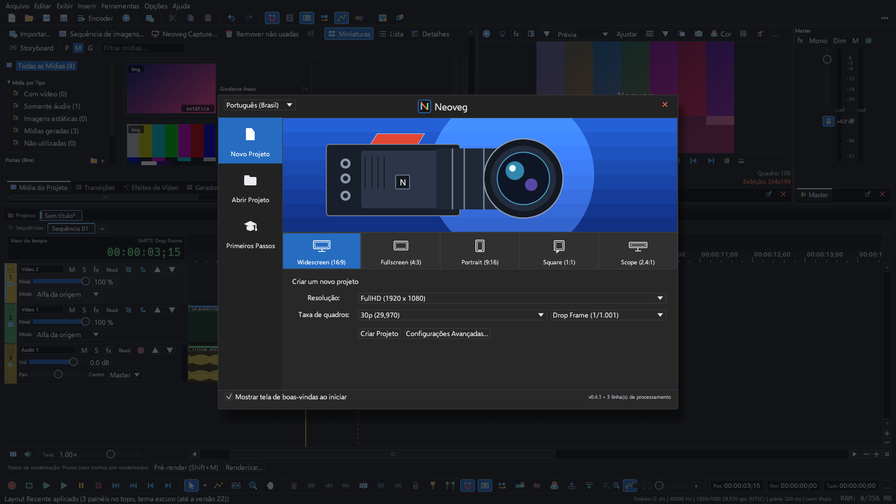
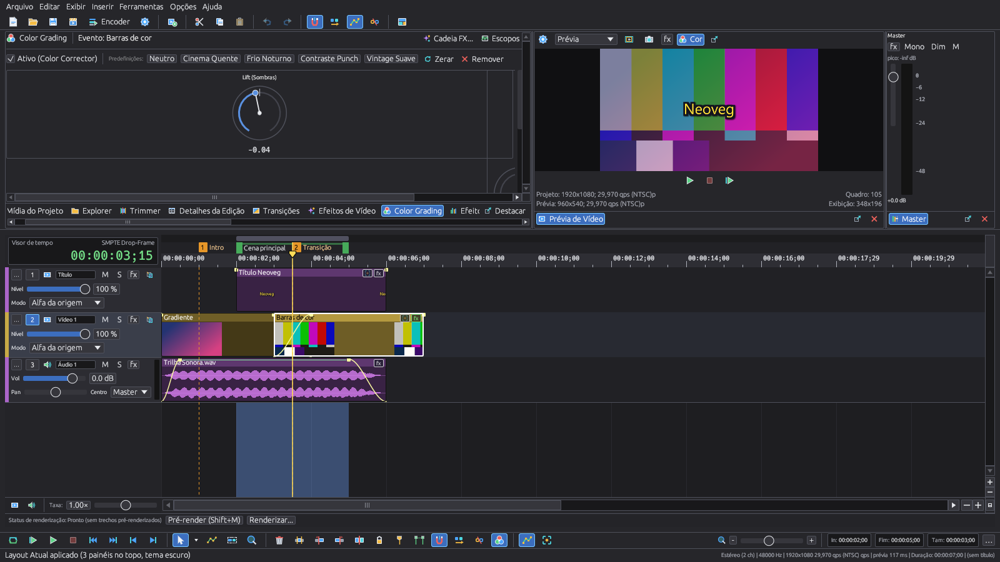
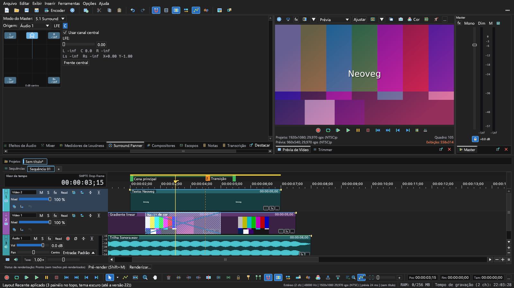

# Manual do Usuário — Neoveg

**Versão de referência:** `0.4.1`  
**Idioma:** Português (Brasil) — o aplicativo também possui interface traduzida para `en`, `es`, `fr`, `de` e `ja`.

O **Neoveg** é um editor de vídeo não-linear (NLE) nativo em Rust projetado com fluxo editorial de alta densidade, representação exata de tempo em inteiros (*ticks* e amostras), compatibilidade com hardware modesto e recuperação automática contra falhas.

---

## Sumário

1. [Requisitos, Instalação e Dados do Programa](#1-requisitos-instalação-e-dados-do-programa)
2. [Primeiros Passos e Interface Principal](#2-primeiros-passos-e-interface-principal)
3. [Projetos, Propriedades, Abas e Recuperação](#3-projetos-propriedades-abas-e-recuperação)
4. [Importação, Mídia do Projeto, Explorer e Trimmer](#4-importação-mídia-do-projeto-explorer-e-trimmer)
5. [Edição na Linha do Tempo (Timeline)](#5-edição-na-linha-do-tempo-timeline)
6. [Efeitos de Vídeo, Transições, Geradores, Pan/Crop e Track Motion](#6-efeitos-de-vídeo-transições-geradores-pancrop-e-track-motion)
7. [Prévia de Vídeo, Color Grading e Escopos](#7-prévia-de-vídeo-color-grading-e-escopos)
8. [Áudio, Mixer, Envelopes, Surround 5.1 e Loudness](#8-áudio-mixer-envelopes-surround-51-e-loudness)
9. [Plug-ins Externos (OFX e VST3)](#9-plug-ins-externos-ofx-e-vst3)
10. [Neoveg Capture (Captura Multi-Fonte)](#10-neoveg-capture-captura-multi-fonte)
11. [Renderização e Neoveg Encoder](#11-renderização-e-neoveg-encoder)
12. [Intercâmbio, Legendas e Transcrição de Fala](#12-intercâmbio-legendas-e-transcrição-de-fala)
13. [Scripts C# (.NET), Loja de Scripts e Integrações](#13-scripts-c-net-loja-de-scripts-e-integrações)
14. [Preferências e Personalização](#14-preferências-e-personalização)
15. [Linha de Comando (CLI)](#15-linha-de-comando-cli)
16. [Referência de Atalhos de Teclado](#16-referência-de-atalhos-de-teclado)
17. [Hardware Limitado e Solução de Problemas](#17-hardware-limitado-e-solução-de-problemas)

---

## 1. Requisitos, Instalação e Dados do Programa

### 1.1 Requisitos mínimos de hardware

O Neoveg foi projetado para abrir, editar, reproduzir e renderizar projetos mesmo em computadores modestos:

- **Processador:** x86-64 de 2 núcleos (sem exigência de instruções AVX2).
- **Memória RAM:** 4 GB (caches de quadros, miniaturas e prévia em RAM são configuráveis).
- **Placa de vídeo:** GPU integrada ou dedicada com Vulkan/DirectX 12 (`wgpu`); se o adaptador não for compatível, o editor recua automaticamente para OpenGL/software (`glow`) e avisa na barra de status.
- **Armazenamento:** disco rígido (HDD) ou SSD.

### 1.2 Instalação no Windows

- **Instalador (`Neoveg-Setup-<versão>.exe`):** execute o instalador e escolha:
  - **Só para mim:** instala em `%LOCALAPPDATA%\Programs\Neoveg` (sem permissão de administrador).
  - **Para todos os usuários:** instala em `%ProgramFiles%\Neoveg` (com confirmação UAC).
  - Opções para criar atalhos no Menu Iniciar e na Área de Trabalho e associar arquivos `.neoveg`.
  - Para remover, use *Configurações → Aplicativos* ou execute `desinstalar.exe` na pasta de instalação.
  - Modo silencioso: `Neoveg-Setup.exe --silent [--user | --all-users] [--dir <pasta>] [--desktop] [--no-assoc]` e `desinstalar.exe --uninstall --silent [--remove-data]`.
- **Pacote portátil (`.zip`):** extraia para qualquer pasta com permissão de escrita e abra `neoveg.exe`.

### 1.3 Instalação no Linux

- **Instalador (`Neoveg-Setup-<versão>-linux-x86_64`):** dê permissão de execução (`chmod +x`) e abra o arquivo.
  - **Só para mim:** instala em `~/.local/opt/neoveg`, atalho em `~/.local/share/applications` e comando `neoveg` em `~/.local/bin`.
  - **Para todos os usuários:** instala em `/opt/neoveg` via `pkexec` (ou `sudo ./Neoveg-Setup-<versão>-linux-x86_64 --silent --all-users`).
  - Desinstalação pelo menu de contexto do atalho (*Desinstalar o Neoveg*) ou `./desinstalar --uninstall`.
- **Pacote portátil (`.tar.gz`):** extraia e execute `./neoveg`.

### 1.4 Onde o programa guarda preferências, logs e backups

- **Modo portátil:** tudo fica ao lado do executável (`preferencias.json`, `logs/`, `autosave/`, `backups/`, `layouts/`, `encoder/`, `prerender/`). Se a pasta for somente leitura, o programa usa automaticamente a pasta temporária do sistema.
- **Modo instalado:** os dados do usuário ficam em `%APPDATA%\Neoveg` (Windows) ou `$XDG_DATA_HOME/Neoveg` / `~/.local/share/Neoveg` (Linux). Os seus dados só são apagados na desinstalação se você marcar explicitamente essa opção.

---

## 2. Primeiros Passos e Interface Principal

### 2.1 Tela de abertura e Tela de boas-vindas

Ao iniciar o Neoveg, a **Tela de abertura** (*Splash Screen*) é exibida enquanto os subsistemas carregam e, em seguida, surge a **Tela de boas-vindas**:



Na Tela de boas-vindas você pode:
- Criar um novo projeto escolhendo uma das **5 proporções**: *Widescreen 16:9*, *Fullscreen 4:3*, *Portrait 9:16*, *Square 1:1* ou *Scope 2.4:1*, ajustando resolução, taxa de quadros (FPS) e modo *Drop-Frame*.
- Abrir um projeto existente ou reabrir projetos recentes em **Abrir Projeto**.
- Alterar o idioma da interface diretamente na tela inicial.
- Reabrir a janela quando quiser por **Ajuda → Tela de boas-vindas** (e rever a abertura em **Ajuda → Tela de abertura**).

### 2.2 Anatomia da janela principal


A janela principal organiza o trabalho em cinco áreas principais:

1. **Barra de menus:** `Arquivo`, `Editar`, `Exibir`, `Inserir`, `Ferramentas`, `Opções` e `Ajuda`.
2. **Barra de ferramentas superior:** acesso rápido a comandos frequentes, ferramentas de edição, botão **Encoder** e personalização via **Opções → Personalizar barra de ferramentas...**.
3. **Área de janelas acopláveis (dock):** por padrão dividida em 3 colunas — **Grupo de Abas** (à esquerda), **Prévia de Vídeo** (ao centro) e **Master Bus** (à direita). O painel em foco exibe contorno destacado.
4. **Linha do tempo (Timeline):** abas de projeto/sequência no topo, régua de tempo, faixa de status de renderização, lista de cabeçalhos de trilhas à esquerda e eventos/envelopes/quadros-chave à direita.
5. **Barra de transporte e status:** controles de reprodução, gravação, loop, *Playback Rate*, leitura/edição de posição do cursor e seleção (`In`, `Fim`, `Tam`) e mensagens de status.

### 2.3 Painéis acopláveis e janelas flutuantes

Todos os painéis podem ser alternados em **Exibir → Janela** ou por atalho:

| Painel | Atalho padrão | Função |
|---|---|---|
| **Explorer** | `Alt+1` | Navegador de pastas e arquivos do computador |
| **Trimmer** | `Alt+2` | Visualização e corte prévio (`In`/`Out`) de clipes |
| **Master Bus** | `Alt+3` | Saída mestre estéreo/5.1, `Mono`, `Dim` e efeitos Master |
| **Prévia de Vídeo** | `Alt+4` | Monitor de vídeo em tempo real e sobreposições |
| **Mídia do Projeto** | `Alt+5` | Biblioteca de mídia, bins, smart bins e storyboards |
| **Notas** | `Alt+6` | Notas de revisão vinculadas ao timecode do projeto |
| **Transições** | `Alt+7` | Catálogo visual das 38 transições de vídeo |
| **Efeitos de Vídeo** | `Alt+8` | Catálogo de efeitos nativos, favoritos e OFX |
| **Geradores de Mídia** | `Alt+9` | Textos, créditos, cores, gradientes, padrões e geradores OFX |
| **Color Grading** | `Alt+G` | Rodas tonais, balanço de cor e predefinições ao vivo |
| **Plug-In Manager** | `Ctrl+Alt+1` | Gerenciador de pastas e cadeias de plug-ins VST3/OFX |
| **Escopos** | `Ctrl+Alt+2` | Histograma, Forma de Onda, Vectorscope e Parade |
| **Surround Panner** | `Ctrl+Alt+3` | Posicionamento espacial de áudio 5.1 |
| **Detalhes da Edição** | `Ctrl+Alt+4` | Edição tabular de eventos, marcadores, regiões e mídia |
| **Mixer** | `Ctrl+Alt+5` | Mesa de mixagem de trilhas e até 26 barramentos auxiliares |
| **Medidores de Loudness** | `Ctrl+Alt+7` | Medição EBU R128 (`M`, `S`, `I`, `LRA`, *True Peak*) |
| **Neoveg Encoder** | `Ctrl+Shift+Alt+M` | Fila de codificação em lote e pastas monitoradas |
| **Efeitos de Áudio** | *(personalizável)* | Catálogo de efeitos nativos de áudio e VST3 |
| **Compositores** | *(personalizável)* | Modos de composição e mesclagem de trilhas |
| **Neoveg Capture** | *(personalizável)* | Captura multi-fonte de tela, janela, webcam e áudio |
| **Transcrição de fala** | *(personalizável)* | Transcrição, remoção de silêncios e legendas da fala |
| **Loja de scripts** | *(personalizável)* | Catálogo para instalar, atualizar e executar scripts |

- **Reorganizar e destacar:** arraste abas entre grupos para dividir ou reagrupar painéis; use **Exibir → Destacar janela da aba atual** (ou destaque a *Prévia de Vídeo* e o *Master Bus* em janelas separadas) para trabalhar com vários monitores. **Exibir → Acoplar todas as janelas flutuantes** devolve tudo à janela principal.
- **Foco na timeline:** `F11` oculta/restaura a área de janelas acopláveis, `Shift+F11` oculta/restaura a lista de trilhas e `Ctrl+F11` maximiza/restaura a timeline.

### 2.4 Layouts, temas, ícones, escala e idiomas

- **Tipos de disposição:** acesse **Editar → Propriedades → Layout** para alternar entre **Clássico**, **Intermediário**, **Recente** e **Moderno**, ou abrir **Configurar Layout...** (posição da timeline, abas no topo/rodapé, posição do transporte, prévia à esquerda/direita, posição do *Master Bus* e sincronização de tema com o layout).
- **Layouts de janela (`.neoveglayout`):** em **Exibir → Layouts de janela**, escolha entre os 5 modelos prontos (**Padrão (Edição)**, **Edição com Trimmer**, **Correção de Cor (Escopos)**, **Mixagem de Áudio** e **Timeline Ampla**), salve sua organização atual em `.neoveglayout` ou carregue um arquivo existente.
- **11 temas visuais:** em **Exibir → Tema** (ou *Preferências → Aparência e Layout*):
  1. *VEGAS Escuro (padrão)*
  2. *VEGAS Moderno (23+)*
  3. *VEGAS Profundo (Preto)*
  4. *VEGAS Médio*
  5. *VEGAS Prata (Intermediário)*
  6. *VEGAS Claro (Clássico)*
  7. *VEGAS Clássico (Cinza Quente)*
  8. *VEGAS Branco*
  9. *VEGAS Ardósia Azul*
  10. *Alto Contraste AAA (Escuro)* — acessibilidade WCAG AAA (contraste ≥ 7:1)
  11. *Alto Contraste AAA (Claro)* — acessibilidade WCAG AAA (contraste ≥ 7:1)
- **Estilos de ícones:** configuráveis em *Preferências → Aparência e Layout* (*Auto*, *Colorido*, *Moderno*, *Clássico* e *Monocromático*).
- **Escala da interface:** ajuste de `50%` a `300%` (passos de `10%`) com `Ctrl+Alt+=` (aumentar), `Ctrl+Alt+-` (diminuir), `Ctrl+Alt+0` (100%) ou em *Preferências*.
- **Idiomas:** troque ao vivo em **Opções → Idioma** ou *Preferências → Geral* entre `pt-BR`, `en`, `es`, `fr`, `de` e `ja`. Também é possível iniciar em um idioma específico via `--lang <código>` ou variável de ambiente `NEOVEG_LANG`.

---

## 3. Projetos, Propriedades, Abas e Recuperação

### 3.1 Criar, abrir, salvar e arquivar projetos

- **Novo projeto (`Ctrl+N`):** inicia um projeto limpo.
- **Abrir (`Ctrl+O`):** ao abrir outro arquivo `.neoveg` (ou legado `.nvp`), ele é aberto em uma nova aba de projeto no topo da timeline; reabrir o arquivo já ativo recarrega no lugar.
- **Fechar projeto (`Ctrl+F4`):** fecha o projeto/aba atual.
- **Salvar (`Ctrl+S`), Salvar como (`Ctrl+Shift+S`) e Salvar versão (`Ctrl+Alt+S`):** grava o projeto no formato contêiner `.neoveg` (ZIP com manifesto, dados do projeto e sequências internas). *Salvar versão* cria automaticamente cópias numeradas sem sobrescrever a anterior.
- **Salvamento avançado e backups (*Arquivo → Salvamento avançado e backups...*):** configura *Live Save*, intervalo de salvamento automático e pasta de backups (*Pasta temporária*, *Pasta do projeto* ou *Pasta personalizada*).
- **Arquivar projeto com mídias (*Arquivo → Arquivar projeto com mídias...*):** reúne o projeto e todas as mídias referenciadas em uma cópia autocontida para backup ou transferência para outro computador.
- **Pastas de trabalho (*Arquivo → Pastas de trabalho...*):** define pastas persistentes por projeto para capturas, gravações de áudio, pré-renderizações, proxies e exportações.

### 3.2 Propriedades do projeto (`Alt+Enter`)

Acesse em **Arquivo → Propriedades do projeto...** (`Alt+Enter`). A janela possui **5 abas**:

1. **Vídeo:** largura, altura, taxa de quadros (FPS), ordem de campos, proporção de pixel, modo 3D estereoscópico e gerenciamento de cor.
2. **Áudio:** modo do barramento Master (*Estéreo* ou *5.1 Surround*), taxa de amostragem (ex.: `48000 Hz`) e profundidade de bits.
3. **Régua:** formato de exibição de tempo padrão e configurações de timecode inicial.
4. **Resumo:** título, autor, engenheiro, direitos autorais e comentários do projeto.
5. **CD de áudio:** metadados de CD e código UPC/EAN utilizados ao exportar folhas `.cue`.

> **Regra do primeiro arquivo importado:** se você ainda não alterou manualmente as *Propriedades do projeto*, importar o primeiro clipe de vídeo ajusta automaticamente as dimensões e a taxa de quadros do projeto para corresponder à mídia.

### 3.3 Recuperação automática e encerramento anormal

Enquanto o editor está aberto, ele grava cópias de segurança automáticas em `autosave/recuperacao.neoveg` (e `autosave/recuperacao_aninhados.json` para projetos aninhados modificados) e mantém um marcador de sessão em `logs/sessoes/`.

Se o computador desligar ou o programa for encerrado de forma inesperada, na abertura seguinte surge a janela **O Neoveg não foi fechado normalmente**, que:
- Informa a causa provável (ou o erro registrado em `logs/crash.log`);
- Lista avisos ou erros isolados da sessão anterior;
- Oferece **recuperar o projeto salvo automaticamente**;
- Permite **copiar o relatório** ou abrir a pasta `logs/`.

---

## 4. Importação, Mídia do Projeto, Explorer e Trimmer

### 4.1 Importar mídia e formatos suportados

Importe arquivos por **Arquivo → Importar mídia...** (`Ctrl+I`), **Arquivo → Importar sequência de imagens...**, ou arrastando diretamente do gerenciador de arquivos do sistema para o Neoveg.

- **Vídeo e contêineres (nativo multiplataforma):** `AVI` (`MJPEG`, `DIB RGB24/32`, `YUY2`, `UYVY`, `I420` + PCM/G.711), `Y4M`, `GIF` animado, `FFV1 v3` sem perdas e demux de `MP4`/`MOV`/`MKV`/`WEBM`.
- **Decodificação acelerada pelo sistema operacional:**
  - **Windows (Media Foundation):** `MP4`, `MOV`, `MKV`, `WEBM`, `M4V`, `M4A`, `AAC`, `WMV`, `ASF`, `WMA`, `3GP`, `3G2`, `M2TS`, `MTS`, `TS`, `MPG`, `MPEG`, `MPE`, `VOB`, `MP2`, `MPA`, `M4B` e `ALAC`.
  - **Linux (VA-API):** decodificação acelerada via `libva` (com fallback automático em Rust puro).
  - **macOS (VideoToolbox / AudioToolbox):** H.264/HEVC e áudio do sistema (com fallback em Rust puro).
- **Imagens e sequências:** `PNG`, `JPEG`, `BMP`, `TIFF`, `WebP` (estático/animado), `GIF`, `TGA`/`ICB`/`VDA`/`VST`, `ICO`/`CUR`, `PNM` (`PBM`/`PGM`/`PPM`/`PAM`), `Radiance HDR`, `DDS`, `Farbfeld`, `QOI`, `OpenEXR` (`.exr`), `DPX` (`.dpx`), `Kodak Cineon` (`.cin`), `WBMP`, `XBM`, `XPM` e `Amiga IFF/ILBM`.
- **Áudio e MIDI:** `WAV`/`BWF`/`RF64` (PCM, Float32, G.711 µ-law/A-law, IMA ADPCM), `AIFF`/`AIFC`, `AU`/`SND`, `CAF`, `Wave64` (`.w64`), `VOC`, `IFF 8SVX`, `QOA`, `FLAC`, `Ogg Vorbis`, `MP3` e **Standard MIDI File** (`.mid`/`.midi`).

### 4.2 Conversão para formato compatível (Windows)

Se um arquivo tiver um codec não decodificável diretamente pelos leitores internos (por exemplo, um `AVI` legado fora de MJPEG), o Neoveg oferece convertê-lo com segurança usando o decodificador do sistema para **AVI MJPEG + PCM** (OpenDML, sem limite de 4 GB) ou **WAV 24 bits** (para somente áudio), importando o resultado automaticamente. A ferramenta também está acessível em **Arquivo → Converter mídia para formato compatível...**.

### 4.3 Mídia do Projeto (`Alt+5`)

A aba **Mídia do Projeto** centraliza todos os clipes, geradores, sequências e capturas usados no projeto:

- **Modos de exibição (*Exibir → Modo de exibição (Mídia do Projeto)*):** *Miniaturas*, *Lista*, *Detalhes* e *Storyboard*.
- **Organização (*Ferramentas → Mídia do Projeto*):**
  - **Nova pasta de mídia (Bin):** agrupa clipes manualmente.
  - **Nova pasta inteligente (Smart Bin):** filtra mídias automaticamente por critérios (nome, tipo, duração etc.).
  - **Novo storyboard** e **Inserir storyboard na timeline:** ordene clipes visualmente como cartões e envie toda a sequência para a linha do tempo de uma vez.
- **Ações sobre a mídia (menu de contexto / *Ferramentas → Mídia do Projeto*):**
  - Duplo clique ou arrastar para a timeline insere o clipe no cursor (mídias A/V criam eventos de vídeo e áudio agrupados).
  - **Adicionar como take aos eventos selecionados:** acrescenta a mídia como nova tomada nos eventos marcados.
  - **Selecionar eventos desta mídia:** destaca na timeline todas as ocorrências do arquivo.
  - **Substituir mídia selecionada:** troca o arquivo-fonte preservando cortes, efeitos e keyframes.
  - **Criar proxy de vídeo para selecionados:** gera cópia leve para edição fluida em vídeos pesados (disponível para arquivos de vídeo).
  - **Remover mídias não utilizadas:** limpa o painel removendo itens ausentes da timeline.

### 4.4 Explorer (`Alt+1`) e Trimmer (`Alt+2`)

- **Explorer (`Alt+1`):** navegue pelas pastas do computador, pré-visualize arquivos e arraste-os direto para *Mídia do Projeto* ou para a timeline.
- **Trimmer (`Alt+2`):** abra qualquer clipe para inspecioná-lo quadro a quadro, marcar pontos **In (`I`)** e **Out (`O`)**, revisar o áudio/forma de onda e enviar apenas o trecho escolhido (vídeo + áudio, só vídeo ou só áudio) para a linha do tempo.

---

## 5. Edição na Linha do Tempo (Timeline)

### 5.1 Régua, grade e faixa de status de renderização

- **7 formatos de tempo (*Exibir → Formato de tempo* ou clique direito na régua):** *SMPTE Drop (29,97 / 59,94)*, *SMPTE Non-Drop*, *Tempo e Quadros*, *Tempo*, *Segundos Decimais*, *Quadros* e *Amostras*.
- **Grade da régua (*Opções → Grade da régua*):** *Automático*, *Quadro*, *Meio segundo*, *1 segundo*, *2 segundos*, *5 segundos*, *10 segundos* ou *Batidas (Beats)*.
- **Faixa de status de renderização (logo abaixo da régua):** mostra visualmente a carga estimada de cada trecho:
  - **Sem cor:** vídeo simples, reproduz diretamente em tempo real.
  - **Amarelo:** possui efeitos ou camadas, mas deve reproduzir em tempo real.
  - **Vermelho:** processamento pesado; recomenda-se pré-renderizar o trecho (`Shift+M`).
  - **Verde:** trecho já pré-renderizado em cache.

### 5.2 Transporte, reprodução e navegação

- **Reproduzir / Pausar:** `Espaço` (retoma do ponto atual) ou `Enter` (para retornando ao ponto inicial de reprodução).
- **Reproduzir do início:** `Shift+Espaço`.
- **Parar:** `Esc`.
- **Loop na região selecionada:** marque `I` e `O` (ou arraste na régua) e alterne o loop com `Q` (`Shift+Q` seleciona a região de loop).
- **Scrub estilo J-K-L:** `J` (reverso), `K` (pausa) e `L` (avanço); pressionar repetidamente `J` ou `L` acelera o scrub.
- **Playback Rate:** o controle deslizante de taxa na área da timeline ajusta a velocidade de reprodução contínua de `0.25×` a `4.00×` (com reamostragem *Sinc* no áudio).
- **Navegação precisa:**
  - `Alt+←` / `Alt+→`: recua ou avança 1 quadro.
  - `PageUp` / `PageDown`: pula pela grade da régua.
  - `Ctrl+←` / `Ctrl+→`: salta entre marcadores e bordas de eventos.
  - `Ctrl+[` / `Ctrl+]`: salta para a borda anterior/seguinte do evento selecionado.
  - `W` ou `Ctrl+Home` / `Ctrl+End`: início ou fim do projeto.
  - `Home` / `End`: início ou fim da seleção de tempo.
  - `Ctrl+G`: diálogo *Ir para...* (digite o timecode exato).
  - `\` (barra invertida): centraliza a visualização da timeline no cursor.
  - `↑` / `↓`: aproxima ou afasta o zoom horizontal (`Ctrl+↑`/`↓` em 2×); `Shift+↑` / `Shift+↓` amplia/reduz a altura visual das formas de onda.

### 5.3 Trilhas e cabeçalhos

Crie trilhas pelo menu **Inserir** ou por atalho:
- **Trilha de vídeo (`Ctrl+Shift+Q`)**, **Trilha de áudio (`Ctrl+Q`)**, **Trilha de ajuste (`Ctrl+Shift+Alt+Q`)**, **Pasta de trilhas** e **Barramento de áudio**.
- **Altura das trilhas:** aumente ou diminua todas as trilhas de uma vez com `Ctrl+Shift+↑` / `Ctrl+Shift+↓`, ou arraste a borda inferior de um cabeçalho individual.
- **Controles do cabeçalho:**
  - **Mudo (`Z`)** e **Mudo exclusivo (`Shift+Z`)** (silencia apenas a trilha selecionada).
  - **Solo (`X`)** e **Solo exclusivo (`Shift+X`)**.
  - **Nível / Opacidade** (vídeo) ou **Volume / Pan** (áudio).
  - **FX da trilha**, **Track Motion** (vídeo), **Armar gravação (`Ctrl+Alt+R`)** (áudio) e **Automação** (*Off / Read / Touch / Latch*).
  - **Botão `Mais (…)`:** permite escolher quais botões ficam visíveis no cabeçalho de trilhas de vídeo e áudio, e salvar padrões em *Ferramentas → Definir propriedades padrão da trilha*.

### 5.4 Ferramentas e modos de edição

Alterne entre ferramentas na barra superior, em **Editar → Ferramenta de edição** ou com **`D`** (próxima), **`Shift+D`** (anterior) e **`Ctrl+D`** (voltar imediatamente para *Normal*):

1. **Normal (`Ctrl+D`):** ferramenta principal de seleção, movimentação e aparo. Possui **8 modos** selecionáveis no menu *Ferramenta de edição*:
   - **Normal:** move e apara eventos livremente.
   - **Shuffle:** reordena eventos trocando suas posições sem sobrepor.
   - **Slip:** desliza o conteúdo interno da mídia mantendo início e fim do evento fixos na timeline.
   - **Slide:** move o evento ajustando automaticamente as bordas dos eventos vizinhos.
   - **Stretch:** estica ou comprime a velocidade do evento ao arrastar a borda.
   - **Split Trim:** divide e apara diretamente na transição.
   - **Roll:** move o ponto de corte compartilhado entre dois eventos adjacentes.
   - **Ripple:** desloca os eventos seguintes ao aparar ou mover.
2. **Envelope:** manipula exclusivamente pontos e curvas de envelopes sem mover eventos por engano.
3. **Seleção:** arrasta uma caixa retangular para selecionar múltiplos eventos (`Shift`/`Ctrl` somam à seleção). Aceita restrição de eixo (*Livre*, *Horizontal* ou *Vertical*).
4. **Zoom:** arrasta um retângulo para aproximar aquela área da timeline (um clique simples ajusta o projeto à janela).
5. **Mão:** arrasta livremente a vista horizontal e vertical da linha do tempo. Nas vistas de *Prévia de Vídeo* (com zoom), *Pan/Crop* e *Track Motion*, segurar `Espaço` e arrastar também ativa a mão temporária (soltar `Espaço` sem arrastar continua funcionando como *Reproduzir / Pausar*).

### 5.5 Cortes, aparo, fades, propriedades e eventos

- **Dividir no cursor (`S`):** corta os eventos selecionados (ou todos sob o cursor se nada estiver selecionado).
- **Smart Split (`Alt+S`):** remove um trecho ou realiza corte suave com transição automática.
- **Juntar eventos (Heal):** recompõe em um único evento dois pedaços contíguos da mesma mídia.
- **Aparo rápido:** `Alt+[` apara o início do evento até o cursor; `Alt+]` apara o fim no cursor; `Ctrl+T` apara mantendo apenas a seleção de tempo.
- **Modo de edição expandido A/B (`Ctrl+Alt+E`):** abre os rolos A e B de um corte ou transição para ajuste fino quadro a quadro (com deslocamento de −1/+1 quadro).
- **Detectar cenas e cortes (*Editar → Detectar cenas e cortes...*):** analisa variações visuais no clipe selecionado para sugerir marcadores ou divisões automáticas de cena.
- **Auto-crossfades (`Ctrl+Shift+X`):** arrastar um evento sobre outro na mesma trilha cria crossfade automático. Use **Editar → Converter corte em crossfade** e **Converter crossfade em corte seco** para alternar entre corte seco e sobreposição.
- **Alças diretas no evento:**
  - Cantos superiores esquerdo e direito: arraste para criar/ajustar **Fade In** e **Fade Out** (clique direito no fade muda o tipo de curva).
  - Borda superior de eventos de áudio: arraste verticalmente para ajustar o **ganho em dB**.
  - Botões no evento (`Pan/Crop`, `fx`, `…`) e cabeçalho do evento (`Ctrl+Alt+M` para mostrar/ocultar).
- **Propriedades do evento (*Ferramentas → Propriedades do evento...* ou clique direito):**


Permite editar com precisão numérica nome, início, duração, deslocamento na mídia, taxa de reprodução (*Playback Rate*), reverso, fades, loop e travamento.
- **Outros comandos frequentes:** Renomear (`F2`), Travar eventos (*Editar → Travar eventos*), Inverter (*Ferramentas → Inverter evento*), Congelar quadro no cursor (*Ferramentas → Congelar quadro no cursor*), Colar inserindo (`Ctrl+Shift+V`), Colar repetindo (`Ctrl+B`), Colar atributos (`Ctrl+Alt+V`) e **Colar atributos seletivamente...** (escolhendo exatamente quais efeitos, Pan/Crop, envelopes ou fades copiar).

### 5.6 Encaixe (Snapping), Ripple e Lacunas

- **Encaixe (`F8`):** ativa/desativa o ímã nas bordas de eventos, cursor, marcadores e grade.
  - Subopções em *Opções*: *Encaixar na grade* (`Ctrl+F8`), *Encaixar em marcadores* (`Shift+F8`), *Encaixar em todos os eventos* (`Ctrl+Shift+F8`) e *Quantizar para quadros* (`Alt+F8`).
- **Ripple automático (`Ctrl+L`):** ao excluir, mover ou inserir eventos, puxa ou empurra automaticamente o restante da linha do tempo.
- **Ripple pós-edição:** aplica o ajuste de deslocamento logo após uma edição manual em três escopos:
  - `F` — trilhas afetadas;
  - `Ctrl+F` — trilhas afetadas, barramentos, marcadores e regiões;
  - `Ctrl+Shift+F` — todas as trilhas, marcadores e regiões.
- **Manipulação de intervalos:** *Editar → Excluir intervalo selecionado (ripple)*, *Editar → Inserir tempo na seleção* e *Editar → Fechar lacunas da trilha selecionada*.

### 5.7 Agrupamento, Sync Link e Sincronia A/V

- **Grupos:** `G` agrupa os eventos selecionados; `U` remove do grupo; `Ctrl+U` limpa o grupo; `Shift+G` seleciona todos os membros do grupo; `Ctrl+Shift+U` ativa *Ignorar agrupamento* temporariamente para ajustar apenas o vídeo ou apenas o áudio.
- **Sync Link (*Editar → Sync Link*):** vincula eventos de trilhas diferentes para se moverem de forma sincronizada sem exigir um grupo rígido (*Criar vínculo*, *Selecionar vinculados*, *Desvincular*).
- **Indicador de dessincronia:** quando um evento de vídeo e seu áudio agrupado saem de sincronia temporal, o evento afetado recebe destaque avermelhado na timeline. Use **Editar → Sincronizar áudio e vídeo movendo evento** ou **deslizando conteúdo (Slip)** para corrigir automaticamente.

### 5.8 Marcadores, Regiões, Takes, Sequências e Multicâmera

- **Marcadores e regiões:**
  - `M`: insere marcador (destacado em laranja).
  - `N` / `Shift+N`: marcadores de faixa e índice de CD de áudio.
  - `C`: marcador de comando.
  - `R`: cria região a partir da seleção de tempo atual.
  - `Backspace`: restaura seleções de tempo anteriores (histórico das últimas 5 seleções).
  - **Notas do projeto (`Alt+6`):** anotações com marcação de tempo inseríveis via *Inserir → Nota do projeto no cursor*.
- **Takes múltiplos:** um mesmo evento pode conter várias tomadas alternativas. Alterne com `T` (próximo) e `Shift+T` (anterior), escolha pela lista em **Editar → Take → Escolher take...** ou exclua o take ativo. Com **Opções → Slip em todos os takes**, deslizar o conteúdo mantém todas as tomadas sincronizadas.
- **Sequências internas e projetos aninhados:**
  - Trabalhe com múltiplas sequências em abas no topo da timeline (*Inserir → Nova sequência*, duplicar, renomear ou excluir).
  - **Aninhar seleção (`Alt+C`):** transforma os eventos selecionados em uma nova sequência interna e substitui o trecho por um evento aninhado.
  - **Importar/Exportar sequência avulsa (`.nvegseq`):** disponível em *Arquivo* ou arrastando para a janela.
  - **Projetos aninhados (`.neoveg`):** insira outro projeto via *Inserir → Linha do tempo aninhada (.neoveg)...*, abra o aninhado em aba com `Alt+N` e volte à linha do tempo pai com `Alt+P`. Alterações propagam ao vivo em memória (com proteção contra ciclos e limite de 32 níveis). Marcadores e regiões definidos dentro de uma sequência aninhada aparecem diretamente sobre o evento pai.
- **Edição Multicâmera (*Ferramentas → Multicâmera*):** selecione as trilhas sincronizadas, execute **Criar trilha multicâmera**, ative o modo com `Ctrl+Shift+D` e corte ao vivo entre as câmeras 1 a 4 durante a reprodução.
- **Detalhes da Edição (`Ctrl+Alt+4`):** exibe e permite editar em formato de planilha eventos, marcadores, regiões e propriedades em lote.

---

## 6. Efeitos de Vídeo, Transições, Geradores, Pan/Crop e Track Motion

### 6.1 Efeitos de Vídeo (`Alt+8`)


A aba **Efeitos de Vídeo** apresenta filtros por categoria (*Todos*, *Terceiros*, *Favoritos* e categorias temáticas), barra de busca, lista de efeitos à esquerda e miniaturas de presets à direita — renderizadas **sobre o quadro real do evento selecionado (ou sob o cursor)** quando disponível.

Para aplicar um efeito, arraste o efeito ou a miniatura do preset até um evento, trilha ou janela de prévia, ou clique nos botões **Eventos**, **Trilha** e **Master**. Marque `★` para guardar favoritos.

O Neoveg inclui **58 efeitos de vídeo nativos** (além de plug-ins externos OFX), abrangendo:
- **Cor e tom:** Brilho e Contraste, Ajuste HSL, Corretor de Cor, Corretor de Cor Secundário, Níveis, Equilíbrio de Branco, Balanço de Cores, Saturação, Mistura de Canais, Mapa de Gradiente, Preto e Branco, Sépia, Inverter, Colorir, Limiar (*Threshold*), Posterizar e *Auto Looks*.
- **Desfoque, nitidez e limpeza:** Desfoque Gaussiano, Desfoque Rápido, Desfoque Linear, Desfoque Radial, *Motion Blur*, Nitidez (*Sharpen*), Máscara de Nitidez (*Unsharp Mask*), Mediana, Mín/Máx e Redução de Ruído (*Denoise*).
- **Luz e cinema:** Brilho (*Glow*), Vinheta, Reflexo de Lente (*Lens Flare*), Raios de Luz (*Light Rays*), Grão de Filme, Adicionar Ruído, Simulador de TV, Efeitos de Filme, Jornal (*Newsprint*) e Relevo (*Emboss*).
- **Distorção e lente:** Onda, Redemoinho (*Swirl*), Esferizar, Pinça/Soco, Deslocamento/Envolvimento, Correção de Lente, Deformar, *Bump Map*, Kernel de Convolução, *Tiny Planet*, Pixelar, Pixelar Radial e Espelhar.
- **Composição, máscara e estabilidade:** *Chroma Keyer*, Máscara Bézier, Gerador de Máscara, *Cookie Cutter*, *Picture-in-Picture*, Borda, Preenchimento de Barras Pretas e Estabilização.

### 6.2 Transições (`Alt+7`)

A aba **Transições** reúne **38 transições nativas** (Dissolver, Fade por Preto, Flash Branco, Varreduras direcionais/diagonais/gradiente/relógio/estrela/íris/espiral, Empurrar, Deslizar, Porta de Celeiro, Zoom, Persianas 2D/3D, Xadrez, *Warp Flow*, Divisão Horizontal, Portais, Cascata 2D/3D, Espremer, Trocar, Voar para Dentro, Folhear Página, *Page Roll*, *Page Loop*, *Shuffle 3D* etc.). Passar o mouse sobre a miniatura anima a prévia; arraste para qualquer sobreposição (auto-crossfade) na timeline para substituir a dissolução padrão.

### 6.3 Geradores de Mídia (`Alt+9`)


Insira mídia sintética diretamente pela aba **Geradores de Mídia** ou pelo menu **Inserir**:
- **Texto / título:** edição de fonte, tamanho, alinhamento, cor, contorno, sombra e animação.
- **Rolagem de créditos (*Credit Roll*):** créditos animados verticais.
- **Cor sólida**, **Gradiente** (linear ou radial), **Xadrez (*Checkerboard*)**, **Barras de cor**, **Ruído** (colorido/mono, estático/animado), **Textura de ruído fractal** (escala e oitavas configuráveis) e **Padrões de teste técnicos** (grade/círculo de convergência, rampa de cinza, placa de zona e grade de pixels).
- **Terceiros (OFX):** geradores externos instalados e descobertos pelo *Plug-In Manager*.
- Pelo menu **Inserir**, também é possível criar **Evento vazio**, **Evento de ajuste** e **Apresentação de slides...** (monta uma sequência automática de fotos com duração e transições definidas).

### 6.4 Pan/Crop e Máscara Bézier

Abra clicando no ícone de **Pan/Crop** no evento ou em **Ferramentas → Pan/Crop do evento...**:
- Ajuste enquadramento, posição X/Y, largura/altura, rotação e ponto de pivô diretamente sobre o quadro interativo.
- A letra **"F"** desenhada no centro do quadro de recorte serve como guia visual de orientação e espelhamento.
- Use a roda do mouse para zoom na área de trabalho e segure **`Espaço` + arrastar** para mover a vista com a ferramenta Mão.
- **Máscara Bézier:** ative a faixa de máscara no rodapé da janela para criar recortes retangulares, elípticos ou poligonais com curvas Bézier animáveis, controle de pena (*feather*), inversão e opacidade.

### 6.5 Track Motion 2D/3D, Composição Pai/Filho e 3D Estereoscópico

Clique no botão **Track Motion** no cabeçalho de uma trilha de vídeo:
- **Modo 2D:** posicionamento, escala, rotação, pivô, **Sombra** e **Brilho** aplicados a toda a trilha.
- **Modo 3D (*3D Source Alpha*):** movimentação e rotação em X/Y/Z com perspectiva, ordenação Z e suporte a câmera estereoscópica 3D.
- **Hierarquia Pai/Filho (*Ferramentas → Composição de trilhas (Pai/Filho)*):** torne uma trilha filha de outra para aplicar transformações 2D/3D conjuntas ou modos de máscara de trilha (*Nenhum*, *Multiply Mask*, *Multiply Invertida*, *Alpha Mask*, *Alpha Invertida*).
- **Modos de mesclagem (*Compositores* / cabeçalho da trilha):** *Source Alpha*, *Add*, *Subtract*, *Multiply*, *Screen*, *Overlay*, *Hard Light*, *Lighten*, *Darken* e *Difference*.

### 6.6 Quadros-chave (Keyframes), Curvas e Motion Tracking

- **Faixa de quadros-chave na timeline:** o botão de quadro-chave no cabeçalho da trilha de vídeo expande as linhas de keyframes de *Track Motion* e efeitos de trilha diretamente abaixo da trilha. Arraste para reposicionar (com encaixe) e clique com o botão direito para adicionar, excluir ou mudar a curva de interpolação.
- **6 curvas de interpolação** (identificadas por cores distintas nos losangos de keyframe): *Linear*, *Rápida*, *Lenta*, *Suave*, *Abrupta* e *Manter (Hold)*.
- **Envelope de velocidade:** ative em *Ferramentas → Inserir/Remover envelope de velocidade* para criar rampas de câmera lenta, aceleração ou pausa congelada com gráfico interativo.
- **Rastrear movimento (*Ferramentas → Rastrear movimento...*):** analisa o deslocamento de uma região do vídeo para gerar quadros-chave de acompanhamento.

---

## 7. Prévia de Vídeo, Color Grading e Escopos

### 7.1 Prévia de Vídeo (`Alt+4`)

A janela **Prévia de Vídeo** exibe o quadro composto na posição do cursor e oferece controles na barra superior e no menu de contexto (botão direito):

- **Qualidade da prévia:** combinação de qualidade (**Rascunho**, **Prévia**, **Boa**, **Melhor**) × resolução (**Completa**, **Metade**, **Quarto**). Quando a resolução exibida é inferior à do projeto, a leitura `Exibição: LxA` no rodapé aparece destacada em vermelho como aviso visual.
- **Zoom e ferramenta Mão:** ajuste zoom (*Ajustar*, *100%*, *+*, *−*, *+5%*, *−5%*, *Ignorar zoom*) e segure **`Espaço` + arrastar** para navegar na imagem ampliada.
- **Tela dividida (Antes/Depois):** compare a imagem atual com os efeitos desativados (*Bypass FX*) ou com uma imagem copiada na área de transferência (*Editar → Copiar quadro da prévia*).
- **Sobreposições e inspeção:** *Áreas de segurança* (título/ação), decodificação de legendas fechadas **CC1–CC4**, visão **360° equiretangular interativa** (arraste na prévia para girar a câmera) e modos **3D Estereoscópico** (*Anáglifo Vermelho/Ciano*, *Lado a Lado*, *Topo/Base*, *Olho Esquerdo/Direito*).
- **Snapshot PNG:** salve o quadro atual em **Arquivo → Salvar quadro (snapshot) em PNG...**.
- **Monitor externo (`Alt+Shift+4`):** abre uma janela secundária dedicada de prévia (ideal para um segundo monitor).
- **Prévia dinâmica em RAM (`Shift+B`):** pré-renderiza a seleção de tempo na memória RAM para reprodução fluida (limpe em *Ferramentas → Limpar cache da prévia em RAM*).
- **Pré-renderização seletiva (`Shift+M`):** grava em disco o trecho selecionado para acelerar a reprodução de partes pesadas (marcadas em verde na faixa de status).

### 7.2 Color Grading (`Alt+G`)



O painel **Color Grading** (também acessível clicando em **Cor** no cabeçalho da prévia) oferece controle direto em tempo real vinculado ao corretor de cor do evento selecionado:
- **Rodas tonais vetoriais:** *Lift* (sombras), *Gamma* (meios-tons) e *Gain* (altas luzes).
- **Balanço e saturação:** pad bidimensional *Temperatura × Tonalidade* e controles de saturação/contraste.
- **Predefinições:** salve e aplique estilos de cor rapidamente acompanhando o resultado ao vivo na prévia e nos escopos.

### 7.3 Escopos de Vídeo (`Ctrl+Alt+2`)


A aba **Escopos** analisa em tempo real o quadro da prévia com quatro instrumentos configuráveis:
- **Histograma:** distribuição RGB e luminância.
- **Forma de Onda (Waveform):** modos *Luminância*, *Sobreposição RGB*, *YC* e *YC sem crominância*; escalas *IRE (−20 a 120)*, *mV*, *Digital 8 bits (0–255)* e *Float (0.0–1.0)*.
- **Vectorscope:** alvos de saturação em *75%* ou *100%*.
- **Parade:** canais *RGB*, *YUV* ou *RGB + Branco (Luma)* lado a lado.
- **Matriz de cor:** *Rec. 601* (SD), *Rec. 709* (HD/SDR) e *Rec. 2020* (UHD/HDR).

---

## 8. Áudio, Mixer, Envelopes, Surround 5.1 e Loudness

### 8.1 Efeitos de áudio nativos

O Neoveg traz **11 processadores DSP nativos de áudio** aplicáveis em eventos, trilhas, barramentos auxiliares e *Master Bus* (além de plug-ins VST3):
- *Ganho (Gain)*, *Equalizador Paramétrico*, *Filtro Passa-Alta*, *Filtro Passa-Baixa*, *Compressor*, *Noise Gate*, *Delay*, *Reverb*, *Chorus*, *Distorção* e *Limiter*.
- Use **Ferramentas → Aplicar efeitos de áudio fora de tempo real** para consolidar efeitos pesados em áudio renderizado, e **Opções → Ignorar todos os efeitos de áudio** para audição limpa instantânea.

### 8.2 Mixer (`Ctrl+Alt+5`), Barramentos (`B`) e Master Bus (`Alt+3`)


- **Barramentos auxiliares:** crie até **26 barramentos** (`Bus A` a `Bus Z`) pelo botão **＋ Barramento** no *Mixer* ou em **Inserir → Barramento de áudio**. Cada trilha pode rotear saída ou envios *pre/post-fader* (com prevenção automática de ciclos). Pressione **`B`** para exibir/ocultar as trilhas de barramentos na timeline e `Ctrl+Shift+B` para a trilha do barramento de vídeo.
- **Master Bus (`Alt+3`):** painel dedicado com medidores estéreo/5.1, fader principal, barramento de prévia, acesso a `fx`, botão **Mono**, **Dim (−20 dB)** (`Ctrl+Shift+F12`) e **Mudo**.

### 8.3 Envelopes, automação e ferramentas de áudio

- **Envelopes de trilha:**
  - `V`: insere/exibe envelope de **Volume** (áudio) ou **Nível de composição/Opacidade** (vídeo); `Shift+V` remove.
  - `P`: insere/exibe envelope de **Pan** (áudio) ou **Fade para cor** (vídeo); `Shift+P` remove.
  - **Opções → Travar envelopes nos eventos:** faz os pontos de envelope se moverem junto quando você reposiciona clipes.
  - **Automação de trilha:** alterne entre *Off*, *Read*, *Touch* e *Latch* para gravar e reproduzir movimentos de fader em tempo real.
- **Tom (Pitch) no evento (*Editar → Tom (Pitch)*):**
  - `=` / `-`: sobe ou desce 1 semitom.
  - `Shift+=` / `Shift+-`: sobe ou desce 1 oitava.
  - `Ctrl+=` / `Ctrl+-`: ajuste fino de ±1 cent.
  - `Ctrl+Shift+=`: redefine o tom para `0 st`.
  - *Preservar tom ao esticar*: mantém a afinação original quando a velocidade do evento é alterada.
- **Ferramentas automáticas (*Ferramentas*):**
  - **Normalizar áudio automaticamente:** ajusta o ganho de pico do evento.
  - **Auto Ducking (redução automática)...:** reduz automaticamente o volume de música/fundo quando há fala em outra trilha.
  - **Detectar batidas e andamento (BPM)...:** identifica o ritmo da música e pode marcar batidas para edição sincronizada.
  - **Reconstruir picos de áudio (`Shift+F5`):** regenera as formas de onda visuais.
- **Gravação de áudio:** arme uma ou mais trilhas de áudio (`Ctrl+Alt+R` ou botão `Rec` no cabeçalho) e inicie/pare a gravação com `Ctrl+R`.
- **Arquivos MIDI (`.mid`/`.midi`):** importe arquivos SMF para reprodução com síntese auxiliar integrada ou roteamento para instrumentos virtuais **VST3**.

### 8.4 Surround Panner 5.1 (`Ctrl+Alt+3`)



Altere o *Modo do Master* para **5.1 Surround** (em *Propriedades do projeto → Áudio* ou no próprio painel) para posicionar trilhas e barramentos no anel de caixas ITU-R BS.775, regular o canal **LFE**, monitorar com downmix estéreo automático e exportar em WAV multicanal de 6 canais.

### 8.5 Medidores de Loudness EBU R128 (`Ctrl+Alt+7`)


Acompanhe durante a reprodução os indicadores **Momentâneo (`M`)**, **Curto Prazo (`S`)**, **Integrado (`I`)**, **Variação de Loudness (`LRA`)** e **True Peak**, escolhendo metas de referência (*EBU R128 −23 LUFS*, streaming, ATSC ou podcast). Use **Analisar projeto** ou **Analisar seleção** para varredura offline completa antes de renderizar.

---

## 9. Plug-ins Externos (OFX e VST3)

Abra o **Plug-In Manager** (`Ctrl+Alt+1`) para gerenciar efeitos e instrumentos externos:

- **Descoberta automática e pastas extras:** o Neoveg verifica os diretórios padrão de **OFX** e **VST3** do sistema operacional e permite adicionar pastas personalizadas (por exemplo, diretórios sincronizados em nuvem) em **Plug-In Manager → Pastas de plug-ins**.
- **Cadeias salvas e favoritos:** organize favoritos e salve combinações reutilizáveis de múltiplos efeitos.
- **Execução isolada (Zero Panic):** todos os plug-ins OFX e VST3 executam em subprocessos isolados (`neoveg --plugin-host`). Se um plug-in de terceiro falhar ou travar, apenas o subprocesso é encerrado e o projeto no editor permanece intacto.
- **Recursos suportados:**
  - **OFX:** contextos *Filter*, *General* (múltiplas entradas auxiliares) e *Generator* (aparecem em *Geradores de Mídia → Terceiros*), renderização por blocos (*tiles*) e animação por quadros-chave.
  - **VST3:** efeitos em eventos, trilhas, barramentos e Master, instrumentos MIDI, interface gráfica nativa do plug-in (`IPlugView`), automação por amostra, persistência de estado e compensação automática de latência (PDC).

---

## 10. Neoveg Capture (Captura Multi-Fonte)

O **Neoveg Capture** grava simultaneamente telas, janelas de aplicativos, webcams, microfones e áudio do sistema, integrando as gravações diretamente à linha do tempo.

### 10.1 Como abrir

- **Arquivo → Neoveg Capture...**
- **Exibir → Janela → Neoveg Capture**
- **Ferramentas → Neoveg Capture → Neoveg Capture...**
- Botão **Neoveg Capture...** na barra de ferramentas da aba *Mídia do Projeto*.

### 10.2 Fontes, prévia e configuração

- **Fontes de vídeo:** selecione um ou mais **monitores**, **janelas específicas** de aplicativos e **webcams/câmeras** (Windows Media Foundation no Windows; captura X11 no Linux).
- **Fontes de áudio:** selecione **microfones** e **áudio do sistema** (*WASAPI loopback* no Windows), com medidores VU estéreo em dBFS ao vivo.
- **Configurações por cartão de fonte:** resolução, FPS, codec de vídeo (`MP4 H.264`, `MP4 HEVC`, `AVI MJPEG` OpenDML ou `MKV FFV1` sem perdas), qualidade, captura do cursor do mouse, canais de áudio, taxa de amostragem e codec de áudio (`WAV 16-bit`, `WAV 24-bit`, `MP3` ou `AAC M4A`).
- **Configurações globais:** pasta de destino, indicador de espaço livre em disco com estimativa de consumo e contagem regressiva opcional antes de iniciar.

### 10.3 Gravar e enviar para a timeline

- Inicie e pare a gravação pelo botão principal ou em **Ferramentas → Neoveg Capture → Iniciar ou parar gravação**.
- Ao concluir, clique em **Exportar para o Neoveg** (ou *Ferramentas → Neoveg Capture → Exportar para a timeline*): cada fonte gravada entra automaticamente em sua própria trilha nomeada na linha do tempo, em uma única ação desfazível com `Ctrl+Z`.
- Projetos de captura salvos em `.nvcap` também podem ser reabertos posteriormente em **Arquivo → Importar projeto Neoveg Capture (.nvcap)...**.

---

## 11. Renderização e Neoveg Encoder

### 11.1 Renderizar como...


Acesse **Arquivo → Renderizar como...** para exportar o projeto final:

- Pesquise modelos, marque favoritos com `★`, escolha entre exportar o **Projeto inteiro** ou apenas a **Região de loop** e ajuste resolução, FPS e taxa de bits.
- **52 formatos de saída disponíveis:**
  - **Vídeo comprimido (Windows Media Foundation / contêineres modernos):** `MP4` (H.264, HEVC, AV1), `MOV` (H.264, HEVC, AV1, MPEG-4), `MKV` (H.264, HEVC, AV1, VP9), `3GP` e `WMV`.
  - **Vídeo intermediário e sem perdas (multiplataforma):** `AVI` (MJPEG OpenDML, Não Comprimido RGB24, BGRA, YUV 4:2:2 e RGB 10-bit), `MOV` (Não Comprimido RGB/YUV 4:2:2, MJPEG, PNG), `MKV` (FFV1 sem perdas, MJPEG, PNG), `GIF` animado e `Y4M`.
  - **Sequências de imagem (12 formatos):** `PNG`, `JPEG`, `TIFF`, `TGA`, `BMP`, `WebP`, `PNM`, `QOI`, `DPX`, `DPX 10-bit`, `Cineon` e `OpenEXR`.
  - **Áudio (13 formatos):** `WAV`, `BWF` (Broadcast Wave), `RF64`, `Wave64`, `AIFF`, `AU`, `CAF`, `QOA`, `FLAC`, `M4A (AAC)`, `AAC (ADTS)`, `WMA` e `MP3`.
- **Janela de progresso da renderização:** acompanha porcentagem, FPS atual e médio, tempo decorrido e estimado, bytes gravados, espaço livre em disco e caixas de seleção **Abrir pasta ao terminar** e **Fechar ao terminar**.
- **Renderizar para nova trilha (`Ctrl+M`):** renderiza o projeto ou seleção e insere o arquivo pronto diretamente em uma nova trilha na timeline.

### 11.2 Neoveg Encoder (codificação em lote e pastas monitoradas)


O **Neoveg Encoder** funciona como uma central de fila de codificação em janela própria:
- **Como abrir:** clique em **Encoder** na barra superior, pressione `Ctrl+Shift+Alt+M` (*Exibir → Janela → Neoveg Encoder*), clique em **Enviar para o Encoder** dentro de *Renderizar como...* ou use **Arquivo → Enviar para o Neoveg Encoder...** (`Ctrl+Shift+M`).
- **4 áreas integradas:**
  1. **Fila de Codificação:** adicione projetos ou arquivos de mídia com múltiplas saídas paralelas por origem (por exemplo, gerar 4K, 1080p vertical e áudio WAV do mesmo corte), duplique, reordene e interprete mídia. A fila persiste em `encoder/queue.json`.
  2. **Codificação (Ao Vivo):** prévia em miniatura, barra de progresso, ETA, pausa cooperativa e interrupção do item atual ou de toda a fila (também controláveis em *Ferramentas → Neoveg Encoder*).
  3. **Navegador de Predefinições:** 6 categorias (*Web e Redes Sociais*, *Transmissão e Produção*, *Dispositivos e GIF*, *Sequências de Imagem*, *Áudio* e *Predefinições do Usuário*), com suporte a arquivos `.neovegpreset`, grupos de múltiplas saídas e apelidos (*aliases*).
  4. **Pastas Monitoradas (*Watch Folders*):** monitora diretórios de entrada e codifica automaticamente qualquer mídia nova depositada neles, com proteção anti-sobrescrita.
- **Configurações de Exportação por item:** recorte `In`/`Out`, *Crop* com trava de proporção, 5 modos de escala de origem e efeitos de pré-codificação (correção de cor, tabela **LUT `.cube` 1D/3D**, sobreposição de imagem/nome/timecode SMPTE e *Ajustador de Tempo*). Os registros ficam salvos em `logs/neoveg_encoder*.log`.

---

## 12. Intercâmbio, Legendas e Transcrição de Fala

### 12.1 Intercâmbio de timelines

Em **Arquivo → Intercâmbio & Legendas** (ou arrastando o arquivo para a janela), importe e exporte timelines completas entre outros editores:
- **OpenTimelineIO (`.otio`)** (também diretamente no menu *Arquivo*)
- **Final Cut Pro XML (`.fcpxml`)**
- **Final Cut Pro 7 XML (`.xml`, `xmeml`)**
- **AAF (`.aaf`)**
- **EDL CMX 3600 (`.edl`)**

### 12.2 Legendas e transcrição de fala

- **Importar/Exportar legendas:** suporte a **SubRip (`.srt`)** e **WebVTT (`.vtt`)** em *Arquivo → Intercâmbio & Legendas*.
- **Legendas a partir de regiões:** crie regiões nomeadas (`R`) na timeline e converta-as em legendas por **Inserir → Legendas a partir das regiões**.
- **Transcrição de fala (*Exibir → Janela → Transcrição de fala*):** transcreva diálogos do projeto para localizar trechos por texto, **Remover silêncios e pausas** automaticamente e gerar **Legendas a partir da fala**.

---

## 13. Scripts C# (.NET), Loja de Scripts e Integrações

### 13.1 Scripts C# / .NET (`ScriptPortal.Vegas`)

Execute automações em **Ferramentas → Executar script (.cs/.dll)...** (ou via CLI `--run-script`). Toda alteração feita pelo script é agrupada em um único passo de Desfazer (`Ctrl+Z`).

A API compatível com `ScriptPortal.Vegas` expõe, entre outros tipos: `Vegas`, `Project`, `Track`, `VideoTrack`, `AudioTrack`, `TrackEvent`, `VideoEvent`, `AudioEvent`, `Take`, `Takes`, `MediaPool`, `Media`, `VideoStream`, `AudioStream`, `Effect`, `EffectParameter`, `EffectKeyframe`, `Envelope`, `EnvelopePoint`, `Fade`, `Marker`, `Timecode`, `TransportControl`, `PlugInNode` e `CurveType`. Scripts podem importar novas mídias, criar eventos e takes, manipular efeitos nativos/OFX/VST3, keyframes, envelopes e marcadores. Formulários e caixas de diálogo (`MessageBox`, `Form.ShowDialog`, seletores de arquivo) funcionam tanto via `System.Windows.Forms` no Windows quanto pela camada nativa multiplataforma integrada no Linux/macOS.

### 13.2 Loja de scripts

Em **Exibir → Janela → Loja de scripts**, navegue pelo catálogo de scripts disponíveis, filtre por **Todos**, **Instalados** ou **Atualizações**, instale, atualize, remova e execute scripts instalados com um clique — sem travar a interface durante os downloads.

### 13.3 Integrações externas (ArtCraft & Blender)

Acesse **Ferramentas → Integrações (ArtCraft & Blender)...** ou o submenu **Ferramentas → Aplicativos externos (ArtCraft & Blender)** (configure os caminhos executáveis em *Preferências → Aplicativos externos*):

- **PhotoCraft / VectorCraft / SoundCraft (fluxo *Round-Trip*):** envia cópias editáveis do evento selecionado (PNG, SVG ou BWF WAV com carimbo de tempo `bext`) como novo *Take* e recarrega automaticamente ao salvar.
- **EffectCraft / AniCraft / FilmCraft:** envia composições, animações e timelines OTIO entre os aplicativos (com comunicação local autenticada para aplicativos ArtCraft em execução).
- **Blender:** renderiza cenas `.blend` diretamente como sequência PNG para a timeline, exporta script `.py` com FPS, marcadores e Pan/Crop e importa dados de câmera `.json` como keyframes de *Track Motion* / *Pan/Crop*.

---

## 14. Preferências e Personalização

Abra **Opções → Preferências...** para configurar o editor em **13 categorias**:

1. **Geral:** idioma da interface, fontes do sistema vs fontes embutidas, tela de abertura/boas-vindas e comportamento inicial.
2. **Aparência e Layout:** seleção dos 11 temas, estilo dos ícones, escala da interface, disposição das áreas acopláveis e sincronização de tema com o layout.
3. **Edição e Timeline:** comportamento de seleção, fades padrão, alinhamento de corte para sobreposição (*Centro*, *Antes*, *Depois*), rolagem durante a reprodução (*Página* ou *Contínua*) e ação da roda do mouse (*Zoom* ou *Rolagem horizontal*).
4. **Vídeo e Prévia:** qualidade padrão, sobreposições e configurações de composição/cor.
5. **Dispositivo de Prévia:** saída em monitor externo e exibição em janela secundária.
6. **Áudio:** profundidade de processamento, curvas de fade de áudio, reamostragem e metas de Loudness.
7. **Dispositivo de Áudio:** escolha da interface de saída/entrada, taxa de amostragem e latência.
8. **MIDI / Sync / Controle:** portas MIDI, sincronização de relógio e superfícies de controle.
9. **E/S de Arquivos (File I/O):** decodificadores nativos do sistema, proxies e opções de leitura/conversão.
10. **Memória e Desempenho:** limite de memória para prévia em RAM (MB), capacidade do cache de quadros e número de threads de trabalho (`0` = automático conforme os núcleos da CPU).
11. **Salvamento Automático:** ativação, intervalo de autosave, *Live Save* e local dos backups.
12. **Atalhos e Controles:** pesquisa, gravação e redefinição de qualquer um dos comandos da Tabela Única de Comandos (também acessível em **Ajuda → Atalhos de teclado**).
13. **Aplicativos externos:** detecção automática e caminhos manuais para a suíte ArtCraft e o Blender.

---

## 15. Linha de Comando (CLI)

O executável `neoveg` também pode ser usado diretamente pelo terminal para automação e processamento sem interface gráfica:

```bash
# Abrir a interface gráfica (opcionalmente abrindo um projeto ou arquivo de mídia)
neoveg [--lang <código>] [--open] [projeto.neoveg | mídia]

# Renderizar um projeto sem abrir a interface gráfica
neoveg [--lang <código>] --render projeto.neoveg saida.ext

# Transcodificar um arquivo pelo Neoveg Encoder (com predefinição opcional)
neoveg [--lang <código>] --encode entrada.mp4 saida.mp4 [id_predefinicao]

# Executar um script C#/.NET (ScriptPortal.Vegas)
neoveg [--lang <código>] --run-script meu_script.cs

# Executar um comando da Tabela Única de Comandos sem interface
neoveg [--lang <código>] --command <id> [projeto.neoveg [saida.neoveg]]

# Listar todos os comandos disponíveis e seus atalhos padrão
neoveg --list-commands

# Listar aplicativos ArtCraft/Blender detectados e portas RPC em JSON
neoveg --probe-integrations
```

Códigos de idioma aceitos em `--lang` e na variável `NEOVEG_LANG`: `pt-BR`, `en`, `es`, `fr`, `de`, `ja`.

---

## 16. Referência de Atalhos de Teclado

Todos os atalhos abaixo são os padrões da Tabela Única de Comandos e podem ser regravados livremente em **Ajuda → Atalhos de teclado** ou **Opções → Preferências... → Atalhos e Controles**.

### Arquivo e Projeto

| Ação | Atalho |
|---|---|
| Novo projeto | `Ctrl+N` |
| Abrir projeto | `Ctrl+O` |
| Fechar projeto | `Ctrl+F4` |
| Salvar | `Ctrl+S` |
| Salvar como... | `Ctrl+Shift+S` |
| Salvar versão | `Ctrl+Alt+S` |
| Importar mídia... | `Ctrl+I` |
| Propriedades do projeto... | `Alt+Enter` |
| Enviar para o Neoveg Encoder... | `Ctrl+Shift+M` |
| Abrir projeto aninhado em aba | `Alt+N` |
| Voltar à linha do tempo pai | `Alt+P` |

### Transporte e Navegação

| Ação | Atalho |
|---|---|
| Reproduzir / Pausar | `Espaço` |
| Reproduzir do início | `Shift+Espaço` |
| Reproduzir / Parar restaurando cursor | `Enter` |
| Parar reprodução | `Esc` |
| Reprodução em loop | `Q` |
| Gravar áudio nas trilhas armadas | `Ctrl+R` |
| Scrub reverso / pausar / avanço | `J` / `K` / `L` |
| Voltar / avançar 1 quadro | `Alt+←` / `Alt+→` |
| Mover à esquerda / direita pela grade | `PageUp` / `PageDown` |
| Marcador ou corte anterior / próximo | `Ctrl+←` / `Ctrl+→` |
| Borda anterior / seguinte do evento selecionado | `Ctrl+[` / `Ctrl+]` |
| Ir para o início / fim do projeto | `W` ou `Ctrl+Home` / `Ctrl+End` |
| Ir para o início / fim da seleção | `Home` / `End` |
| Ir para timecode... | `Ctrl+G` |
| Centralizar timeline no cursor | `\` |
| Zoom horizontal + / − | `↑` / `↓` |
| Zoom horizontal + / − (2×) | `Ctrl+↑` / `Ctrl+↓` |

### Edição, Cortes, Grupos e Takes

| Ação | Atalho |
|---|---|
| Desfazer / Refazer | `Ctrl+Z` / `Ctrl+Y` |
| Recortar / Copiar / Colar / Excluir | `Ctrl+X` / `Ctrl+C` / `Ctrl+V` / `Delete` |
| Colar inserindo (ripple) | `Ctrl+Shift+V` |
| Colar repetindo... | `Ctrl+B` |
| Colar atributos do evento | `Ctrl+Alt+V` |
| Dividir no cursor | `S` |
| Smart Split (corte com transição) | `Alt+S` |
| Aparar início / fim do evento no cursor | `Alt+[` / `Alt+]` |
| Aparar para a seleção de tempo | `Ctrl+T` |
| Modo de edição expandido (A/B) | `Ctrl+Alt+E` |
| Ferramenta Normal / próxima / anterior | `Ctrl+D` / `D` / `Shift+D` |
| Definir entrada (`In`) / saída (`Out`) / selecionar loop | `I` / `O` / `Shift+Q` |
| Restaurar seleção de tempo anterior (até 5) | `Backspace` |
| Selecionar todos / Limpar seleção | `Ctrl+A` / `Ctrl+Shift+A` |
| Agrupar / Desagrupar / Limpar grupo / Selecionar grupo | `G` / `U` / `Ctrl+U` / `Shift+G` |
| Renomear evento | `F2` |
| Próximo take / Take anterior | `T` / `Shift+T` |
| Aninhar seleção em nova sequência | `Alt+C` |
| Ripple pós-edição: trilhas afetadas | `F` |
| Ripple pós-edição: trilhas, barramentos, marcadores e regiões | `Ctrl+F` |
| Ripple pós-edição: todas as trilhas, marcadores e regiões | `Ctrl+Shift+F` |

### Trilhas, Inserção, Envelopes e Áudio

| Ação | Atalho |
|---|---|
| Inserir trilha de vídeo / áudio / ajuste | `Ctrl+Shift+Q` / `Ctrl+Q` / `Ctrl+Shift+Alt+Q` |
| Inserir marcador / região / comando | `M` / `R` / `C` |
| Inserir marcador de faixa / índice de CD | `N` / `Shift+N` |
| Envelope de Volume / Opacidade (inserir / remover) | `V` / `Shift+V` |
| Envelope de Pan / Fade para cor (inserir / remover) | `P` / `Shift+P` |
| Mudo na trilha selecionada / Mudo exclusivo | `Z` / `Shift+Z` |
| Solo na trilha selecionada / Solo exclusivo | `X` / `Shift+X` |
| Armar trilha para gravação (Rec) | `Ctrl+Alt+R` |
| Subir / descer tom (±1 semitom) | `=` / `-` |
| Subir / descer tom (±1 oitava) | `Shift+=` / `Shift+-` |
| Subir / descer tom (±1 cent) | `Ctrl+=` / `Ctrl+-` |
| Redefinir tom (`0 st`) | `Ctrl+Shift+=` |
| Atenuar saída do Master (Dim −20 dB) | `Ctrl+Shift+F12` |
| Reconstruir picos de áudio | `Shift+F5` |

### Exibição, Opções e Ferramentas

| Ação | Atalho |
|---|---|
| Encaixe (`Snapping`) | `F8` |
| Encaixar na grade / marcadores / todos os eventos | `Ctrl+F8` / `Shift+F8` / `Ctrl+Shift+F8` |
| Quantizar para quadros | `Alt+F8` |
| Crossfades automáticos | `Ctrl+Shift+X` |
| Ripple automático | `Ctrl+L` |
| Ignorar agrupamento de eventos | `Ctrl+Shift+U` |
| Mostrar envelopes / formas de onda / cabeçalhos dos eventos | `Ctrl+Shift+E` / `Ctrl+Shift+W` / `Ctrl+Alt+M` |
| Ampliar / reduzir formas de onda (vertical) | `Shift+↑` / `Shift+↓` |
| Aumentar / diminuir altura de todas as trilhas | `Ctrl+Shift+↑` / `Ctrl+Shift+↓` |
| Mostrar trilhas de barramentos / barramento de vídeo | `B` / `Ctrl+Shift+B` |
| Minimizar área de janelas / lista de trilhas / maximizar timeline | `F11` / `Shift+F11` / `Ctrl+F11` |
| Escala da interface: Aumentar / Diminuir / 100% | `Ctrl+Alt+=` / `Ctrl+Alt+-` / `Ctrl+Alt+0` |
| Monitor externo (Prévia) | `Alt+Shift+4` |
| Prévia dinâmica em RAM (seleção) | `Shift+B` |
| Pré-renderizar seletivamente região | `Shift+M` |
| Renderizar para nova trilha | `Ctrl+M` |
| Ativar edição multicâmera | `Ctrl+Shift+D` |

---

## 17. Hardware Limitado e Solução de Problemas

### 17.1 Otimizando a edição em computadores modestos

- **Reduza a resolução da prévia:** selecione *Rascunho (Quarto)* ou *Prévia (Metade)* na barra da *Prévia de Vídeo* durante o corte e volte para *Melhor (Completa)* apenas para checar cor e nitidez.
- **Use proxies de vídeo:** selecione clipes 4K ou de codecs pesados em *Mídia do Projeto* e execute *Ferramentas → Criar proxy de vídeo para selecionados*.
- **Pré-renderize trechos vermelhos:** quando a faixa sob a régua ficar vermelha, selecione o trecho (`I`/`O`) e pressione `Shift+M` (ou `Shift+B` para prévia rápida em RAM).
- **Ajuste cache e threads:** em *Opções → Preferências... → Memória e Desempenho*, reduza o limite de *Prévia em RAM* e o *Cache de quadros* se o sistema tiver 4 GB de RAM.

### 17.2 Problemas comuns

- **Um arquivo de vídeo ou áudio não abre diretamente:** no Windows, aceite a conversão oferecida (ou use *Arquivo → Converter mídia para formato compatível...*) para gerar uma cópia em AVI MJPEG + PCM ou WAV 24 bits.
- **Evento ficou avermelhado na timeline:** indica perda de sincronia entre vídeo e áudio agrupados. Use *Editar → Sincronizar áudio e vídeo movendo evento* (ou *deslizando conteúdo*).
- **Aviso `"Modo gráfico alternativo (OpenGL/software): WGPU indisponível"`:** comportamento esperado quando a GPU não suporta Vulkan ou DirectX 12. O editor segue utilizável normalmente; prefira qualidade de prévia *Rascunho* ou *Prévia*.
- **Sem áudio na reprodução:** verifique *Opções → Dispositivo de áudio*, se *Opções → Silenciar áudio da prévia* não está marcado, e se nenhuma trilha está em *Solo (`X`)* ou *Mudo (`Z`)* por engano.
- **Um plug-in OFX/VST3 apresentou erro:** graças ao isolamento `--plugin-host`, o projeto permanece salvo e ativo. Remova o efeito problemático da cadeia e consulte `logs/neoveg.log` para detalhes do diagnóstico.
- **Texto ou ícones pequenos demais (ou grandes demais):** ajuste em **Exibir → Escala da interface** (`Ctrl+Alt+=` / `Ctrl+Alt+-` / `Ctrl+Alt+0`) ou em *Preferências → Aparência e Layout*.
- **Precisa relatar um erro?** Consulte `logs/neoveg.log` e, se existir, `logs/crash.log` (eles já ocultam caminhos pessoais e dados sensíveis) e anexe os passos para reproduzir ao abrir uma issue no repositório do projeto.
